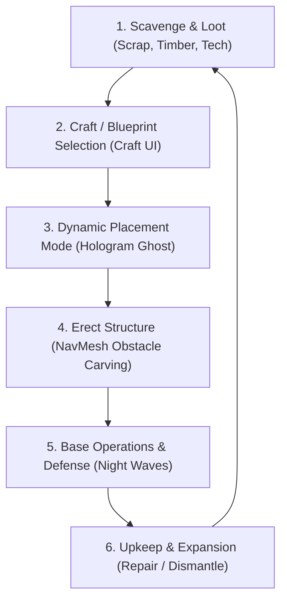
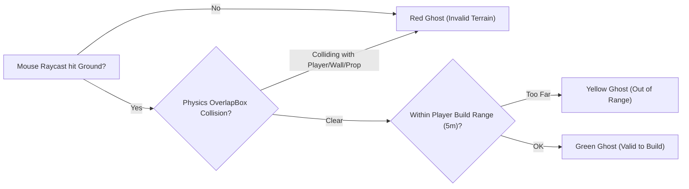
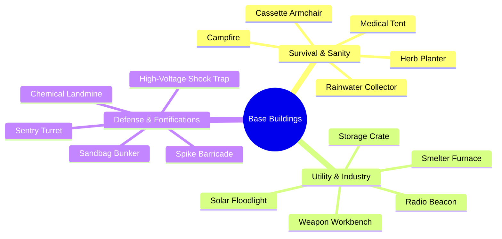
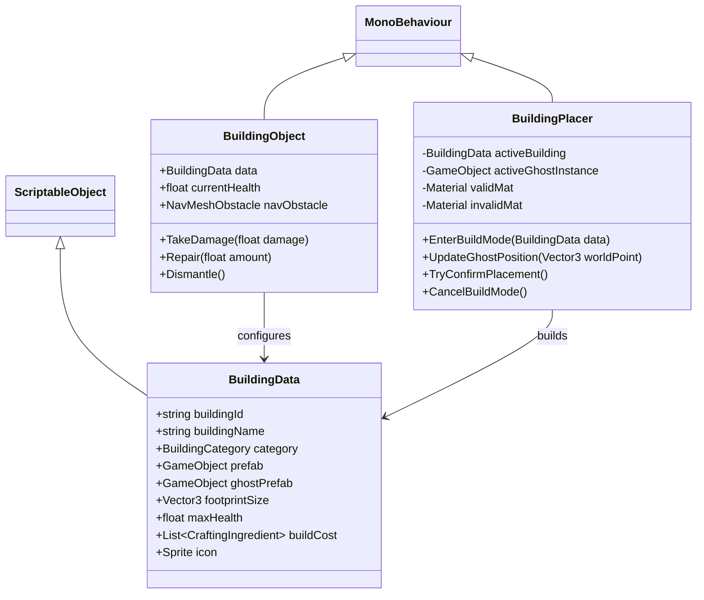

# Game Design Document (GDD)
## The Last Empire — Building & Base Defense System
**Document Version:** 1.0  
**Target Platform:** PC / Windows (Unity 3D)  
**Status:** Approved for Implementation  
**Related Systems:** `CraftController`, `PlayerInventory`, `ItemDatabase`, `Combat / NavMesh`

---

## 1. Executive Summary & Design Pillars

### 1.1 Overview
The **Building & Base Defense System** transforms *The Last Empire* from a transient survival combat run into an engaging strategic loop where players establish, reinforce, and maintain forward operating bases, safe havens, and defensive choke points against escalating waves of mutated abominations, alien lifeforms, and rogue autonomous machines.



### 1.2 Core Design Pillars
1. **Meaningful Base Utility, Not Just Sandbox Decoration**:
   Every building directly addresses a core survival pressure: **HP attrition**, **Sanity / Brain degradation**, **Ammunition scarcity**, **Storage limits**, or **Defensive bottlenecks**.
2. **Snappy & Intuitive Placement**:
   Placing structures should feel as fluid as firing a weapon. No clunky multi-tier modal menus; seamless transition between walking, aiming, previewing (Green/Red ghost), and placing.
3. **Tactical Synergy with Enemy AI**:
   Structures physically interact with Unity's NavMesh. Barricades funnel hordes into kill zones; shock traps disable robot swarms; floodlights counter darkness-buffed aliens.
4. **Permanent vs. Disposable Strategic Depth**:
   Low-tier defenses (Sandbags, Spikes) can be deployed mid-combat as consumable covers, while high-tier installations (Workbenches, Turrets, Generators) require strategic site selection and resource investment.

---

## 2. Core Mechanics & Interaction Loop

### 2.1 Placement Mode (UX & Controls)
When the player selects a building recipe from the `CraftController` (or uses a dedicated Build Tool / Hotbar Blueprint):

| Input | Action | Feedback / Result |
| :--- | :--- | :--- |
| **Mouse Aim** | Raycast onto Walkable Surface (`LayerMask: Ground/Floor`) | Updates Hologram Ghost position in real time. |
| **Mouse Scroll / `R`** | Rotate Blueprint (45° or 90° snaps) | Smoothly rotates ghost around its Y-axis. |
| **Left Click (`LMB`)** | Confirm Construction | If valid: deducts items from `PlayerInventory`, plays dust VFX + audio, spawns permanent GameObject. |
| **Right Click (`RMB`) / `Esc`** | Cancel Placement | Dismisses the ghost and returns player to normal combat mode. |
| **`Shift` (Hold)** | Free Placement / Grid Snap Toggle | Toggles between 1.0m grid snapping and freeform positioning. |

### 2.2 Hologram Validation Rules


* **Valid (Green Shader):** Area is flat, within 5.0m build radius, and free of blocking colliders.
* **Obstructed (Red Shader):** Overlaps world geometry, enemies, NPCs, or other buildings.
* **Out of Range (Yellow Shader):** Raycast is valid but exceeds maximum placement reach.

---

## 3. Structural Durability, Maintenance & AI Pathfinding

### 3.1 Health & Damage Calculation
All deployed structures inherit from `BuildingObject : MonoBehaviour, IDamageable`.

$$\text{Damage Taken} = \max\left(1, \; \text{Incoming Damage} \times (1 - \text{Damage Resistance})\right)$$

* **Melee Vulnerability:** Barricades and light wooden walls take full damage from Zombie claw attacks.
* **Explosive Vulnerability:** Sandbags resist explosive/kinetic damage by 70%, but take full acid/fire damage.
* **Destruction:** When $\text{HP} \le 0$, the structure triggers a destruction particle effect, removes its NavMesh obstacle, and drops 20% scrap salvage.

### 3.2 Repair & Dismantle
* **Repairing (`E` with Repair Tool / Scrap in bag):** Restores 25% of Max HP per tick using 1x Scrap Metal or 1x Wood Log.
* **Dismantling (`F` hold for 2.0s):** Safely destroys the building, refunding **50% of original crafting ingredients** back into the player's inventory.

### 3.3 Dynamic NavMesh Integration
Every placed building automatically attaches a `NavMeshObstacle` component:
* `Carve = true`
* `CarveOnlyStationary = false`
* `TimeToStationary = 0.1s`
* Enemies dynamically recalculate pathing around the perimeter. If a path is completely blocked (choke point fully sealed), enemy AI triggers an **Aggro-Breach state**, attacking the weakest barrier in their path.

---

## 4. Comprehensive Structure Catalog (14 Structures)



---

### Category A: Survival & Sanity (เอาชีวิตรอด & สภาพจิตใจ)

#### 1. Campfire (กองไฟ) — *Tier 1*
* **Description:** A primitive stone-ringed firepit providing warmth, psychological stability, and basic culinary utility.
* **Build Cost:** `ITEM0066_WoodLog` x3, `ITEM0067_RoughStone` x4.
* **Footprint & HP:** $1.5\text{m} \times 1.5\text{m}$ | **HP:** 150.
* **Gameplay Benefits:**
  * **Sanity Halo:** Restores +1.5 Sanity/sec for nearby players within 4m radius during nighttime.
  * **Cooking Station:** Interact (`E`) to roast Raw Meat into `ITEM0031_CookedMeat` (5s cooking cycle).
  * **Illumination:** Casts warm dynamic light (prevents darkness spawn penalty).

#### 2. Clean Rainwater Collector (เครื่องกรองน้ำฝน/ถังดักน้ำ) — *Tier 2*
* **Description:** A corrugated tin funnel attached to an industrial filter system for passive water condensation.
* **Build Cost:** `ITEM0072_ScrapSteelPipe` x2, `ITEM0090_CleanWaterFilter` x1, `ITEM0071_DuctTape` x2.
* **Footprint & HP:** $1.2\text{m} \times 1.2\text{m} \times 2.0\text{m}$ | **HP:** 250.
* **Gameplay Benefits:**
  * **Passive Production:** Generates 1x Clean Water every 120 seconds in game (capped at 5 stored).
  * **Recipe Catalyst:** Water is consumed by high-tier Sanity brews (Coffee, Herbal Tea) and field pharmaceuticals.

#### 3. Medical Cot / First-Aid Station (เต็นท์พยาบาลสนาม) — *Tier 2*
* **Description:** A sanitized emergency stretcher equipped with saline drips and clean bandages.
* **Build Cost:** `ITEM0068_PlantFiber` x6, `ITEM0069_SturdyRope` x3, `ITEM0037_TornInfectedCloth` x4.
* **Footprint & HP:** $2.0\text{m} \times 1.2\text{m}$ | **HP:** 200.
* **Gameplay Benefits:**
  * **Triage Healing:** Resting restores +4 HP/sec.
  * **Detoxification:** Cleanses active status ailments (**Poison**, **Infection**, and **Bleed**) after 6 seconds of continuous rest.

#### 4. Comfort Armchair & Cassette Deck (โซฟาพักผ่อนพร้อมเครื่องเล่นเทป) — *Tier 2*
* **Description:** A salvaged leather armchair paired with a battery-operated retro cassette player.
* **Build Cost:** `ITEM0081_ScrapLeather` x4, `ITEM0080_NostalgicCassetteTape` x1, `ITEM0071_DuctTape` x2.
* **Footprint & HP:** $1.5\text{m} \times 1.5\text{m}$ | **HP:** 180.
* **Gameplay Benefits:**
  * **Rapid Sanity Recovery:** Recharges the player's Brain Meter at +5.0 Sanity/sec while seated.
  * **Ambient Audio:** Plays relaxing ambient tape loops, dampening spooky environmental noises.

#### 5. Greenhouse Herb Planter (แปลงปลูกสมุนไพรและพืช) — *Tier 2*
* **Description:** A raised wooden planter box filled with aerated soil and drip irrigation.
* **Build Cost:** `ITEM0066_WoodLog` x4, `ITEM0068_PlantFiber` x4, Clean Water x1.
* **Footprint & HP:** $2.0\text{m} \times 1.0\text{m}$ | **HP:** 200.
* **Gameplay Benefits:**
  * **Cultivation:** Insert seeds/spores to grow medicinal plants (`HerbalCalmingTea` materials, wheat for `Bread`).
  * **Yield Cycle:** Produces 2–3 harvestable herbs every 180 seconds.

---

### Category B: Utility & Industry (สาธารณูปโภค & อุตสาหกรรม)

#### 6. Scrap Storage Crate (กล่องเก็บของจากเศษเหล็ก) — *Tier 1*
* **Description:** A reinforced sheet-metal lockbox resistant to scavenging wildlife.
* **Build Cost:** `ITEM0046_ScrapMetalPlate` x3, `ITEM0070_BoxOfNails` x2, `ITEM0066_WoodLog` x2.
* **Footprint & HP:** $1.0\text{m} \times 1.0\text{m}$ | **HP:** 500.
* **Gameplay Benefits:**
  * **Base Stash:** Provides 24 dedicated storage slots accessible via `E`.
  * **Inventory Unburdening:** Prevents loot overflow from tactical field runs.

#### 7. Weapon & Tool Workbench (โต๊ะซ่อมและคราฟต์อาวุธขั้นสูง) — *Tier 2*
* **Description:** A heavy industrial workbench fitted with a bench vise, angle grinder, and precision tools.
* **Build Cost:** `ITEM0066_WoodLog` x5, `ITEM0072_ScrapSteelPipe` x3, `ITEM0070_BoxOfNails` x2.
* **Footprint & HP:** $2.5\text{m} \times 1.2\text{m}$ | **HP:** 450.
* **Gameplay Benefits:**
  * **Advanced Weapon Tech:** Unlocks Tier 2 & Tier 3 craftables (SMG, Sniper Rifle, Chainsaw, Katana).
  * **Weapon Modding / Repair:** Restores weapon durability and installs weapon modifications (extended mags, compensators).

#### 8. Scrap Smelter / Mini Furnace (เตาหลอมเศษเหล็กและแร่) — *Tier 2*
* **Description:** A clay-and-stone blast furnace fueled by coal or timber for metal recrystallization.
* **Build Cost:** `ITEM0067_RoughStone` x8, `ITEM0073_CharcoalLump` x3, `ITEM0046_ScrapMetalPlate` x2.
* **Footprint & HP:** $1.8\text{m} \times 1.8\text{m}$ | **HP:** 600.
* **Gameplay Benefits:**
  * **Metallurgical Refining:** Converts raw scrap metal into `ReinforcedTitaniumPlate` and bullet casings.
  * **Gunpowder Processing:** Combines `SulfurPowder` and `CharcoalLump` into bulk `GunpowderMix` for ammo manufacturing.

#### 9. Solar Floodlight Post (เสาไฟสปอตไลท์โซลาร์เซลล์) — *Tier 2*
* **Description:** A telescoping aluminum pole topped with high-lumen LED arrays and photovoltaic cells.
* **Build Cost:** `ITEM0072_ScrapSteelPipe` x2, `ITEM0082_CopperWireSpool` x2, `ITEM0049_BasicLogicChip` x1.
* **Footprint & HP:** $0.8\text{m} \times 0.8\text{m} \times 4.0\text{m}$ | **HP:** 300.
* **Gameplay Benefits:**
  * **Tactical Visibility:** Emits a powerful 120° cone of light up to 18 meters.
  * **Night debuff mitigation:** Nullifies the stealth/cloak ability of mutant stalkers (`AlienInvisible`) walking through the illuminated beam.

#### 10. Long-Range Radio Transmitter (เสาส่งสัญญาณวิทยุ) — *Tier 3*
* **Description:** A patched telecommunications relay capable of piercing atmospheric EMP interference.
* **Build Cost:** `ITEM0047_TornCopperWiring` x4, `ITEM0053_AdvancedNeuralProcessor` x1, `ITEM0051_HighCapacityCapacitor` x2.
* **Footprint & HP:** $1.5\text{m} \times 1.5\text{m} \times 5.0\text{m}$ | **HP:** 700.
* **Gameplay Benefits:**
  * **Supply Airdrop:** Call in an emergency military crate containing rare weapons/medical supplies (Cooldown: 10 mins).
  * **Wandering Merchant Call:** Signals the Travelling Arms Dealer NPC to visit the player's outpost.

---

### Category C: Defense & Fortifications (การป้องกันฐาน & กับดัก)

#### 11. Wooden Spike Barricade (รั้วไม้หนามขวางทาง) — *Tier 1*
* **Description:** Sharpened oak stakes bound with barbed wire and tension rope.
* **Build Cost:** `ITEM0066_WoodLog` x4, `ITEM0069_SturdyRope` x2, `ITEM0070_BoxOfNails` x1.
* **Footprint & HP:** $3.0\text{m} \times 0.8\text{m} \times 1.2\text{m}$ | **HP:** 400.
* **Gameplay Benefits:**
  * **Choke Formation:** Blocks standard zombie/crawler pathways.
  * **Thorns Reflection:** Deals 25 contact physical damage per second to any unit bashing against it.

#### 12. Reinforced Sandbag Bunker (บังเกอร์กระสอบทราย) — *Tier 1*
* **Description:** Staggered heavy burlap bags packed with dense soil and gravel.
* **Build Cost:** `ITEM0037_TornInfectedCloth` x4, `ITEM0067_RoughStone` x3, `ITEM0069_SturdyRope` x1.
* **Footprint & HP:** $2.5\text{m} \times 1.0\text{m} \times 1.1\text{m}$ | **HP:** 850.
* **Gameplay Benefits:**
  * **Ranged Cover:** Players crouching behind it take **-60% damage** from projectile attacks (`RobotGunner`, `AlienSpitter`).
  * **Penetration Resistant:** Completely absorbs shotgun pellets and standard rifle rounds.

#### 13. Automated Sentry Turret (ป้อมปืนกลอัตโนมัติ) — *Tier 3*
* **Description:** A motorized 360-degree gimbal fitted with a submachine gun and optical targeting sensor.
* **Build Cost:** `ITEM0046_ScrapMetalPlate` x4, `ITEM0022_SMG` x1, `ITEM0049_BasicLogicChip` x2, `ITEM0051_HighCapacityCapacitor` x1.
* **Footprint & HP:** $1.2\text{m} \times 1.2\text{m} \times 1.6\text{m}$ | **HP:** 600.
* **Gameplay Benefits:**
  * **Autonomous Sentry:** Scans a 12m perimeter (360°), automatically locking onto hostile targets.
  * **Ammunition Feed:** Consumes `PistolAmmo` loaded into its internal magazine (holds up to 150 rounds).
  * **Rate of Fire:** 5 rounds/sec, dealing 15 damage per shot.

#### 14. High-Voltage Shock Floor Trap (แผ่นกับดักไฟฟ้าช็อต) — *Tier 2*
* **Description:** An insulated ground plate laced with copper coils and high-discharge capacitors.
* **Build Cost:** `ITEM0087_SpringSteelCoil` x2, `ITEM0020_StunBaton` x1, `ITEM0082_CopperWireSpool` x2.
* **Footprint & HP:** $2.0\text{m} \times 2.0\text{m} \times 0.1\text{m}$ (Ground Plate) | **HP:** 350.
* **Gameplay Benefits:**
  * **Crowd Control:** Triggers when hostiles step onto the plate, discharging 60 shock damage.
  * **EM Stun:** Paralyzes biological targets for 2.5s and causes mechanical enemies (`RobotKamikaze`, `RobotNormal`) to short-circuit and attack erratically.
  * **Recharge:** 8-second internal cooldown between discharges.

---

## 5. Technical Implementation Architecture

### 5.1 Unity Component Hierarchy


### 5.2 Key Script Responsibilities
1. **`BuildingData.cs` (`ScriptableObject`)**:
   Defines building metadata, costs, health, preview ghost prefabs, and interaction type.
2. **`BuildingObject.cs` (`MonoBehaviour`)**:
   Attached to the root of every placed prefab. Handles:
   * Health tracking and damage events (`IDamageable`).
   * Dynamic `NavMeshObstacle` enabling upon spawn.
   * Interaction prompts (`E: Cook`, `E: Open Storage`, `E: Repair`, `Hold F: Dismantle`).
3. **`BuildingPlacer.cs` (`MonoBehaviour`)**:
   Attached to the Player or UI manager. Handles:
   * Mouse Raycasting on layer mask `Ground`.
   * Real-time BoxCast / OverlapBox collision validation.
   * Ghost shader material swapping (`Shader: Holo_Green` vs `Holo_Red`).
   * Final instantiation and inventory item consumption via `PlayerInventory.RemoveItem()`.
4. **`BuildingManager.cs` (`Singleton MonoBehaviour`)**:
   * Registry for all currently active buildings in the active scene.
   * Serializes/Deserializes buildings for persistent saving (`Position`, `Rotation`, `Health`, `StoredItems`).

---

## 6. Implementation Roadmap

```mermaid
flowchart TD
    subgraph Milestone 1: Core Mechanics
        M1_1["1.1 Create BuildingData ScriptableObject schema"]
        M1_2["1.2 Implement BuildingPlacer (Mouse Raycast + Ghost Mesh)"]
        M1_3["1.3 Physics Validation (Green/Red Material swap)"]
        M1_4["1.4 Spawn Prefab with NavMeshObstacle"]
    end

    subgraph Milestone 2: Crafting Integration
        M2_1["2.1 Wire Building recipes into CraftingDatabase"]
        M2_2["2.2 Hook CraftController Building/Defense tabs to trigger Placer"]
        M2_3["2.3 Prototype 3 initial prefabs: Campfire, Spike Barricade, Storage Crate"]
    end

    subgraph Milestone 3: Base Functionality
        M3_1["3.1 Storage Crate UI (Chest inventory window)"]
        M3_2["3.2 Campfire Cooking & Sanity Aura"]
        M3_3["3.3 Building Damage & Repair (Enemy AI attacks barricades)"]
    end

    subgraph Milestone 4: Advanced Systems
        M4_1["4.1 Sentry Turret auto-targeting & ammo loading"]
        M4_2["4.2 Electric Shock Trap & Rainwater Collector"]
        M4_3["4.3 Save/Load serialization of base state"]
    end

    Milestone 1 --> Milestone 2 --> Milestone 3 --> Milestone 4
```

---

## 7. Latest Implemented Enhancements (11 Nov 2026)

1. **`BUILD0023` — Wooden Lantern Post (`LanternBuilding.cs`)**:
   * Tall wooden lantern post (`Utility` category) equipped with a warm orange Point Light that automatically turns on at night and off during the day via `DayNightManager`.
2. **Stage Coordinate Isolation (`StageX, StageY`)**:
   * Every placed `BuildingObject` records the room's `(StageX, StageY)` coordinates when placed.
   * When transitioning between stages via portals, `BuildingManager` toggles building visibility so buildings remain strictly in the room where they were built and reappear intact when the player returns.
3. **Workbench Category Tab Gating (`CraftController.cs` & `WorkbenchBuilding.cs`)**:
   * All `Utility` buildings (Campfire, Workbench, Storage Crate, Water Purifier, Sleeping Bedroll, Sanity Beacon Lantern, Generator, Wooden Lantern Post) can be crafted anywhere without a workbench.
   * `Building` and `Defense` categories require proximity to a `Survivor Workbench` (`[E] Crafting Table`), and their left-side category buttons are hidden (`SetActive(false)`) until the player interacts with a workbench.

---
*Created and maintained for The Last Empire development team.*

