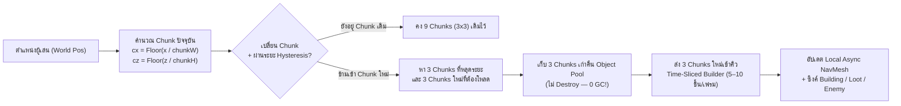
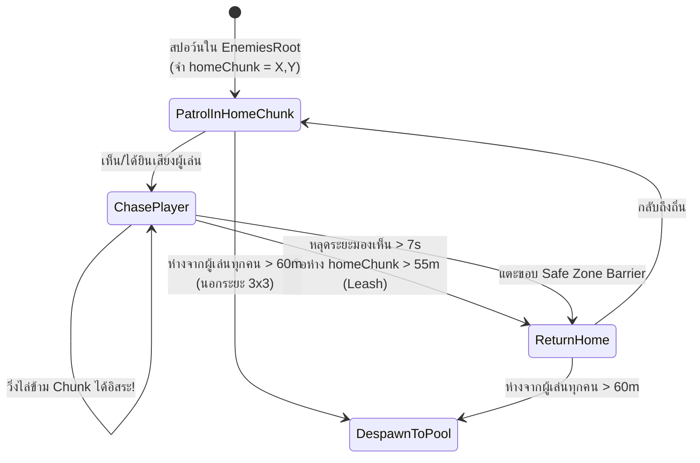

# Project Mayhem — Seamless Open-World Architecture Plan (3×3 Chunk Streaming)

**ชื่อโครงการย่อย**: Project Mayhem  
**เป้าหมายหลัก**: ยกระดับ **The Last Empire** จากระบบเดินกดวาร์ปข้ามห้อง (`TransitionPortal`) สู่ **โลกเปิดไร้รอยต่อ (Seamless Open-World 3×3 Chunk Streaming)** ที่ลื่นไหล 60 FPS รองรับตั้งแต่เล่นคนเดียว (Offline), Co-op 1–6 คน, ไปจนถึง **Dedicated Server 30 คน/ห้องบน Steam** โดยต่อยอดร่วมกับ [steam-ugs-cloud-architecture-plan.md](file:///d:/Unity%20Game%20Project/Eruption/TheLastEmpire/TheLastEmpire/Docs/steam-ugs-cloud-architecture-plan.md)

---

## 1. วิสัยทัศน์และเหตุผลในการเปลี่ยน (Why Project Mayhem?)

| หัวข้อ | ระบบเดิม (Room-by-Room Warp) | Project Mayhem (Seamless 3×3 Open World) |
| :--- | :--- | :--- |
| **การเดินทาง** | เดินชนขอบห้อง -> กด `[E]` ที่ `TransitionPortal` -> โหลดห้องใหม่ที่ `(0,0,0)` | เดินข้ามถนน/ข้ามบล็อกได้ต่อเนื่องไร้รอยต่อ ไม่มีจอโหลด |
| **ประสบการณ์ Co-op / 30 คน** | เห็นเพื่อนเฉพาะตอนอยู่พิกัด `(X,Y)` เดียวกัน เปลี่ยนห้องทีคือหายวับ | เห็นเพื่อนเดินข้ามถนนมาแต่ไกล วิ่งหนีฝูงซอมบี้ข้ามบล็อกมาช่วยกันได้จริง |
| **ซอมบี้ & การต่อสู้** | ถูกล็อกอยู่แค่ในกรอบห้อง 1 ห้อง | ซอมบี้วิ่งไล่ข้ามบล็อกได้จริง มีระบบ Leash / Safe Zone / Despawn สมจริง |
| **ปัญหาบั๊กที่หายถาวร** | บั๊กจุดวาร์ป (`TransitionPortal`), จอค้างตอนสลับห้อง, ขอบล่องหน 4 ด้าน | ตัด `TransitionPortal` ทิ้ง 100% ทุกอย่างอยู่บนพิกัด World Position จริง |

---

## 2. สถาปัตยกรรม 3×3 Chunk Streaming (Zero-Stutter Pipeline)

### 2.1 แผนผังการทำงาน (Streaming Architecture)



### 2.2 ระบบพิกัดโลกและขนาด Chunk (World Coordinates & Dimensions)
อ้างอิงจากขนาดกริดปัจจุบันใน [`EnvironmentManager.cs`](file:///d:/Unity%20Game%20Project/Eruption/TheLastEmpire/TheLastEmpire/Assets/Scripts/Runtime/Managers/EnvironmentManager.cs) (`gridWidth = 32f`, `gridHeight = 18f`):
- **ขนาด Chunk แนะนำ**:
  - **ตัวเลือก A (แนะนำที่สุด)**: **`32m × 32m` (สี่เหลี่ยมจัตุรัส)** — ทำให้ถนน, บล็อกเมือง, มุมกล้อง, และระยะ 3×3 สมมาตรเท่ากันทุกทิศ N/S/E/W (`96m × 96m` รอบผู้เล่น)
  - **ตัวเลือก B (ใช้สัดส่วนเดิม)**: **`32m × 18m`** — ใช้ Layout เดิมของ `EnvironmentManager` ได้ทันทีโดยไม่ต้องปรับสัดส่วนกริด 6×9
- **จุดศูนย์กลางโลก (Floating-Point Precision Safety)**:
  - กำหนดให้จุดเกิดหลัก `(spawnX, spawnY)` อยู่ที่ **`World (0, 0, 0)`**
  - สูตรแปลง Chunk -> World Center:
    ```csharp
    Vector3 ChunkToWorldCenter(int cx, int cy)
    {
        float wx = (cx - spawnX) * chunkWidth;
        float wz = (cy - spawnY) * chunkDepth;
        return new Vector3(wx, 0f, wz);
    }
    ```
  - **ความแม่นยำพิกัด `float`**:
    - แผนที่ **64×64** (`32m`/ช่อง): ขอบโลก `±1,024m` — แม่นระดับ 0.06 มม.
    - แผนที่ **128×128** (`32m`/ช่อง): ขอบโลก `±2,048m` — แม่นระดับ 0.12 มม.
    - แผนที่ **256×256** (`32m`/ช่อง): ขอบโลก `±4,096m` — แม่นระดับ 0.24 มม. (ไม่มีอาการโมเดลสั่น)
- **คำแนะนำขนาดแผนที่ตามรูปแบบการเล่น (สำหรับห้อง 30 คน)**:
  - **เดินเท้าเป็นหลัก**: `32×32` (1,024 ช่อง) ถึง `64×64` (4,096 ช่อง) — กว้างมากพอสำรวจได้ยาว แต่ยังมีโอกาสเดินเจอผู้เล่นอื่นจริง
  - **มีรถ/มอเตอร์ไซค์ขับได้ + จุด Fast Travel**: ขยายเป็น `128×128` หรือ `256×256` ได้ทันทีโดยไม่กระทบ FPS

### 2.3 เทคนิคทำให้ลื่น 60 FPS ตลอด (Zero Frame Spike)
1. **Chunk & Prop Object Pooling**:
   - สร้าง Pool ล่วงหน้าสำหรับพื้น Ground Plane (9–12 แผ่น), ซากตึก, ต้นไม้, รถ, และ Props ตาม Prefab ID
   - เมื่อเดินข้าม Chunk ให้นำวัตถุจาก 3 ช่องที่หลุดระยะกลับเข้า Pool แล้ววางใหม่ใน 3 ช่องข้างหน้าแทนการ `Instantiate`/`Destroy`
2. **Time-Slicing Spawner (ไม่สร้างทุกอย่างใน 1 เฟรม)**:
   - มีคิว `Queue<ChunkBuildJob>` วาง Prop สูงสุด **6–10 ชิ้นต่อเฟรม** (สร้างครบ 3 ช่องใหม่ภายใน ~0.2–0.4 วินาที)
   - เนื่องจากผู้เล่นมีกันชน 1 ช่องเต็ม (`32m`) รอบตัว กว่าจะเดินไปถึงขอบ ฉากด้านหน้าจะสร้างเสร็จล่วงหน้าเรียบร้อยแล้ว
3. **Hysteresis Buffer (กันอาการเดินยึกยักตรงเส้นขอบ)**:
   - Trigger โหลด Chunk ใหม่เมื่อเดินข้ามเส้นขอบเข้ามาแล้วอย่างน้อย **3 เมตร** (และเก็บ Chunk เก่าเมื่อห่างเกินระยะ 3×3 + Margin) ป้องกันการโหลด-ลบสลับไปมาเมื่อยืนสู้ตรงรอยต่อ
4. **Waterways & World Edge Blocking**:
   - ยกเลิกกล่องขอบห้องล่องหน 4 ด้าน (`BoundaryLeft/Right/Top/Bottom`) ใน `PlayerController`
   - วาง Collider กั้นเฉพาะ **ขอบสุดของแผนที่โลก** และ **ขอบช่องที่เป็น `BiomeType.Waterways`** (แม่น้ำ/ทะเลสาบ) แทน

---

## 3. ระบบ Enemy & AI ข้ามแมพ (Cross-Chunk Enemy Lifecycle)

ปัญหาที่พบบ่อยที่สุดของเกม Open World คือ *"มอนสเตอร์วิ่งไล่ข้าม Chunk แล้วหายไปกลางอากาศ หรือลากมอนเข้า Safe Zone"* — Project Mayhem แก้ด้วยกฎ **4 ข้อ** ดังนี้:



1. **แยก Parent ของ Enemy ออกจาก Chunk (`EnemiesRoot`)**:
   - ศัตรูทุกตัวเป็นลูกของ `EnemiesRoot` กลาง ไม่ใช่ลูกของ Ground Chunk
   - เก็บข้อมูล `HomeChunkX`, `HomeChunkY` และอัปเดต `CurrentChunkX`, `CurrentChunkY` จากพิกัดจริงทุก 0.5 วินาที
   - เมื่อ Chunk ต้นทางถูก Unload ทิ้ง มอนที่กำลังไล่ผู้เล่นอยู่ **จะยังวิ่งไล่ต่อไปไม่หายวับ**
2. **Leash & Safe Zone Barrier**:
   - **Leash Distance (`55m`)**: หากวิ่งห่างจากจุดเกิดเกิน 55m และไม่เห็นผู้เล่นต่อเนื่อง 7 วินาที ให้เลิกไล่แล้วเดินกลับถิ่น
   - **Safe Zone Barrier**: พื้นที่รอบจุดเกิดกลาง `(spawnX, spawnY)` รัศมี 1 ช่อง เป็นเขตห้ามมอนเข้า หากมอนแตะขอบให้หยุดไล่และเดินหันหลังกลับทันที
3. **Distance-Based Despawn & Pool**:
   - ทุกๆ 1 วินาที ตรวจว่ามอนตัวไหนอยู่ห่างจากผู้เล่น **ทุกคน** เกินระยะ `60m` (นอก 3×3) -> คืนเข้า Enemy Pool (ลดการใช้ CPU)
   - หากเป็นมอนในด่านที่ยังไม่ Cleared เมื่อผู้เล่นเดินกลับมาอีกครั้ง ระบบจะสปอว์นเฉพาะจำนวนที่ยังเหลืออยู่ (ไม่ปั๊มซ้ำเกินโควต้า)
4. **Local Async NavMesh (ไม่ค้างตอนเดินข้าม Chunk)**:
   - เปลี่ยนจากการสั่ง `BuildNavMesh()` ทันที (Synchronous) เป็น **`LocalNavMeshBuilder`** (ใช้ `NavMeshBuilder.UpdateNavMeshDataAsync` ครอบคลุมพื้นที่ `80m × 80m` รอบผู้เล่น อัปเดตแบบ Async ทุกครั้งที่ผู้เล่นเดินเกิน `10m` จากจุด Bake ล่าสุด) -> ไม่เกิด Frame Drop แน่นอน!

---

## 4. ระบบ Building, Loot, Dropped Items & Dynamic World Events

การเปลี่ยนเป็นพิกัด World Position จริงทำให้ระบบเหล่านี้ **จัดการง่ายกว่าเดิมมาก**:

- **Base Building (`BuildingManager`)**:
  - สิ่งปลูกสร้างทุกชิ้นเก็บ `(chunkX, chunkY, worldPos, rotY, hp, crateItems)` ลงใน `WorldDeltaSave`
  - เมื่อ Chunk `(cx, cy)` ถูกโหลดเข้า 3×3 -> สร้างตึกที่บันทึกไว้ของ Chunk นั้นขึ้นมาทันที และเมื่อ Chunk หลุดระยะ 3×3 -> ซ่อน/คืน Pool (ข้อมูลไม่หาย)
- **Loot Containers (`LootContainer`) & Dropped Items (`CollectibleItem`)**:
  - รถ/กล่องทุกคันมี Deterministic ID จาก `(chunkX, chunkY, slotIndex)` ผูกกับ `_syncedContainerStates` เดิม
  - ไอเทมที่ผู้เล่นโยนทิ้ง (ระบบ Drag / `Alt+Drag` + `[E]` Pickup) วางอยู่บน World Position จริงใน Chunk นั้นๆ
- **Dynamic World Events (`RandomStageEventManager`)**:
  - เปลี่ยนจาก Event ประจำห้องวาร์ป เป็น **Encounter ตาม Chunk/ระยะทาง**:
    - `NomadTrader`: ตั้งแคมป์ริมถนนใน Chunk นั้น เห็นกองไฟล่วงหน้าตั้งแต่เดินเข้าใกล้
    - `FleeingSurvivor`: Maya วิ่งหนีฝูงซอมบี้ข้ามถนนจาก Chunk ข้างๆ เข้ามาหาผู้เล่นจริง
    - `SupplyDrop`: เครื่องบิน/เสียงหวอดัง + เสาควันสีแดงขึ้นที่ Chunk ใกล้เคียง (ดึงผู้เล่นหลายคนในห้อง 30 คนให้วิ่งมาแย่ง/ช่วยกันเก็บ!)
    - `BloodMoonSurge`: เกิดเป็น Global Weather Event ทั่วทั้งเซิร์ฟเวอร์ตอนกลางคืน

---

## 5. การรองรับ Multiplayer 30 คน/ห้อง (Steam Dedicated Server)

เมื่อโครงสร้างโลกเป็น 3×3 Seamless Chunk แล้ว จะต่อยอดเป็นเซิร์ฟเวอร์ 30 คนบน Steam ได้ลงตัวมาก:

1. **3×3 Spatial Interest Management (ฝั่ง Server)**:
   - Server แบ่งตารางผู้เล่นและมอนสเตอร์ตาม Grid Chunk `(cx, cy)` (`Dictionary<Vector2Int, HashSet<Entity>>`)
   - สำหรับผู้เล่นแต่ละคน Server จะส่ง Update (ตำแหน่งเพื่อน, กระสุน, มอน, ของดรอป, ตึก) **เฉพาะสิ่งที่อยู่ใน 9 ช่อง (3×3) รอบตัวผู้เล่นคนนั้น** -> ลด Bandwidth ลงกว่า 80–90%
2. **Dedicated Server (Unity Headless + Steam Game Server)**:
   - รันบน Linux VPS โดยไม่โหลด Mesh/Texture/Audio/UI (กิน RAM ~1–1.5 GB ต่อห้อง 30 คน)
   - Server เปิด Active Simulation เฉพาะ Chunk ที่มีผู้เล่นอยู่รอบๆ (`Union` ของ 3×3 รอบผู้เล่นทั้ง 30 คน)
   - ส่งแพ็กเก็ตผ่าน **`SteamNetworkingSockets` (UDP)** แยกช่อง Unreliable (ตำแหน่ง) / Reliable (ไอเทม/ตึก/ดาเมจ)
3. **Persistence & Database**:
   - ข้อมูลสกิล/โปรไฟล์ผู้เล่น -> **Unity Cloud Save + Cloud Code** (ตามแผน [steam-ugs-cloud-architecture-plan.md](file:///d:/Unity%20Game%20Project/Eruption/TheLastEmpire/TheLastEmpire/Docs/steam-ugs-cloud-architecture-plan.md))
   - ข้อมูลโลก 30 คน (ตึก/รถที่รื้อ/โซนที่เคลียร์) -> เก็บแบบ Seed + Delta (ถ้าเป็น Co-op 1–6 คนใช้ Unity Cloud Save, ถ้าเป็นเซิร์ฟ 30 คนเปิด 24 ชม. ใช้ SQLite/PostgreSQL บนตัว VPS Server เอง)

---

## 6. โครงสร้างไฟล์ใหม่และไฟล์ที่ต้องปรับ

```text
Assets/Scripts/Runtime/
├── World/                                  # [โฟลเดอร์ใหม่สำหรับ Project Mayhem]
│   ├── WorldChunkCoords.cs                 # สูตรแปลง WorldPos <-> Chunk(x,y) และระยะ 3x3
│   ├── SeamlessWorldStreamer.cs            # ตัวคุม 3x3 Active Chunks + Hysteresis + Time-Slicing Queue
│   ├── WorldChunkInstance.cs               # คอนเทนเนอร์ของแต่ละ Chunk (Ground, Props, Buildings, Containers)
│   ├── EnvironmentPropPool.cs              # Object Pool สำหรับรีไซเคิลพื้น/ตึก/ต้นไม้/รถ (0 GC)
│   └── LocalAsyncNavMeshUpdater.cs         # Bake NavMesh รอบผู้เล่นแบบ Async ไม่ให้เฟรมค้าง
├── Map/
│   ├── WorldMapManager.cs                  # [ปรับ] อัปเดต CurrentPlayerX/Y อัตโนมัติจากพิกัดเดินจริง (ไม่ต้องรอวาร์ป)
│   └── TransitionPortal.cs                 # [ปิดใช้งานในโหมด Seamless / เก็บไว้เป็นตัวเลือก Legacy]
├── Managers/
│   ├── EnvironmentManager.cs               # [ปรับ] เพิ่ม GenerateChunkInto(WorldChunkInstance, StageData)
│   └── GameManager.cs                      # [ปรับ] เปลี่ยนการสปอว์นมอนเข้า EnemiesRoot + Despawn นอก 3x3
├── Player/
│   └── PlayerController.cs                 # [ปรับ] ถอด Boundary 4 ด้านรอบห้อง เหลือเฉพาะขอบโลก/Waterways
└── Combat/
    └── BaseEnemyAI.cs                      # [ปรับ] เพิ่ม homeChunk, Leash Distance, และ Safe Zone Barrier
```

---

## 7. แผนการพัฒนาทีละขั้น (Project Mayhem Roadmap)

> **กฎความปลอดภัยก่อนเริ่มลงมือ**: แยก Branch ใหม่ **`feat/project-mayhem`** จาก `multi-player-netcode` เสมอ เพื่อเก็บเวอร์ชันวาร์ปที่ทำงานสมบูรณ์แล้วไว้เป็นตัวสำรอง 100%

### Phase 1 — Core 3×3 Chunk Streaming & Free Movement (2–3 วัน)
- [ ] สร้าง `WorldChunkCoords`, `EnvironmentPropPool`, `WorldChunkInstance`, และ `SeamlessWorldStreamer`
- [ ] ปรับ `EnvironmentManager` ให้สร้าง Prop ลงใน `WorldChunkInstance` ตาม `stage.stageSeed` (Deterministic 100%) พร้อม Time-Slicing
- [ ] ถอด `BoundaryLeft/Right/Top/Bottom` ใน `PlayerController` และให้ `WorldMapManager` อัปเดตพิกัด `(CurrentPlayerX, CurrentPlayerY)` + Minimap อัตโนมัติตามการเดินข้าม Chunk
- [ ] ทดสอบเดินยาว 20 ช่องต่อเนื่อง -> ยืนยัน 60 FPS นิ่ง ไม่มีอาการกระตุก และถนน/ไบโอมต่อกันเนียน

### Phase 2 — Cross-Chunk Enemy AI & Local Async NavMesh (2 วัน)
- [ ] เพิ่ม `LocalAsyncNavMeshUpdater` ครอบคลุมรอบผู้เล่นแบบ Async
- [ ] ย้ายการสปอว์นซอมบี้/หุ่น/เอเลี่ยนเข้า `EnemiesRoot` พร้อม `homeChunk`, **Leash 55m**, **Safe Zone Barrier**, และ **Despawn Pool นอก 3×3**
- [ ] ทดสอบลากซอมบี้วิ่งข้าม 2–3 Chunk -> ไม่หายวับกลางทาง, ไม่เข้า Safe Zone, และคืน Pool อัตโนมัติเมื่อหนีพ้น

### Phase 3 — Seamless Buildings, Loot, Events & Camera/Minimap (2 วัน)
- [ ] ปรับ `BuildingManager` และ `LootContainer` ให้ผูกกับ Chunk `(cx, cy)` และโหลด/ซ่อนตาม 3×3 Streaming
- [ ] ปรับ `RandomStageEventManager` ให้ทำงานแบบ Dynamic World Encounter (เช่น Trader ริมถนน, Supply Drop ขึ้นเสาควัน, Maya วิ่งหนีข้ามถนน)
- [ ] ปรับ Minimap & World Map ให้แสดงตำแหน่งผู้เล่นและเพื่อนแบบเรียลไทม์บนโลกต่อเนื่อง

### Phase 4 — Multiplayer Interest Management & Steam/Cloud Integration (3–4 วัน)
- [ ] เปลี่ยนการเช็ค "เห็นเพื่อน/เห็นกระสุน/เห็นมอน" จาก `stageX == localX && stageY == localY` เป็น **ระยะ 3×3 (`Mathf.Abs(dx) <= 1 && Mathf.Abs(dy) <= 1`)** -> เดินข้ามบล็อกมาเจอกันแบบไร้รอยต่อใน Co-op ทันที!
- [ ] เชื่อมระบบ Transport Steam (`SteamNetworkingSockets`) + Dedicated Server 30 คน + ระบบ Save (Seed + Delta) ตามแผน [steam-ugs-cloud-architecture-plan.md](file:///d:/Unity%20Game%20Project/Eruption/TheLastEmpire/TheLastEmpire/Docs/steam-ugs-cloud-architecture-plan.md)
