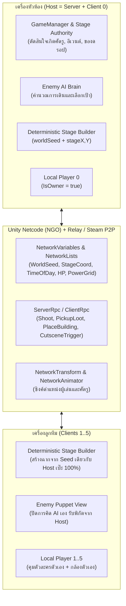
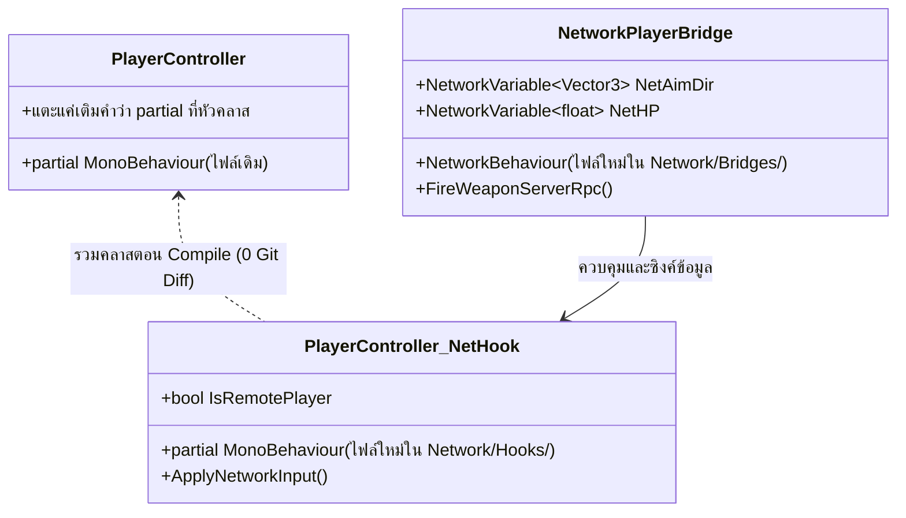
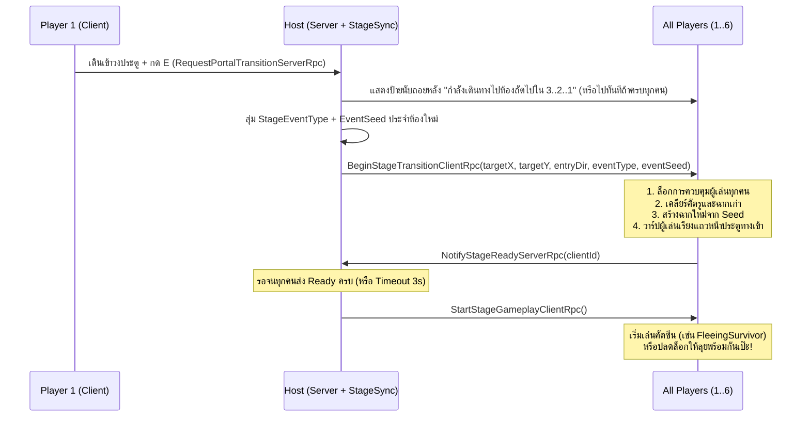
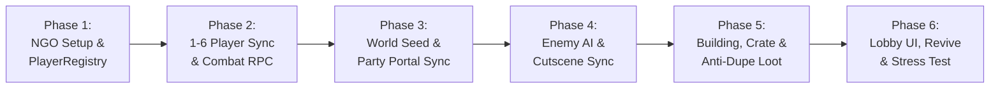

# The Last Empire - 1–6 Player Co-op Netcode Architecture Plan (แผนสถาปัตยกรรมระบบ Multiplayer ไร้ปัญหา State Diff)

เอกสารฉบับนี้กำหนดพิมพ์เขียวสถาปัตยกรรม (Architecture Blueprint) สำหรับการพัฒนาระบบ **Co-op Multiplayer (รองรับผู้เล่น 1–6 คน)** ของโปรเจกต์ **The Last Empire** ด้วย **Unity Netcode for GameObjects (NGO)** โดยเน้นหลักการสำคัญสูงสุด 2 ประการคือ:
1. **Zero State Diff (Zero Desync)**: ป้องกันปัญหาข้อมูลระหว่างเครื่อง Host และ Client เพี้ยนหรือเหลื่อมล้ำกัน 100% (ฉาก, ตึก, ศัตรู, ของดรอป, หีบเก็บของ, ระบบไฟ PowerGrid, และเวลา Day/Night ต้องตรงกันทุกเครื่อง)
2. **Zero Destructive Code Diff (Non-Invasive Bridge Pattern)**: ออกแบบด้วยสถาปัตยกรรม Component Bridge แยกโฟลเดอร์ชัดเจน แตะต้องไฟล์เดิมให้น้อยที่สุด (Minimal Touchpoints) เพื่อให้โหมดเล่นคนเดียว (Singleplayer Offline) ยังคงทำงานได้สมบูรณ์ 100% และไม่เกิด Git Merge Conflict

---

## 1. ภาพรวมสถาปัตยกรรมเครือข่าย (Network Topology & Stack)

* **รูปแบบเครือข่าย (Topology):** **Host-Authoritative (Listen Server)** — ผู้เล่นคนที่ 1 ทำหน้าที่เป็นทั้งเครื่องแม่ข่ายและผู้เล่น (`Host = Server + Local Client`) ส่วนผู้เล่นคนที่ 2–6 เชื่อมต่อเข้ามาเป็นลูกข่าย (`Client`)
* **ไลบรารีหลัก (Core Stack):**
  * `com.unity.netcode.gameobjects` (Unity NGO สำหรับจัดการ NetworkObject, NetworkVariable, RPC)
  * `com.unity.transport` (Unity Transport Layer)
  * `com.unity.services.relay` & `com.unity.services.lobbies` (สำหรับสร้างห้องด้วยรหัส Join Code 6 หลัก ทะลุ Firewall/NAT โดยไม่ต้องทำ Port Forwarding)
  * *(ทางเลือกเสริมสำหรับ Steam)* `Facepunch.Steamworks` + `SteamNetworkingSockets` Transport สำหรับชวนเพื่อนผ่านรายชื่อเพื่อนใน Steam ฟรี
* **เครื่องมือทดสอบหลายจอในเครื่องเดียว:** **ParrelSync** หรือ **Unity Multiplayer Play Mode** (จำลอง Host + Client 2–4 จอบนคอมเครื่องเดียวโดยไม่ต้อง Build เกมใหม่ทุกครั้ง)



---

## 2. กฎเหล็กป้องกันปัญหา "Diff / Desync" (Zero-Diff Principles)

สาเหตุหลักที่เกม Co-op มักเกิดอาการ **"ภาพไม่ตรงกัน (State Diff / Desync)"** มาจากการที่ต่างคนต่างสุ่มค่า หรือต่างคนต่างรันฟิสิกส์/AI แยกกัน แผนนี้จึงบังคับใช้ **กฎเหล็ก 5 ข้อ** ดังนี้:

| ปัญหาที่มักทำให้เกิด Diff | กฎเหล็กป้องกัน (Zero-Diff Solution) |
| :--- | :--- |
| **1. ตึก/ต้นไม้/พื้นเกิดไม่ตรงกัน** | **ห้ามใช้ `UnityEngine.Random` โกลบอลปะปนกับเกมเพลย์** ให้สร้างอินสแตนซ์ `new System.Random(stageSeed)` แยกเฉพาะตอนเสกฉากใน `EnvironmentManager` โดยคำนวณ `stageSeed = ComputeDeterministicSeed(worldSeed, stageX, stageY)` |
| **2. ศัตรูเดินไปคนละทิศในแต่ละจอ** | **AI Brain รันเฉพาะบนเครื่อง Host (`IsServer`) เท่านั้น** เครื่อง Client จะปิดลอจิก `UpdateAI()` ใน `BaseEnemyAI` แล้วขยับตาม `NetworkTransform` ที่ซิงค์มาจาก Host เพียงแหล่งเดียว |
| **3. เก็บของชิ้นเดียวกันพร้อมกันได้ 2 ชิ้น (Loot Dupe)** | **Atomic Server Claim** เมื่อผู้เล่นชนไอเทม จะยังไม่เสกเข้ากระเป๋าทันที แต่ส่ง `RequestPickupServerRpc(itemNetId)` ไปหา Host ให้ Host เช็คตัวแปร `_isClaimed` ถ้ายังว่างจึงอนุมัติและสั่งลบไอเทมออกจากทุกจอ |
| **4. วางตึกทับกัน หรือไฟ `PowerGrid` ไม่เท่ากัน** | **Server-Authoritative Building Transaction** การวาง/ทุบตึกต้องส่งผ่าน `PlaceBuildingServerRpc` ให้ Host ตรวจสอบพื้นที่ว่างและอัปเดตลิสต์กลาง จากนั้นทุกเครื่องจะคำนวณ `PowerGridManager` จากลิสต์ตึกชุดเดียวกัน |
| **5. คนหนึ่งเข้าห้องใหม่แล้ว แต่อีกคนยังโหลดไม่เสร็จ** | **Two-Phase Barrier Sync** เมื่อย้ายห้องผ่าน `TransitionPortal` ทุกเครื่องต้องโหลดฉากจาก Seed ให้เสร็จและส่ง `StageReadyServerRpc()` กลับมาครบก่อน Host จึงสั่งปลดล็อกผู้เล่นและเริ่มสปอว์นศัตรู/คัตซีนพร้อมกัน |

---

## 3. แนวทางการออกแบบสถาปัตยกรรมแบบไม่กระทบโค้ดเดิม (Zero-Conflict Bridge & Partial Class Pattern)

เพื่อให้คนที่รับเอกสารนี้ไปพัฒนาต่อสามารถทำควบคู่กับทีมหลักได้โดย **ไม่เกิด Git Merge Conflict (Zero Git Diff)** ทั้งในไฟล์สคริปต์หลักและไฟล์ Scene (`.unity`) ให้ปฏิบัติตาม **กฎเหล็กสำหรับผู้พัฒนา Netcode 4 ข้อ** ดังนี้:

### กฎเหล็กป้องกัน Git Conflict สำหรับผู้รับงานต่อ:
1. **ใช้ `partial class` แยกไฟล์ `.NetHook.cs` แทนการแก้ไฟล์หลัก:**
   * ในไฟล์หลักเดิม เช่น `PlayerController.cs`, `BaseEnemyAI.cs`, `GameManager.cs`, `TransitionPortal.cs`, `RandomStageEventManager.cs`, `BuildingManager.cs` ให้เติมคำว่า `partial` ที่หัวคลาสเพียงจุดเดียว (เช่น `public partial class PlayerController : MonoBehaviour`)
   * โค้ดส่วนขยายสำหรับ Multiplayer ทั้งหมด ให้ไปเขียนในไฟล์ใหม่ภายใต้โฟลเดอร์ `Assets/Scripts/Runtime/Network/Hooks/` (เช่น `PlayerController.NetHook.cs`) เพื่อไม่ให้บรรทัดโค้ดชนกับคนที่แก้ไฟล์หลัก
2. **ห้ามแก้ไฟล์ Scene (`Gameplay_3D.unity`) โดยตรง:**
   * ไฟล์ `.unity` มีขนาดใหญ่และเกิด Git Conflict ได้ง่ายมาก
   * ให้สร้างระบบ Network ทั้งหมดเป็น Prefab แยกใน `Assets/Resources_Addressable/Prefabs/Network/NetworkBootstrap.prefab` แล้วใช้ `[RuntimeInitializeOnLoadMethod(RuntimeInitializeLoadType.BeforeSceneLoad)]` ในสคริปต์ `EmpireNetworkManager.cs` เพื่อเสกตัวเองขึ้นมาอัตโนมัติตอนรันเกมโดยไม่ต้องแก้ไฟล์ Scene
3. **ห้ามแก้ Prefab เดิมตรงๆ ถ้าทำผ่าน Runtime Component Injection ได้:**
   * เมื่อ `PlayerController` หรือ `BaseEnemyAI` ถูกสร้างขึ้นมา ให้ `EmpireNetworkManager` ตรวจสอบและแปะ `NetworkPlayerBridge` / `NetworkEnemyBridge` หรือลงทะเบียนผ่านสคริปต์ในโฟลเดอร์ `Network/`
4. **รักษาโหมด Singleplayer ให้เล่นได้ 100% เสมอ:**
   * ทุกจุดที่มีการเชื่อมต่อระบบ Network ต้องเช็ค `if (!EmpireNetworkManager.IsOnline)` ก่อนเสมอ ถ้าไม่ได้อยู่ในโหมดออนไลน์ ให้รันลอจิกออฟไลน์เดิมทันที



---

## 4. รายละเอียดการปรับปรุงแยกตามระบบหลัก (System-by-System Specification)

### 4.1 ระบบจัดการผู้เล่น 1–6 คน (`PlayerRegistry` & `PlayerController`)

#### ปัญหาในระบบปัจจุบัน:
* สคริปต์จำนวนมากเรียกใช้ `PlayerController.Instance` หรือ `FindFirstObjectByType<PlayerController>()` ซึ่งจะคืนค่าผู้เล่นแค่คนแรกคนเดียว
* หากมีผู้เล่น 6 คนในฉาก กล้อง `CameraFollow`, UI `PlayerHUD`, และศัตรู `BaseEnemyAI` จะสับสนทันทีว่าต้องอ้างอิงใคร

#### วิธีแก้ไข:
1. **สร้างคลาสใหม่ `PlayerRegistry.cs`:**
   * เก็บ `public static readonly List<PlayerController> AllPlayers = new List<PlayerController>();`
   * เก็บ `public static PlayerController LocalPlayer { get; private set; }` (ชี้ไปที่ตัวละครของเครื่องเราเสมอ ทั้งโหมด Singleplayer และ Multiplayer)
   * มีฟังก์ชันช่วยเหลือสำหรับ AI:
     ```csharp
     public static PlayerController GetClosestAlivePlayer(Vector3 fromPosition, float maxRange = float.MaxValue)
     ```
2. **การปรับจุดเชื่อมต่อใน [PlayerController.cs](file:///d:/Unity%20Game%20Project/Eruption/TheLastEmpire/TheLastEmpire/Assets/Scripts/Runtime/Player/PlayerController.cs):**
   * ในระบบปัจจุบัน `Awake()` ตั้ง `Instance = this` ทันที และ `Start()` สร้าง/เปิด `PlayerInput` ให้อัตโนมัติทุกตัว — ต้องเปลี่ยนให้ตั้ง `Instance = this` เฉพาะตัวละครฝั่ง Local (`IsLocalPlayer == true`) ผ่าน `PlayerRegistry.LocalPlayer` เพื่อไม่ให้ UI ([PlayerHUD.cs](file:///d:/Unity%20Game%20Project/TheLastEmpire/TheLastEmpire/Assets/Scripts/Runtime/Player/PlayerHUD.cs), [InventoryUI.cs](file:///d:/Unity%20Game%20Project/Eruption/TheLastEmpire/TheLastEmpire/Assets/Scripts/Runtime/UI/InventoryUI.cs), [CameraFollow.cs](file:///d:/Unity%20Game%20Project/Eruption/TheLastEmpire/TheLastEmpire/Assets/Scripts/Runtime/Player/CameraFollow.cs)) โดนตัวละครของเพื่อนแย่ง Reference
   * เพิ่มแฟล็ก `public bool IsRemotePlayer { get; set; } = false;` และปิดการทำงานของ `PlayerInput` (`playerInput.enabled = false`) บนตัวละคร Remote เพื่อไม่ให้ปุ่ม WASD/คลิกของเครื่องเราไปบังคับตัวเพื่อน
   * ใน `Update()`, `OnMove()`, `OnAttack()`: ถ้า `IsRemotePlayer == true` ให้ข้ามการอ่าน Input จากคีย์บอร์ด/เมาส์ของเครื่องเรา แล้วรับค่าความเร็ว/ทิศทางหันหน้ามาจาก `NetworkPlayerBridge` แทน

---

### 4.2 ระบบแผนที่โลกและการเสกฉากไร้ Diff ([WorldMapGenerator.cs](file:///d:/Unity%20Game%20Project/Eruption/TheLastEmpire/TheLastEmpire/Assets/Scripts/Runtime/Map/WorldMapGenerator.cs), [WorldMapManager.cs](file:///d:/Unity%20Game%20Project/Eruption/TheLastEmpire/TheLastEmpire/Assets/Scripts/Runtime/Map/WorldMapManager.cs) & [EnvironmentManager.cs](file:///d:/Unity%20Game%20Project/Eruption/TheLastEmpire/TheLastEmpire/Assets/Scripts/Runtime/Managers/EnvironmentManager.cs))

#### กลไก Deterministic Generation (ไม่ต้องส่งข้อมูลตึกผ่านเน็ต):
1. เมื่อเริ่มเกม Host จะสุ่ม `worldSeed` (เช่น `8492014`) แล้วบันทึกลง `NetworkVariable<int> NetWorldSeed`
2. **จุดสำคัญใน [WorldMapManager.cs](file:///d:/Unity%20Game%20Project/Eruption/TheLastEmpire/TheLastEmpire/Assets/Scripts/Runtime/Map/WorldMapManager.cs):** ปัจจุบัน `Start()` จะเรียก `StartNewGame(Random.Range(1000, 99999))` ทันที — ในโหมด Co-op ต้องดักให้เครื่อง **Client ข้ามการสุ่ม Seed เอง** แล้วรอรับ `NetWorldSeed` จาก Host ก่อนจึงเรียก `mapGenerator.GenerateMap()` ทำให้ตารางแผนที่ **`128x128` ห้อง (`GridSize = 128`)** บนเครื่องทุกคนเหมือนกัน 100% (Biome, พิกัดบอส, พิกัดร้านค้า)
3. เมื่อเข้าสู่ห้อง `(stageX, stageY)` ทุกเครื่องจะคำนวณ Seed ประจำห้องด้วยสูตรตายตัว (หรือใช้ `stage.stageSeed` ที่ถูกสร้างจาก `System.Random(worldSeed)` ตั้งแต่ `GenerateMap()`):
   ```csharp
   public static int GetDeterministicStageSeed(int worldSeed, int stageX, int stageY)
   {
       unchecked
       {
           int hash = 17;
           hash = hash * 31 + worldSeed;
           hash = hash * 31 + stageX;
           hash = hash * 31 + stageY;
           return hash;
       }
   }
   ```
4. ใน [EnvironmentManager.cs](file:///d:/Unity%20Game%20Project/Eruption/TheLastEmpire/TheLastEmpire/Assets/Scripts/Runtime/Managers/EnvironmentManager.cs) ตอนสร้างตึก ต้นไม้ และฉากหลังรอบห้อง (`GenerateStageEnvironment` & `GenerateSurroundingBackgroundScenery`) จะล็อก `Random.InitState(stageSeed)` ก่อนเสก และควรบันทึก/คืนค่า `Random.state` ให้ครบทุกเมธอดเพื่อไม่ให้ไปกวนค่าสุ่มของระบบอื่นในเฟรมเดียวกัน

---

### 4.3 ระบบย้ายห้องแบบปาร์ตี้และคัตซีน ([TransitionPortal.cs](file:///d:/Unity%20Game%20Project/Eruption/TheLastEmpire/TheLastEmpire/Assets/Scripts/Runtime/Map/TransitionPortal.cs) & [RandomStageEventManager.cs](file:///d:/Unity%20Game%20Project/Eruption/TheLastEmpire/TheLastEmpire/Assets/Scripts/Runtime/Managers/RandomStageEventManager.cs))

เนื่องจากเกมใช้ฉาก 3D เดียวในการสลับแสดงผลห้องปัจจุบัน การย้ายห้องในโหมด Co-op 1–6 คนจึงใช้ระบบ **Party Travel (ย้ายห้องพร้อมกันทั้งทีม)**:



* **การจัดตำแหน่งยืนเมื่อวาร์ปเข้าห้องใหม่ (Spawn Formation):**
  * เพื่อไม่ให้ผู้เล่น 6 คนวาร์ปทับจุดเดียวกันจนฟิสิกส์ดีดตัวกระเด็น ให้จัดเรียงตำแหน่งตาม `playerSlotIndex (0..5)` เป็นแถวหน้ากระดานเว้นระยะห่างกันคนละ `1.2m` รอบจุด `GetInwardEntryPosition()` ของประตู

---

### 4.4 ระบบศัตรู, AI และ Object Pool ([BaseEnemyAI.cs](file:///d:/Unity%20Game%20Project/Eruption/TheLastEmpire/TheLastEmpire/Assets/Scripts/Runtime/Combat/BaseEnemyAI.cs) & [ObjectPoolManager.cs](file:///d:/Unity%20Game%20Project/Eruption/TheLastEmpire/TheLastEmpire/Assets/Scripts/Runtime/Combat/ObjectPoolManager.cs))

1. **การเลือกเป้าหมายของศัตรู (Multi-Target Aggro):**
   * ใน [BaseEnemyAI.cs](file:///d:/Unity%20Game%20Project/Eruption/TheLastEmpire/TheLastEmpire/Assets/Scripts/Runtime/Combat/BaseEnemyAI.cs), [ZombieAI.cs](file:///d:/Unity%20Game%20Project/Eruption/TheLastEmpire/TheLastEmpire/Assets/Scripts/Runtime/Combat/ZombieAI.cs), [RobotAI.cs](file:///d:/Unity%20Game%20Project/Eruption/TheLastEmpire/TheLastEmpire/Assets/Scripts/Runtime/Combat/RobotAI.cs), [AlienAI.cs](file:///d:/Unity%20Game%20Project/Eruption/TheLastEmpire/TheLastEmpire/Assets/Scripts/Runtime/Combat/AlienAI.cs):
   * เปลี่ยนจากการแคช `playerTransform` แค่ตอนเริ่มเกม เป็นการอัปเดตเป้าหมายทุกๆ `0.3 วินาที` บนเครื่อง Host โดยเรียก `PlayerRegistry.GetClosestAlivePlayer(transform.position)` (หรือหันไปหาผู้เล่นที่เพิ่งยิงใส่ศัตรูตัวนั้น)
2. **การซิงค์ตำแหน่งและอนิเมชันแบบประหยัดแบนด์วิดท์:**
   * ใช้ `NetworkEnemyBridge` ซิงค์เฉพาะพิกัด `(X, Z)` และมุมหมุน `Y` (Half-float precision) พร้อมใช้การคำนวณความสูงพื้น `naturalGroundY` บนเครื่องตัวเอง ทำให้ประหยัดแบนด์วิดท์ลงถึง 50% รองรับซอมบี้ 30–50 ตัวพร้อมกันได้สบาย
3. **การซิงค์อีเวนต์ `FleeingSurvivor`:**
   * ในช่วงคัตซีนที่ศัตรูวิ่งด้วยสปีด `1.0 m/s` และเปิด `EnableChaserPhasing` เครื่อง Host จะส่ง `ClientRpc` สั่งเปิดโหมดทะลุสิ่งกีดขวางบนเครื่อง Client ด้วย เพื่อให้คัตซีนลื่นไหลและเมื่อครบ 2 วินาทีก็จะเร่งสปีดเป็น `3.5 m/s` พร้อมกันทุกเครื่อง
4. **การผูก Pool กับ Unity NGO (`INetworkPrefabInstanceHandler`):**
   * ปัจจุบัน [ObjectPoolManager.cs](file:///d:/Unity%20Game%20Project/Eruption/TheLastEmpire/TheLastEmpire/Assets/Scripts/Runtime/Combat/ObjectPoolManager.cs) ดึง/ทำลาย Pool ภายในเครื่องเอง (`CleanAndRebuildPools()` ใน `OnSceneLoaded`)
   * ในโหมด Multiplayer ห้าม Client เปิด/ปิด Pool ศัตรูเองโดยตรง แต่ต้องลงทะเบียน `NetworkPoolHandler : INetworkPrefabInstanceHandler` เข้ากับ `NetworkManager.Singleton.PrefabHandler` เพื่อให้ตอน Host เรียก `NetworkObject.Spawn()` / `Despawn()` ตัว Pool ของทั้ง Host และ Client จะดึง/คืนออบเจกต์ตรงกันอัตโนมัติ (ส่วนเอฟเฟกต์เลือด/กระสุน Visual สามารถใช้ Pool ท้องถิ่นตามเดิมได้)

---

### 4.5 ระบบการต่อสู้, อาวุธ และของดรอป ([Projectile.cs](file:///d:/Unity%20Game%20Project/Eruption/TheLastEmpire/TheLastEmpire/Assets/Scripts/Runtime/Combat/Projectile.cs), [Health.cs](file:///d:/Unity%20Game%20Project/Eruption/TheLastEmpire/TheLastEmpire/Assets/Scripts/Runtime/Combat/Health.cs), [CollectibleItem.cs](file:///d:/Unity%20Game%20Project/Eruption/TheLastEmpire/TheLastEmpire/Assets/Scripts/Runtime/Combat/CollectibleItem.cs))

1. **Client-Side Visual Prediction (ยิงลื่นไม่ดีเลย์ตามค่า Ping):**
   * เมื่อผู้เล่นกดยิงปืน เครื่องของผู้เล่นคนนั้นจะแสดงเอฟเฟกต์ไฟปากกระบอกปืน เสียงปืน และเสกกระสุน Visual พุ่งออกไปทันที (ไม่รอ Server ตอบกลับ)
   * พร้อมกันนั้นจะส่ง `FireProjectileServerRpc(spawnPos, direction, weaponId, pelletSeed)` ไปให้ Host
   * Host จะกระจาย `SpawnVisualProjectileClientRpc` ไปให้เพื่อนอีก 5 คนเห็นกระสุน และเป็นคนตัดสินผลการชนดาเมจจริงที่ `Health.TakeDamage()`
2. **ตัวเลขดาเมจลอย (`DamageNumberManager`):**
   * เมื่อ `Health` บนเครื่อง Host ถูกลดเลือด จะส่ง `ShowDamageNumberClientRpc(targetPos, damageAmount, isCritical)` ให้ผู้เล่นในห้องเห็นตัวเลขดาเมจตรงกัน
3. **ระบบป้องกันการเก็บของซ้ำ (`CollectibleItem` Mutex Lock):**
   * ของทุกชิ้นที่ดรอปจาก `LootDropper` หรือวางในด่านจะมีรหัส `int itemDropId` ที่รันลำดับโดย Host
   * เมื่อผู้เล่นเดินชนของ จะส่ง `ClaimLootServerRpc(itemDropId)`
   * Host เช็คใน `Dictionary<int, GroundLootState>` ถ้าชิ้นนั้นยังไม่ถูกเก็บ จะตั้งค่า `isClaimed = true` ทันที, สั่งเพิ่มไอเทมเข้ากระเป๋าผู้เล่นคนนั้นด้วย `GrantLootClientRpc`, และสั่งลบไอเทมออกจากพื้นของทุกเครื่องด้วย `DespawnLootClientRpc(itemDropId)`

---

### 4.6 ระบบสร้างฐาน, ไฟฟ้า และหีบเก็บของ ([BuildingManager.cs](file:///d:/Unity%20Game%20Project/Eruption/TheLastEmpire/TheLastEmpire/Assets/Scripts/Runtime/Building/BuildingManager.cs), [PowerGridManager.cs](file:///d:/Unity%20Game%20Project/Eruption/TheLastEmpire/TheLastEmpire/Assets/Scripts/Runtime/Building/PowerGridManager.cs), [StorageCrateBuilding.cs](file:///d:/Unity%20Game%20Project/Eruption/TheLastEmpire/TheLastEmpire/Assets/Scripts/Runtime/Building/StorageCrateBuilding.cs))

1. **การวางและทำลายสิ่งปลูกสร้าง:**
   * เมื่อผู้เล่นกดวางสิ่งปลูกสร้างผ่าน [BuildingPlacer.cs](file:///d:/Unity%20Game%20Project/Eruption/TheLastEmpire/TheLastEmpire/Assets/Scripts/Runtime/Building/BuildingPlacer.cs) จะส่ง `RequestPlaceBuildingServerRpc(buildingDataId, position, rotation)`
   * Host ตรวจสอบว่าไม่มีใครเพิ่งวางตึกทับจุดเดียวกันในเสี้ยววินาทีนั้น แล้วสั่งสร้างตึกพร้อมกำหนด `buildingInstanceId` ส่งให้ทุกคนสร้างตึกเดียวกัน
2. **ระบบไฟฟ้า ([PowerGridManager.cs](file:///d:/Unity%20Game%20Project/Eruption/TheLastEmpire/TheLastEmpire/Assets/Scripts/Runtime/Building/PowerGridManager.cs) & [ShockTowerBuilding.cs](file:///d:/Unity%20Game%20Project/Eruption/TheLastEmpire/TheLastEmpire/Assets/Scripts/Runtime/Building/ShockTowerBuilding.cs)):**
   * เมื่อมีตึกประเภทเครื่องปั่นไฟ (`GeneratorBuilding`) หรือป้อมใช้ไฟ (`SentryTurretBuilding`, `ShockTowerBuilding`) ถูกวางหรือพังลง `PowerGridManager` บนทุกเครื่องจะสั่ง `RecalculateGrid()` จากรายการตึกที่ซิงค์ตรงกันแล้ว ทำให้สถานะไฟพอ/ไฟตกตรงกัน 100%
3. **หีบเก็บของส่วนกลาง ([StorageCrateBuilding.cs](file:///d:/Unity%20Game%20Project/Eruption/TheLastEmpire/TheLastEmpire/Assets/Scripts/Runtime/Building/StorageCrateBuilding.cs)):**
   * ใช้ระบบ **Transaction RPC (`DepositItemServerRpc` / `WithdrawItemServerRpc`)** โดยมี Host เป็นตัวกลางตรวจสอบจำนวนของในหีบก่อนอนุมัติ ป้องกันไม่ให้เพื่อน 2 คนดึงไอเทมชิ้นเดียวกันออกจากหีบพร้อมกัน

---

### 4.7 ระบบชุบชีวิตเพื่อนร่วมทีม (Co-op Downed & Revive System)

ในโหมดเล่นหลายคน เมื่อผู้เล่นเลือดหมด (`currentHealth <= 0`) แทนที่จะขึ้นหน้าจอ Game Over ทันที:
1. ตัวละครจะเข้าสู่สถานะ **Downed (ล้มลงคลาน รอเพื่อนช่วย)** เป็นเวลา 30 วินาที
2. เพื่อนร่วมทีมสามารถวิ่งเข้ามาในระยะ `2.0m` แล้วกดปุ่ม `[E] ค้างไว้ 3 วินาที` เพื่อชุบชีวิตให้กลับมาด้วยเลือด 30%
3. จะเกิด **Game Over (Party Wipe)** ก็ต่อเมื่อผู้เล่นทุกคนในปาร์ตี้ล้มหรือตายหมดทุกคนพร้อมกัน

---

## 5. โครงสร้างข้อมูล Network Packets (`INetworkSerializable`)

ตัวอย่างโครงสร้างข้อมูลขนาดเล็กที่จะสร้างใน `Assets/Scripts/Runtime/Network/Data/NetDataModels.cs`:

```csharp
using Unity.Collections;
using Unity.Netcode;
using UnityEngine;

namespace TheLastEmpire.Network
{
    /// <summary>
    /// ข้อมูลซิงค์การย้ายห้องของปาร์ตี้ (ส่งครั้งเดียวตอนเปลี่ยนด่าน รับประกัน 0% Diff)
    /// </summary>
    public struct StageTransitionNetPayload : INetworkSerializable
    {
        public int worldSeed;
        public int targetStageX;
        public int targetStageY;
        public byte entryDirection;       // TransitionDirection enum
        public byte triggeredEventType;   // StageEventType enum
        public int stageEventSeed;        // Seed สำหรับสุ่มชนิดซอมบี้และตำแหน่งของในอีเวนต์

        public void NetworkSerialize<T>(BufferSerializer<T> serializer) where T : IReaderWriter
        {
            serializer.SerializeValue(ref worldSeed);
            serializer.SerializeValue(ref targetStageX);
            serializer.SerializeValue(ref targetStageY);
            serializer.SerializeValue(ref entryDirection);
            serializer.SerializeValue(ref triggeredEventType);
            serializer.SerializeValue(ref stageEventSeed);
        }
    }

    /// <summary>
    /// ข้อมูลสิ่งปลูกสร้างที่วางในด่าน
    /// </summary>
    public struct PlacedBuildingNetData : INetworkSerializable
    {
        public int instanceId;
        public FixedString32Bytes buildingId;
        public Vector3 position;
        public float rotationY;
        public float currentHealth;

        public void NetworkSerialize<T>(BufferSerializer<T> serializer) where T : IReaderWriter
        {
            serializer.SerializeValue(ref instanceId);
            serializer.SerializeValue(ref buildingId);
            serializer.SerializeValue(ref position);
            serializer.SerializeValue(ref rotationY);
            serializer.SerializeValue(ref currentHealth);
        }
    }
}
```

---

## 6. โครงสร้างไฟล์ใหม่และตารางจุดแก้ไขไฟล์เดิม (Zero-Conflict File Map)

### 6.1 โฟลเดอร์ใหม่ทั้งหมด (`Assets/Scripts/Runtime/Network/`)
ผู้รับงานต่อให้สร้างไฟล์ทั้งหมดไว้ในโฟลเดอร์นี้ เพื่อไม่ให้ปะปนหรือเกิด Git Conflict กับโฟลเดอร์อื่น:
```text
Assets/Scripts/Runtime/Network/
├── Core/
│   ├── EmpireNetworkManager.cs        // ควบคุม Host / Client / Disconnect + [RuntimeInitializeOnLoadMethod]
│   ├── LobbyRelayService.cs           // เชื่อมต่อ Unity Relay (QoS) & Steamworks SDR
│   └── PlayerRegistry.cs              // เก็บรายชื่อผู้เล่น 1-6 คน + GetClosestAlivePlayer()
├── Hooks/                             // ไฟล์ partial class ขยายความสามารถคลาสเดิมโดยไม่แก้ไฟล์หลัก
│   ├── PlayerController.NetHook.cs    // partial class PlayerController
│   ├── BaseEnemyAI.NetHook.cs         // partial class BaseEnemyAI
│   ├── GameManager.NetHook.cs         // partial class GameManager
│   ├── TransitionPortal.NetHook.cs    // partial class TransitionPortal
│   └── RandomStageEventManager.NetHook.cs
├── Bridges/
│   ├── NetworkPlayerBridge.cs         // ซิงค์การเดิน, อาวุธ, เลือด, ยิงปืน (0ms Client Prediction)
│   ├── NetworkEnemyBridge.cs          // ซิงค์ตำแหน่งและเลือดศัตรู
│   ├── NetworkStageSyncManager.cs     // ซิงค์ WorldSeed, พิกัดห้อง, การโหวตข้ามประตู, และคัตซีน
│   ├── NetworkLootManager.cs          // คุมการดรอปของและล็อกป้องกันการเก็บของซ้ำ (Anti-Dupe)
│   └── NetworkBuildingSyncManager.cs  // ซิงค์การวางตึก, พลังงานไฟฟ้า PowerGrid, และหีบเก็บของ
├── Data/
│   └── NetDataModels.cs               // Structs ที่ใช้ส่งผ่าน INetworkSerializable
└── UI/
    ├── MultiplayerLobbyUI.cs          // หน้าจอสร้างห้อง / กรอกโค้ดเข้าห้อง / ชวนเพื่อนผ่าน Steam
    └── PartyStatusHUD.cs              // แถบแสดงชื่อ, ไอคอน และหลอดเลือดของเพื่อนร่วมทีม 1-5 คนด้านซ้ายจอ
```

### 6.2 ตารางจุดที่แตะไฟล์เดิม (Minimal Touchpoints เพื่อไม่ให้เกิด Git Diff กระทบงานอื่น)

| ไฟล์เดิมในโปรเจกต์ | สิ่งที่เพิ่มเข้าไป (Minimal Hook) | ผลกระทบต่อโหมด Singleplayer |
| :--- | :--- | :---: |
| [PlayerController.cs](file:///d:/Unity%20Game%20Project/Eruption/TheLastEmpire/TheLastEmpire/Assets/Scripts/Runtime/Player/PlayerController.cs) | เพิ่มพร็อพเพอร์ตี้ `IsRemotePlayer` เพื่อข้ามการอ่าน Input เครื่องอื่น และลงทะเบียนเข้า `PlayerRegistry` ตอน `OnEnable/OnDisable` | ไม่มี (ทำงานเหมือนเดิม 100%) |
| [BaseEnemyAI.cs](file:///d:/Unity%20Game%20Project/Eruption/TheLastEmpire/TheLastEmpire/Assets/Scripts/Runtime/Combat/BaseEnemyAI.cs) | เพิ่มพร็อพเพอร์ตี้ `IsNetworkPuppet` (ถ้าเป็น Client ให้ข้ามลอจิกเดินเอง) และเปลี่ยนการหาเป้าไปเรียก `PlayerRegistry.GetClosestAlivePlayer()` | ไม่มี (ถ้ามีผู้เล่นคนเดียวจะได้ตัวเดิมทันที) |
| [TransitionPortal.cs](file:///d:/Unity%20Game%20Project/Eruption/TheLastEmpire/TheLastEmpire/Assets/Scripts/Runtime/Map/TransitionPortal.cs) | เพิ่ม Hook `if (EmpireNetworkManager.IsMultiplayer)` ให้ส่งคำขอย้ายห้องไปที่ `NetworkStageSyncManager` แทนการวาร์ปทันทีคนเดียว | ไม่มี |
| [GameManager.cs](file:///d:/Unity%20Game%20Project/Eruption/TheLastEmpire/TheLastEmpire/Assets/Scripts/Runtime/Managers/GameManager.cs) | ใน `SpawnLocalStageContent` เช็คว่าถ้าเป็น Client ให้รอรับรายการศัตรูจาก Host แทนการสุ่มเกิดเอง | ไม่มี |
| [RandomStageEventManager.cs](file:///d:/Unity%20Game%20Project/Eruption/TheLastEmpire/TheLastEmpire/Assets/Scripts/Runtime/Managers/RandomStageEventManager.cs) | แยกฟังก์ชัน `ExecuteEventWithSeed(StageEventType type, int eventSeed)` เพื่อให้ Host ส่งชนิดอีเวนต์และ Seed มาสั่งรันคัตซีนตรงกัน | ไม่มี |

---

## 7. แผนการดำเนินงานพัฒนา 6 เฟส (Step-by-Step Roadmap)



### Phase 1: ติดตั้งแพ็กเกจและวางโครงสร้างพื้นฐาน (Foundation & PlayerRegistry)
* ติดตั้ง `Netcode for GameObjects`, `Unity Transport`, `Relay`, `Lobby` และ `ParrelSync` ใน `Packages/manifest.json`
* สร้าง `PlayerRegistry.cs` และ `EmpireNetworkManager.cs`
* ทดสอบเปิดเกมโหมด Singleplayer เพื่อยืนยันว่าไม่มี Error หรือพฤติกรรมใดเปลี่ยนไปจากเดิม

### Phase 2: ซิงค์ตัวละครผู้เล่น 1–6 คน และการยิงปืน (Player & Combat Sync)
* สร้าง `NetworkPlayerBridge.cs` แปะลงบน `PlayerPrefabs.prefab`
* ซิงค์การเคลื่อนที่, การหมุนตัวเล็งเมาส์, อนิเมชันการถืออาวุธ/วิ่ง (`Speed`, `IsRunning`), และการใช้สกิล Shift (`ShiftAbilities.cs`)
* ทำระบบยิงกระสุนผ่าน `FireProjectileServerRpc` พร้อม Visual Prediction บนเครื่องคนยิง

### Phase 3: ซิงค์แผนที่โลกและการย้ายห้องพร้อมกัน (Deterministic World & Portal Barrier)
* สร้าง `NetworkStageSyncManager.cs` ซิงค์ `worldSeed` และพิกัดห้อง `(stageX, stageY)`
* เชื่อมต่อ `TransitionPortal.cs` ให้แสดงจำนวนคนที่มายืนรอหน้าประตู และวาร์ปเข้าห้องใหม่พร้อมกันทั้งปาร์ตี้ด้วยระบบ Two-Phase Barrier
* ยืนยันผลลัพธ์ว่าตึก ต้นไม้ และพื้นข้างเคียง (`GroundBiomeMaterialController`) ของทั้ง Host และ Client ตรงกันทุกตารางเมตร

### Phase 4: ซิงค์ศัตรู, บอส และอีเวนต์คัตซีน (Host-Authoritative AI & Cutscene)
* สร้าง `NetworkEnemyBridge.cs` เชื่อมกับ `BaseEnemyAI` และ `ObjectPoolManager`
* ปรับให้ศัตรูเลือกวิ่งไล่ผู้เล่นที่อยู่ใกล้ที่สุดในกลุ่ม 1–6 คน
* เชื่อมต่อ `RandomStageEventManager` ให้คัตซีน `FleeingSurvivor` (Maya วิ่งหนี + Camera Whip-Pan + ซอมบี้วิ่งไล่สปีด 1.0 -> 3.5 m/s) ทำงานพร้อมกันบนหน้าจอของทุกคน

### Phase 5: ซิงค์ของดรอป, การสร้างฐาน และระบบไฟฟ้า (Loot, Base Building & PowerGrid)
* สร้าง `NetworkLootManager.cs` ป้องกันการเก็บของซ้ำ (Mutex Lock)
* สร้าง `NetworkBuildingSyncManager.cs` ซิงค์การวางกำแพง/ป้อมปืน/เครื่องปั่นไฟ, อัปเดตกราฟไฟฟ้าใน `PowerGridManager`, และซิงค์ช่องเก็บของใน `StorageCrateBuilding`
* ซิงค์เวลา `DayNightManager` จากนาฬิกาของ Host

### Phase 6: หน้าจอสร้างห้อง, แถบสถานะเพื่อนร่วมทีม และระบบชุบชีวิต (Lobby UI, Party HUD & Revive)
* สร้าง `MultiplayerLobbyUI.cs` ในหน้าเมนูหลัก (ปุ่ม Host Game แสดงรหัสห้อง 6 หลัก และปุ่ม Join Game กรอกรหัสเข้าห้อง)
* สร้าง `PartyStatusHUD.cs` แสดงชื่อ ตัวละคร และหลอดเลือดของเพื่อนทั้ง 5 คน
* เพิ่มระบบล้มรอเพื่อนชุบชีวิต (Downed & Revive) และเชื่อมระบบเซฟเกม ([SaveSystem.cs](file:///d:/Unity%20Game%20Project/Eruption/TheLastEmpire/TheLastEmpire/Assets/Scripts/Runtime/Save/SaveSystem.cs)) ให้ Host บันทึกความคืบหน้าของโลกและตัวละครของเพื่อนที่เข้ามาเล่นด้วยกันได้

---

## 8. การป้องกันปัญหา Ping, การเลือก Regional Server (QoS) และการสลับ Cloud Transport

เพื่อให้ความรู้สึกตอนเล่นลื่นไหลระดับ **0 ms Input Lag** เทียบเท่าเอนจินสาย Deterministic (เช่น Photon Quantum) ระบบจะใช้การตั้งค่าดังนี้:

### 8.1 การลดความหน่วงมือเป็น 0 ms (Zero Input Lag Architecture)
1. **Owner-Authoritative Movement (`ClientNetworkTransform`):**
   * เครื่องของผู้เล่นแต่ละคนเป็นคนคำนวณการเดิน การสไลด์ และการหันเมาส์ของตัวเองโดยตรง แล้วซิงค์พิกัดไปให้เครื่องอื่น
   * **ผลลัพธ์:** ต่อให้ผู้เล่นคนนั้นมีค่า Ping 100–150 ms การกดเดินและหันเล็งเมาส์บนจอตัวเองจะลื่นไหลทันที **0 ms** ไม่มีอาการหน่วงหรือดึงกลับ (Rubber-banding)
2. **Client-Side Visual Prediction สำหรับการยิงปืน:**
   * ทันทีที่คลิกซ้ายยิง เครื่องผู้เล่นจะแสดงไฟปากกระบอกปืน เสียงปืน และเสกกระสุนพุ่งออกไปทันทีในเฟรมนั้น (0 ms) พร้อมส่ง `FireProjectileServerRpc` ไปให้ Host ตัดสินดาเมจจริงเบื้องหลัง
3. **Target-Side Hitbox Validation สำหรับการหลบหลีก:**
   * การโจมตีของศัตรูและบอสจะอ้างอิงตำแหน่งของผู้เล่นเป้าหมายเป็นหลัก ป้องกันปัญหา *"เดินหลบพ้นบนจอตัวเองแล้วแต่ยังโดนซอมบี้ตบ"*

### 8.2 การเลือก Regional Server อัตโนมัติ (Auto QoS Region Selection)
* **Unity Cloud (Unity Relay + Lobby):**
  * เปิดใช้งานระบบ **QoS (Quality of Service)** ตอนสร้างห้องเพื่อวัดค่า Ping ไปยัง Data Center ทุกภูมิภาค และเลือกเซิร์ฟเวอร์ที่ใกล้ที่สุดให้อัตโนมัติ (สำหรับผู้เล่นในไทยจะเกาะโซน `asia-southeast1` สิงคโปร์ ค่า Ping เฉลี่ย **25–35 ms**)
  * รองรับผู้เล่นออนไลน์พร้อมกันฟรี **50 CCU** โดยไม่ต้องเปิดโปรแกรม Steam
* **Steam Network (Valve SDR - Steam Datagram Relay):**
  * สามารถสลับ `NetworkTransport` ของ Unity NGO ไปเกาะกับท่อของ **Steamworks (`Facepunch.Steamworks`)** ได้ตลอดเวลาโดยไม่ต้องแก้โค้ดเกมเพลย์
  * วิ่งผ่านโหนดเซิร์ฟเวอร์ของ Valve โซนไทย/สิงคโปร์โดยตรง (ค่า Ping เฉลี่ย **10–25 ms**) และ **ใช้งานได้ฟรีแบบไม่จำกัดจำนวนคนออนไลน์ (Unlimited CCU)** พร้อมรองรับการกด Invite เพื่อนผ่านหน้าต่าง Steam Overlay (`Shift + Tab`) ได้ทันที

---

## 9. สิ่งที่ต้องลงและตั้งค่าใน Unity Editor ก่อนเริ่มทำ (Developer Prerequisites Checklist)

เนื่องจากโปรเจกต์ปัจจุบันใช้ **Unity `6000.3.0f1`** และใน [manifest.json](file:///d:/Unity%20Game%20Project/Eruption/TheLastEmpire/TheLastEmpire/Packages/manifest.json) ปัจจุบันติดตั้งไว้เพียง `com.unity.multiplayer.center` (`1.0.1`) งานส่วนที่ต้องลงแพ็กเกจ, ผูกบัญชี Cloud, และปรับ UI/Prefab ควรทำผ่าน **Unity Editor** โดยตรงดังนี้:

### 9.1 การลง Package ผ่าน Unity Editor (ทำก่อน Phase 1)
เปิด Unity Editor แล้วเข้าเมนู **`Window > Multiplayer > Multiplayer Center`** (หรือ **`Window > Package Manager`**) เพื่อติดตั้ง:
1. **`Netcode for GameObjects`** (`com.unity.netcode.gameobjects`) + **`Unity Transport`** (`com.unity.transport`) — *จำเป็นหลัก*
2. **ระบบเชื่อมต่อออนไลน์ (เลือกตามเป้าหมาย):**
   * *เล่นผ่านรหัสห้อง 6 หลัก (ไม่ต้องใช้ Steam):* ลง **`Multiplayer Services`** (`com.unity.services.multiplayer` — รวม Auth, Relay และ Lobby สำหรับ Unity 6)
   * *เล่น/ชวนเพื่อนผ่าน Steam:* ลง **`Facepunch.Steamworks`** + Steam Transport สำหรับ NGO (เพิ่มไฟล์ `steam_appid.txt` เลข `480` ช่วงพัฒนา)
3. **เครื่องมือเทสหลายจอในเครื่องเดียว:** ลง **`Multiplayer Play Mode`** (`com.unity.multiplayer.playmode`) เพื่อกด Play แล้วเปิดทดสอบ 2–4 หน้าต่างพร้อมกันได้ทันที
4. **อัปเดต Assembly Definition:** เพิ่ม Reference `Unity.Netcode.Runtime` (และ `Unity.Collections`, `Unity.Services.Multiplayer` ถ้าใช้) ลงใน [TheLastEmpire.Runtime.asmdef](file:///d:/Unity%20Game%20Project/Eruption/TheLastEmpire/TheLastEmpire/Assets/Scripts/Runtime/TheLastEmpire.Runtime.asmdef)

### 9.2 การผูกบัญชี Unity Cloud (เฉพาะกรณีใช้ Unity Relay / Lobby)
1. ใน Unity Editor ไปที่ **`Edit > Project Settings > Services`**
2. ลงชื่อเข้าใช้ (Sign in) ด้วย Unity Account แล้วกด **Link / Create Project ID**
3. เปิดหน้า [Unity Cloud Dashboard](https://cloud.unity.com) แล้วกดเปิดใช้งาน (**Activate**) บริการ **Relay** และ **Lobby** ในโปรเจกต์นั้น

### 9.3 การเตรียม Git Branch, Prefab และ Scene (ทำร่วมกับทีม)
1. **เคลียร์ Git ก่อนแตก Branch:** ตรวจสอบไฟล์ค้างบน `main` (เช่น [Teko-VariableFont_wght SDF.asset](file:///d:/Unity%20Game%20Project/Eruption/TheLastEmpire/TheLastEmpire/Assets/Font/Teko-VariableFont_wght%20SDF.asset)) แล้วแตก Branch ใหม่ชื่อ `feat/multiplayer-netcode` จาก `main`
2. **จัดการ Prefab และ Scene ผ่าน Inspector:**
   * ติดตั้ง `NetworkObject` และ `NetworkPlayerBridge` ลงบน `PlayerPrefabs.prefab` รวมถึงลงทะเบียน Prefab ศัตรู/โปรเจกต์ไทล์ลงใน `NetworkPrefabsList`
   * จัดหน้าตา UI ปุ่ม Create Room / Join Code ใน [MainMenu.unity](file:///d:/Unity%20Game%20Project/Eruption/TheLastEmpire/TheLastEmpire/Assets/Scenes/MainMenu.unity) หรือ [Lobby.unity](file:///d:/Unity%20Game%20Project/Eruption/TheLastEmpire/TheLastEmpire/Assets/Scenes/Lobby.unity)
3. **การทดสอบหลายจอ (Multi-Client Verification):**
   * เปิดทดสอบ 2–4 จอผ่าน **Multiplayer Play Mode** เพื่อตรวจสอบการเดิน, การยิง, การข้ามประตูพร้อมกัน, คัตซีน `FleeingSurvivor`, การเก็บของไม่ซ้ำ และระบบไฟ `PowerGrid` ให้ตรงกันทุกหน้าจอ


