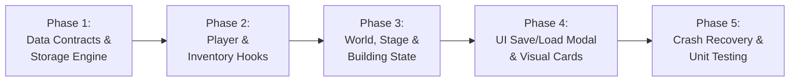

# The Last Empire - Save & Load System Architecture Plan (แผนสถาปัตยกรรมระบบเซฟเกม)

เอกสารฉบับนี้กำหนดพิมพ์เขียวสถาปัตยกรรม (Architecture Blueprint) สำหรับการพัฒนาระบบบันทึกและโหลดข้อมูลเกม (Save & Load System) ของโปรเจกต์ **The Last Empire** เพื่อให้รองรับสถานะเกมที่ซับซ้อน ครอบคลุมผู้เล่น, คลังไอเทม, อาวุธ, แผนที่โลก, สถานะด่านย่อย, สิ่งก่อสร้างฐาน (Base Building), เควสต์ และบทสนทนา พร้อมกลไกความปลอดภัยขั้นสูงป้องกันไฟล์เซฟเสียหาย (Crash-Proof Atomic Storage)

---

## 1. ภาพรวมและเป้าหมาย (Executive Summary)

### ปัญหาของระบบเดิม
- `SaveData.cs` เดิมบันทึกเฉพาะ `worldSeed`, `playerCoordX`, `playerCoordY`, `exploredStageIndices`, และ `clearedStageIndices`
- ยังไม่มีการบันทึกสถานะสำคัญ ได้แก่:
  - สถานะตัวละคร (HP, MaxHP, Hunger, Sanity, พิกัดในห้อง)
  - Operative ที่เลือกเล่น (Vanguard, Juggernaut, Phantom, Marksman, Scavenger)
  - คลังไอเทมและเงิน (PlayerInventory: Gold, Stacks, Consumables)
  - อาวุธที่สวมใส่ (ปืนปัจจุบัน, กระสุนในรังเพลิง, อาวุธประชิด, กระสุนสำรอง)
  - สิ่งก่อสร้างฐาน (Base Buildings: กำแพง, ป้อมปืน, เตียงนอน, หีบเก็บของ Storage Crate)
  - สถานะร้านค้า NPC ประจำด่าน (สินค้าคงเหลือในสต็อก)
  - เควสต์และบทสนทนาที่เคยคุย
- การเขียนไฟล์เดิมใช้ `File.WriteAllText` ทับไฟล์ตรงๆ หากเกมหลุดหรือไฟฟ้าดับขณะเขียน ไฟล์จะเสียหายทันที (Corrupted 0 KB)

### เป้าหมายของระบบใหม่
1. **Full State Persistence**: บันทึกและคืนค่าสถานะเกมได้ 100% ครบทุกระบบ
2. **Crash-Proof Atomic Saving**: เขียนลงไฟล์ชั่วคราว (`.tmp`) ตรวจสอบความสมบูรณ์ แล้วสลับไฟล์จริง พร้อมสำรองไฟล์ย้อนหลัง (`.bak`)
3. **Multi-Slot Architecture**: รองรับช่องเซฟหลายช่อง (Slot 0 = AutoSave, Slot 1..3 = Manual Save)
4. **Lightweight Metadata Header**: แยกอ่านเฉพาะข้อมูลสรุปย่อ (ชื่อตัวละคร, เวลาเล่น, วันเวลา, ด่าน) ไปแสดงผลบน UI โดยไม่ต้อง Deserialize ข้อมูลทั้งหมด
5. **Schema Versioning**: ระบุ `saveVersion` เพื่อรองรับการอัปเกรดโครงสร้างในอนาคตโดยไม่ทำลายเซฟเก่า

---

## 2. แผนผังสถาปัตยกรรมระบบ (Architecture Diagram)

```mermaid
flowchart TD
    subgraph TriggerLayer ["1. Trigger Layer (จุดกระตุ้นการเซฟ)"]
        T1["Auto-Save: เดินข้ามประตู TransitionPortal"]
        T2["Auto-Save: เคลียร์ห้องสำเร็จ (All Enemies Defeated)"]
        T3["Manual Save: พักผ่อนที่ Bedroll / นั่ง Campfire"]
        T4["Manual Save: กดปุ่ม Save ใน Pause Menu (ESC)"]
        T5["Save & Quit: บันทึกอัตโนมัติก่อนออกจากเกม"]
    end

    subgraph Orchestrator ["2. SaveManager (Singleton Controller)"]
        SM["SaveManager.Instance<br/>รวบรวม State จาก Manager ต่างๆ"]
    end

    subgraph DataModules ["3. Data Contract (SaveData Model)"]
        M1["SaveProfileMeta<br/>(SlotIndex, Timestamp, Character, Biome, Playtime)"]
        M2["PlayerSaveData<br/>(OperativeId, Health, Hunger, Sanity, RoomPos)"]
        M3["InventorySaveData<br/>(Gold, ItemList, StackCounts, QuickSlots)"]
        M4["EquipmentSaveData<br/>(RangedWeapon, ClipAmmo, MeleeWeapon, AmmoReserves)"]
        M5["WorldMapSaveData<br/>(WorldSeed, CurrentCoordX/Y, Explored, Cleared)"]
        M6["StagePersistenceData<br/>(DroppedLoot, RemainingEnemies, SavedShopItems)"]
        M7["BaseBuildingSaveData<br/>(BuildingList: Pos, Rot, Health, CrateItems)"]
        M8["StorySaveData<br/>(CompletedQuests, TalkedDialogues, AmnesiaClues)"]
    end

    subgraph StorageEngine ["4. Crash-Proof Storage Engine"]
        SE1["1. Serialize เป็น JSON String"]
        SE2["2. เขียนลง 'save_slot_X.json.tmp'"]
        SE3["3. ตรวจสอบความสมบูรณ์ (File Integrity Check)"]
        SE4["4. สำรองไฟล์เดิมเป็น 'save_slot_X.bak'"]
        SE5["5. Atomic Rename / Swap เป็น 'save_slot_X.json'"]
    end

    TriggerLayer --> SM
    SM --> DataModules
    DataModules --> StorageEngine
```



---

## 3. โครงสร้างข้อมูลอย่างละเอียด (Data Model Specification)

### 3.1 Metadata หัวไฟล์ (`SaveProfileMeta`)
```csharp
[Serializable]
public class SaveProfileMeta
{
    public int slotIndex;              // 0 = AutoSave, 1..3 = Manual Slots
    public int saveVersion = 1;        // เวอร์ชันข้อมูล ป้องกันเซฟเวอร์ชันเก่าพัง
    public string saveTimestamp;       // "2026-11-10 22:30:15"
    public float playtimeSeconds;      // เวลารวมที่เล่นไป (วินาที)
    public string characterId;         // "VANGUARD", "JUGGERNAUT", etc.
    public string characterName;       // "Imperial Vanguard"
    public string currentBiome;        // "UrbanRuins"
    public int stageCoordX;            // พิกัดห้อง X
    public int stageCoordY;            // พิกัดห้อง Y
    public int totalGold;              // จำนวนเงิน Gold ที่มี
}
```

### 3.2 สถานะผู้เล่น (`PlayerSaveData`)
```csharp
[Serializable]
public class PlayerSaveData
{
    public string characterId;
    public float currentHealth;
    public float maxHealth;
    public float currentHunger;
    public float maxHunger;
    public float currentSanity;
    public float maxSanity;
    public Vector3 roomLocalPosition;  // ตำแหน่งยืนภายในห้อง
    public Vector3 aimDirection;
    public bool isDead;
}
```

### 3.3 คลังและอุปกรณ์ (`InventorySaveData` & `EquipmentSaveData`)
```csharp
[Serializable]
public class ItemStackEntry
{
    public string itemName;
    public int quantity;
}

[Serializable]
public class InventorySaveData
{
    public int gold;
    public int maxSlots;
    public List<ItemStackEntry> items = new List<ItemStackEntry>();
}

[Serializable]
public class EquipmentSaveData
{
    public string equippedRangedWeapon;   // e.g. "Rifle"
    public int currentMagazineAmmo;      // กระสุนในแม็กกาซีน
    public string equippedMeleeWeapon;    // e.g. "Katana"
    public string equippedConsumable;     // e.g. "Bandage"
    
    // สำรองกระสุน 5 ชนิด
    public int pistolAmmo;
    public int shotgunAmmo;
    public int rifleAmmo;
    public int heavyAmmo;
    public int boltAmmo;
}
```

### 3.4 ข้อมูลโลกและด่านย่อย (`WorldMapSaveData` & `StagePersistenceData`)
```csharp
[Serializable]
public class SavedGroundItem
{
    public string itemName;
    public int count;
    public Vector3 groundPosition;
    public bool isMoney;
}

[Serializable]
public class StageRoomData
{
    public int gridIndex;                // x + y * 64
    public List<SavedGroundItem> droppedItems = new List<SavedGroundItem>();
    public List<ShopItemConfig> savedShopItems = new List<ShopItemConfig>();
    public List<string> remainingEnemies = new List<string>();
}

[Serializable]
public class WorldMapSaveData
{
    public int worldSeed;
    public int playerCoordX;
    public int playerCoordY;
    public List<int> exploredStageIndices = new List<int>();
    public List<int> clearedStageIndices = new List<int>();
    public List<StageRoomData> persistentRooms = new List<StageRoomData>();
}
```

### 3.5 สิ่งก่อสร้างฐานและกล่องเก็บของ (`BaseBuildingSaveData`)
```csharp
[Serializable]
public class PlacedBuildingEntry
{
    public string buildingId;            // Unique Instance ID
    public string buildingType;          // "Wall", "Door", "SentryTurret", "StorageCrate"
    public Vector3 position;
    public Quaternion rotation;
    public float currentHealth;
    public float maxHealth;
    
    // สำหรับ StorageCrateBuilding
    public List<ItemStackEntry> storedItems = new List<ItemStackEntry>();
}

[Serializable]
public class BaseBuildingSaveData
{
    public List<PlacedBuildingEntry> placedBuildings = new List<PlacedBuildingEntry>();
}
```

### 3.6 เนื้อเรื่อง เควสต์ และ NPC (`StorySaveData`)
```csharp
[Serializable]
public class StorySaveData
{
    public bool awakeningBannerSeen;
    public List<string> talkedDialogueIds = new List<string>();
    public List<string> activeQuestIds = new List<string>();
    public List<string> completedQuestIds = new List<string>();
}
```

---

## 4. กลไกความปลอดภัยไฟล์ (Crash-Proof Storage Engine)

ระบบเซฟจะใช้หลักการ **Atomic File Replacement** และ **Rolling Backup**:

```
[เขียนไฟล์ใหม่]
  Memory State
      │
      ▼
  1. save_slot_1.json.tmp  <-- เขียนลง Temp ไฟล์ก่อน
      │
  2. ตรวจสอบความถูกต้อง (ขนาด > 0, JSON Parse ผ่าน)
      │
      ├──> ถ้าผ่าน:
      │      3. ย้าย save_slot_1.json เดิม -> save_slot_1.bak (สำรอง)
      │      4. ย้าย save_slot_1.json.tmp -> save_slot_1.json (ไฟล์จริง)
      │
      └──> ถ้าล้มเหลว:
             ลบไฟล์ .tmp ทิ้ง, แจ้งเตือนข้อผิดพลาด, เซฟเดิมไม่ถูกแตะต้อง!
```

---

## 5. จุดกระตุ้นการเซฟ (Save Triggers & Timing)

| จุดกระตุ้น | ประเภท | รายละเอียด |
| :--- | :---: | :--- |
| **ข้ามห้อง (TransitionPortal)** | AutoSave | ทำงานทันทีเมื่อผู้เล่นเดินผ่านประตูวาร์ปเข้าห้องใหม่ บันทึกความคืบหน้าของห้องเดิมและห้องใหม่ |
| **เคลียร์ห้อง (Room Cleared)** | AutoSave | ทำงานเมื่อกำจัดศัตรูตัวสุดท้ายในห้องหมด ป้องกันการเสียความคืบหน้าการต่อสู้ |
| **จุดพักผ่อน (Bedroll / Campfire)** | Manual Save | เมื่อผู้เล่นกดปุ่ม Interact เพื่อพักผ่อน ฟื้นฟูสติและเซฟเกม |
| **Pause Menu (ESC)** | Manual Save | ผู้เล่นสามารถเลือกบันทึกเกมลง Slot 1, 2, 3 ได้ตลอดเวลา |
| **Save & Quit** | AutoSave | เมื่อผู้เล่นเลือก "กลับสู่หน้าหลัก (Main Menu)" หรือ "ออกจากเกม" จะเซฟ State ล่าสุดทันที |

---

## 6. แผนการดำเนินงานพัฒนา (Implementation Roadmap)



### รายละเอียดแต่ละเฟส:

- **Phase 1: โครงสร้างข้อมูลและตัวจัดเก็บไฟล์ (Data Contracts & Storage Engine)**
  - อัปเกรด `SaveData.cs` ให้มี Sub-Class ครบถ้วน
  - อัปเกรด `SaveSystem.cs` ให้รองรับ Multi-Slot (`slotIndex`), Atomic Temp-Write (`.tmp`), และ Backup Rollback (`.bak`)
  - ฟังก์ชันตรวจสอบความถูกต้อง (Checksum / Integrity Verification)

- **Phase 2: เชื่อมต่อระบบผู้เล่นและไอเทม (Player & Inventory Integration)**
  - เพิ่ม `ExportSaveData()` และ `ImportSaveData()` ใน [PlayerController.cs](file:///d:/TLEGIT/TheLastEmpire/Assets/Scripts/Runtime/Player/PlayerController.cs)
  - เพิ่มการ Export/Import คลังไอเทมและเงินใน [PlayerInventory.cs](file:///d:/TLEGIT/TheLastEmpire/Assets/Scripts/Runtime/Player/PlayerInventory.cs)
  - คืนค่าอาวุธที่ถือ, กระสุนในรังเพลิง และหลอดพลังชีวิต/ความหิว/สติ

- **Phase 3: เชื่อมต่อโลก ด่านย่อย และสิ่งก่อสร้าง (World, Stage & Base Persistence)**
  - อัปเกรด [WorldMapManager.cs](file:///d:/TLEGIT/TheLastEmpire/Assets/Scripts/Runtime/Map/WorldMapManager.cs) และ [GameManager.cs](file:///d:/TLEGIT/TheLastEmpire/Assets/Scripts/Runtime/Managers/GameManager.cs) ให้คืนค่าของที่ตกบนพื้นและสินค้าในร้านค้า
  - เชื่อมต่อ [BuildingManager.cs](file:///d:/TLEGIT/TheLastEmpire/Assets/Scripts/Runtime/Building/BuildingManager.cs) และ [StorageCrateBuilding.cs](file:///d:/TLEGIT/TheLastEmpire/Assets/Scripts/Runtime/Building/StorageCrateBuilding.cs) ให้คืนค่าตำแหน่งอาคารและของในหีบได้ถูกต้อง

- **Phase 4: ส่วนติดต่อผู้ใช้ (UI Save/Load Modal)**
  - พัฒนาหน้าต่างเลือกเซฟ [SaveLoadUI.cs](file:///d:/TLEGIT/TheLastEmpire/Assets/Scripts/Runtime/UI/) แสดงการ์ด Slot 0..3
  - แสดงภาพไอคอนตัวละคร, ชื่อ Operative, พิกัดห้อง, เวลาเล่น, วันเวลาบันทึก
  - เชื่อมต่อปุ่ม Continue / Load Game ในหน้า [MainMenuManager.cs](file:///d:/TLEGIT/TheLastEmpire/Assets/Scripts/Runtime/UI/MainMenuManager.cs)

- **Phase 5: ทดสอบความทนทานและการกู้คืนไฟล์ (Verification & Safety Testing)**
  - ทดสอบจำลองกรณีไฟล์เซฟเสีย (Corrupt file simulation) เพื่อยืนยันว่าระบบ Rollback ไปใช้ไฟล์ `.bak` ได้อย่างราบรื่น
  - ตรวจสอบว่าไม่มี Garbage Collection Spikes ตอนเซฟขณะเล่น
