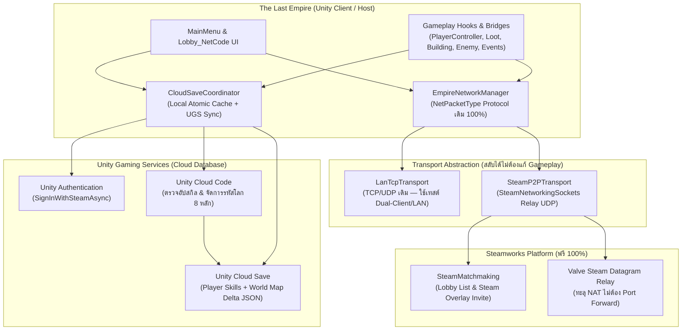

# The Last Empire — Steam Multiplayer & Unity Cloud Database Architecture Plan

เอกสารฉบับนี้เป็นแผนพิมพ์เขียว (Architecture & Implementation Plan) สำหรับการต่อยอดระบบ **Multiplayer ปัจจุบัน** ขึ้นแพลตฟอร์ม **Steam** ควบคู่กับระบบฐานข้อมูลเซฟบน **Unity Gaming Services (Authentication + Cloud Save + Cloud Code)** โดยออกแบบให้ **ไม่ต้องรื้อโค้ดเกมเพลย์ (`*.NetHook.cs` / `Network*Bridge`)** และควบคุมขนาดข้อมูล/ค่าใช้จ่ายให้ต่ำที่สุด

---

## 1. ภาพรวมสถาปัตยกรรม (High-Level Architecture)

แยกความรับผิดชอบของ 2 ระบบอย่างชัดเจน:
1. **Steamworks (`SteamMatchmaking` + `SteamNetworkingSockets`)** — รับผิดชอบเรื่อง **Real-time Multiplayer** (ห้อง Lobby, ชวนเพื่อนผ่าน Steam Overlay, ส่ง Packet แบบ UDP Relay ฟรีผ่านเซิร์ฟเวอร์ Valve)
2. **Unity Gaming Services (`Authentication` + `Cloud Save` + `Cloud Code`)** — รับผิดชอบเรื่อง **Database ถาวร** (ข้อมูลแมพ/โลก + สกิล/ความก้าวหน้าผู้เล่น + ตรวจสิทธิ์กันโกง)



---

## 2. ส่วนที่ 1: ระบบ Multiplayer ลง Steam (ไม่รื้อโค้ดเดิม)

### 2.1 โครงสร้าง Transport Layer (`INetworkTransportLayer`)
เนื่องจาก [`EmpireNetworkManager.cs`](file:///d:/Unity%20Game%20Project/Eruption/TheLastEmpire/TheLastEmpire/Assets/Scripts/Runtime/Network/Core/EmpireNetworkManager.cs) และ [`NetcodeCompatLayer.cs`](file:///d:/Unity%20Game%20Project/Eruption/TheLastEmpire/TheLastEmpire/Assets/Scripts/Runtime/Network/Core/NetcodeCompatLayer.cs) แยกชั้นส่งข้อมูล (`SendToServer` / `SendToClient` / `Broadcast`) ออกจากโค้ดเกมเพลย์อยู่แล้ว เราจึงสร้าง Interface กลางเพียง 1 ไฟล์:

```csharp
public interface INetworkTransportLayer
{
    bool IsHost { get; }
    bool IsConnected { get; }
    ulong LocalClientId { get; }

    event Action<ulong> OnClientConnected;
    event Action<ulong> OnClientDisconnected;
    event Action<ulong, NetPacketType, byte[]> OnPacketReceived;

    void StartHost(string roomName, int maxPlayers);
    void JoinRoom(string addressOrLobbyId);
    void Shutdown();
    void Tick();

    void SendToServer(NetPacketType type, byte[] payload, bool reliable = true);
    void SendToClient(ulong clientId, NetPacketType type, byte[] payload, bool reliable = true);
    void BroadcastToClients(NetPacketType type, byte[] payload, bool reliable = true, ulong excludeClientId = ulong.MaxValue);
}
```

### 2.2 การแยกช่องส่งข้อมูล Reliable vs Unreliable (ข้อดีของ Steam UDP)
เมื่อเปลี่ยนเป็น `SteamNetworkingSockets` จะสามารถส่งข้อมูลแยกช่องเพื่อลดอาการกระตุกข้ามเน็ตจริงได้ทันที:

| ประเภท Packet (`NetPacketType`) | โหมดการส่ง | เหตุผล |
| :--- | :--- | :--- |
| `PlayerStateSync`, `EnemyBatchSync` | **Unreliable** | ส่งถี่ (15–20 Hz) หากหลุด 1 เฟรมให้ข้ามไปใช้เฟรมล่าสุดทันที ไม่เกิดอาการค้างแล้ววาร์ป |
| `LootClaimRequest/Result`, `LootSpawnBroadcast`, `ContainerLootSync`, `ClientDropItemRequest` | **Reliable** | ข้อมูลไอเทมต้องถึงครบ 100% ป้องกันของหายหรือปั๊มของ |
| `BuildingPlace/Destroy`, `StageEventBroadcast`, `EnemyDamageRequest`, `ProjectileFire`, `LobbySync` | **Reliable** | เหตุการณ์สำคัญของด่านและการต่อสู้ต้องถึงตรงกันทุกเครื่อง |

### 2.3 ระบบ Lobby & ชวนเพื่อนผ่าน Steam (`SteamMatchmaking`)
เชื่อมเข้ากับ [`MultiplayerLobbyUI.cs`](file:///d:/Unity%20Game%20Project/Eruption/TheLastEmpire/TheLastEmpire/Assets/Scripts/Runtime/Network/UI/MultiplayerLobbyUI.cs) เดิมโดยไม่ต้องสร้าง UI ใหม่:
- **สร้างห้อง (`CreateLobby`)**: `SteamMatchmaking.CreateLobby(ELobbyType.k_ELobbyTypeFriendsOnly, 6)` และฝาก Metadata (`RoomName`, `HostName`, `WorldSeed`, `GameVersion`)
- **ค้นหาห้อง (`RefreshRooms`)**: ดึงทั้งห้องของเพื่อนบน Steam และ Public Lobby มาเติมลงแถว `RoomThumbnailUI` ทั้ง 5 แถว
- **ชวนเพื่อน (`Invite Friend`)**: เรียก `SteamFriends.ActivateGameOverlayInviteDialog(currentLobbyId)` และดัก Event `GameLobbyJoinRequested_t` เมื่อเพื่อนกด Accept Invite จากแชท Steam ให้ Join ห้องอัตโนมัติ
- **การทดสอบฟรี**: วางไฟล์ `steam_appid.txt` ที่มีเลข **`480`** (*Spacewar* สำหรับ Dev) ไว้ข้างโปรเจกต์เพื่อเทสต์ข้ามเครื่องผ่าน Steam จริงได้ฟรีทันทีก่อนซื้อ Steam Direct

---

## 3. ส่วนที่ 2: ระบบฐานข้อมูลบน Unity Gaming Services (UGS)

### 3.1 การติดตั้ง Package & เชื่อมบัญชี (Authentication)
ติดตั้งผ่าน Unity Package Manager (`com.unity.services.*`):
1. `com.unity.services.core`
2. `com.unity.services.authentication`
3. `com.unity.services.cloudsave`
4. `com.unity.services.cloudcode`

**Flow การล็อกอินเมื่อเปิดเกม**:
1. เรียก `await UnityServices.InitializeAsync()`
2. ถ้าเปิดผ่าน Steam -> ขอ Steam Auth Ticket (`SteamUser.GetAuthTicketForWebApi("unityauthentication")`) แล้วเรียก `await AuthenticationService.Instance.SignInWithSteamAsync(ticket, "unityauthentication")`
3. ถ้าอยู่ใน Unity Editor หรือโหมด Offline -> Fallback เป็น `SignInAnonymouslyAsync()` หรือทำงานในโหมด Local Offline โดยไม่บล็อกผู้เล่น

---

### 3.2 โครงสร้างข้อมูลที่เก็บ (Data Schema — เน้นเล็ก & เร็ว ~10–100 KB)

ออกแบบเก็บเฉพาะ **2 หมวดหลัก** ตามความต้องการของเกม (สกิลผู้เล่น + สถานะแมพแบบ Seed + Delta):

#### A. Player Data (ผูกกับ Player ID ของแต่ละคน — เก็บใน `CloudSaveService.Instance.Data.Player`)

**Key 1: `player_profile_v1`** (~0.5 KB)
```json
{
  "schemaVersion": 1,
  "displayName": "P4NDORA",
  "lastSelectedCharacterId": "MARKSMAN",
  "unlockedCharacterIds": ["VANGUARD", "JUGGERNAUT", "PHANTOM", "MARKSMAN", "SCAVENGER", "REBEL", "DEMOLITIONIST"],
  "totalPlaytimeSeconds": 14200,
  "ownedWorldCodes": ["48291053"]
}
```

**Key 2: `player_skills_v1`** (~1–5 KB)
```json
{
  "schemaVersion": 1,
  "skillPoints": 12,
  "totalXp": 4850,
  "level": 9,
  "unlockedSkills": {
    "VANGUARD": ["hp_boost_2", "dash_cd_1", "shield_bash_1"],
    "MARKSMAN": ["crit_chance_3", "reload_speed_2"],
    "DEMOLITIONIST": ["blast_radius_2", "c4_damage_2"]
  },
  "equippedPassives": ["crit_chance_3", "reload_speed_2"]
}
```

#### B. World / Map Save Data (เก็บแบบ Seed + Delta — เก็บใน `CloudSaveService` Custom Data Key `world_<8DigitCode>` หรือ Slot ของ Host)

**Key: `world_<8DigitCode>`** (~10–80 KB, ไม่เก็บต้นไม้/ซากตึกเดิมที่สร้างจาก Seed ได้)
```json
{
  "schemaVersion": 1,
  "roomCode": "48291053",
  "worldName": "P4NDORA's Wasteland",
  "ownerPlayerId": "ugs_player_abc123",
  "worldSeed": 91827364,
  "dayCount": 4,
  "timeOfDay": 0.42,
  "lastSavedUtc": "2026-11-22T07:30:00Z",
  "exploredStageIndices": [8256, 8257, 8384],
  "clearedStageIndices": [8256, 8257],
  "lootedContainers": [
    { "stageX": 64, "stageY": 64, "containerId": "Car_12_-4", "remainingItems": [] }
  ],
  "buildings": [
    {
      "stageX": 64,
      "stageY": 64,
      "buildingId": "BUILD0023",
      "pos": [2.5, 0.0, -1.2],
      "rotY": 90.0,
      "hp": 100.0,
      "crateItems": []
    }
  ]
}
```

> **หมายเหตุเรื่องขนาดไฟล์**: ด้วยเทคนิค **Seed + Delta** ต่อให้ผู้เล่นสำรวจไปแล้ว 200 ด่านและสร้างบ้าน 150 ชิ้น ขนาด JSON จะอยู่ที่ประมาณ **30–90 KB** เท่านั้น (ต่ำกว่าลิมิต 5 MB ของ Unity Cloud Save กว่า 50 เท่า) และสามารถบีบอัด GZip + Base64 เพิ่มได้อีก 70% หากโลกใหญ่มากในอนาคต

---

### 3.3 ฟังก์ชันฝั่ง Server (`Unity Cloud Code` Modules)

ใช้ Cloud Code เฉพาะจุดที่ต้อง **กันโกง** หรือ **จัดการสิทธิ์ข้ามผู้เล่น** (ไม่ต้องเรียกตอนเดินหรือยิง):

| Cloud Code Endpoint | Input | การทำงานฝั่ง Server |
| :--- | :--- | :--- |
| **`UnlockSkill`** | `characterId`, `skillId` | ตรวจ `player_skills_v1` ว่ามี `skillPoints` พอและมีเงื่อนไข Prerequisite ครบ -> หักแต้ม + ปลดล็อกสกิล + บันทึกลง Cloud Save แล้วคืนค่าใหม่ (กันคนแก้ไฟล์โกงสกิล) |
| **`AwardPlayerXp`** | `xpGain`, `sourceTag` | บวก XP / อัปเลเวล / เพิ่ม `skillPoints` พร้อม Rate-limit กันยิงสแปม |
| **`CreateWorldSave`** | `worldName`, `worldSeed` | สุ่มรหัส `roomCode` 8 หลักที่ไม่ซ้ำ สร้างเอกสาร `world_<roomCode>` ใน Custom Data และผูกสิทธิ์ `ownerPlayerId` |
| **`SaveWorldDelta`** | `roomCode`, `worldDeltaJson` | ตรวจว่าผู้เรียกเป็น Host/เจ้าของโลก (หรือสมาชิกที่ได้รับสิทธิ์) -> ตรวจสอบ Schema + บันทึกลง `world_<roomCode>` |
| **`LoadWorldByCode`** | `roomCode` | โหลดข้อมูล `world_<roomCode>` กลับมาให้ Host สร้างแมพต่อจากเดิมและซิงค์ `WorldSeed` + ตึก + รถที่รื้อแล้วให้ลูกทีมทุกคน |

---

### 3.4 กลยุทธ์การยิง Save (ประหยัดโควต้า + รองรับ Offline 100%)

เพื่อไม่ให้ยิง Request เปลืองและป้องกันเซฟหายเวลาเน็ตหลุด:
1. **Local Atomic Cache เสมอ**: ทุกครั้งที่เซฟ ให้เขียนลง Local Disk แบบ Atomic (`.tmp` -> ตรวจครบ -> สลับเป็น `.json` + `.bak`) ตามแผน [`Docs/save-system-plan.md`](file:///d:/Unity%20Game%20Project/Eruption/TheLastEmpire/TheLastEmpire/Docs/save-system-plan.md)
2. **จังหวะซิงค์ขึ้น Cloud (Cloud Sync Triggers)**:
   - เมื่อ **ปลดล็อก/อัปเกรดสกิล** -> ยิง `Cloud Code: UnlockSkill` ทันที
   - เมื่อ **เปลี่ยนด่าน (`TransitionPortal`)** -> Mark Dirty และซิงค์ขึ้น Cloud (มี Cooldown/Debounce อย่างน้อย **30 วินาที** ป้องกันคนเดินเข้าออกประตูรัวๆ)
   - **Auto-Save Timer** -> ทุกๆ **3 นาที** (เฉพาะเมื่อมีข้อมูลเปลี่ยนแปลง `_isDirty == true`)
   - **Manual Save / Quit to Menu / `OnApplicationQuit`** -> บังคับ Flush เซฟขึ้น Cloud 1 ครั้งสุดท้าย
3. **Offline Recovery**: หากเน็ตหลุดขณะเล่น ระบบจะเซฟลง Local ไว้พร้อม Timestamp และเมื่อต่อเน็ตใหม่จะเทียบ `lastSavedUtc` เพื่อซิงค์ข้อมูลล่าสุดขึ้น Cloud ให้อัตโนมัติ

---

## 4. โครงสร้างไฟล์ที่จะสร้างและปรับปรุง

```text
Assets/Scripts/Runtime/
├── Network/
│   ├── Transport/
│   │   ├── INetworkTransportLayer.cs        # [ใหม่] Interface กลางสำหรับส่ง Packet
│   │   ├── LanTcpTransport.cs               # [แยกออก] โค้ด TCP/UDP LAN เดิม
│   │   └── SteamP2PTransport.cs             # [ใหม่] SteamNetworkingSockets + SteamMatchmaking
│   └── Core/
│       └── EmpireNetworkManager.cs          # [ปรับ] เรียกผ่าน INetworkTransportLayer แทน TcpClient ตรงๆ
└── Save/
    ├── SaveSystem.cs                        # [ปรับ] เพิ่ม Atomic Write (.tmp/.bak)
    ├── CloudSaveModels.cs                   # [ใหม่] PlayerProfileData, PlayerSkillsData, WorldDeltaSaveData
    ├── UgsAuthService.cs                    # [ใหม่] Init UGS + SignInWithSteamAsync + Offline fallback
    ├── CloudSaveManager.cs                  # [ใหม่] โหลด/เซฟ Player & World Data + Debounce/Auto-Save
    └── CloudCodeClient.cs                   # [ใหม่] Wrapper เรียก UnlockSkill / SaveWorldDelta / LoadWorldByCode
```

---

## 5. แผนการพัฒนาทีละขั้น (Implementation Roadmap)

### Phase 1 — ตั้งค่าโปรเจกต์ & Local Atomic Save (1 วัน)
- [ ] อัปเกรด `SaveSystem.cs` เป็น Crash-Proof Atomic Save (`.tmp` + `.bak`) และสร้าง `CloudSaveModels.cs` (เก็บ Map Delta: `worldSeed`, `explored/cleared`, `buildings`, `lootedContainers` + `player_skills`)
- [ ] เชื่อม `WorldMapManager`, `BuildingManager`, และ `LootContainer` (`_syncedContainerStates`) ให้ Serialize/Deserialize ข้อมูลแมพได้ครบทั้งตอนเล่น Offline และ Host

### Phase 2 — ตั้งค่า Unity Gaming Services (Cloud Save + Cloud Code) (1–2 วัน)
- [ ] เปิดโปรเจกต์บน Unity Cloud Dashboard -> เปิดใช้ **Authentication**, **Cloud Save**, **Cloud Code**
- [ ] ติดตั้ง UGS SDK ใน Unity Package Manager และสร้าง `UgsAuthService.cs` + `CloudSaveManager.cs`
- [ ] เขียนและ Deploy Cloud Code Script 3 ตัวแรก: `UnlockSkill`, `CreateWorldSave`, `SaveWorldDelta`
- [ ] ทดสอบเซฟ/โหลดแมพและสกิลข้ามเครื่อง (ลบไฟล์ Local แล้วโหลดกลับจาก Cloud ได้ 100%)

### Phase 3 — แยก Transport Layer & ต่อ Steamworks (2–3 วัน)
- [ ] แยก TCP เดิมใน `EmpireNetworkManager` ออกมาเป็น `LanTcpTransport : INetworkTransportLayer` (ทดสอบ Dual-Client LAN ให้ยังใช้งานได้เหมือนเดิม 100%)
- [ ] ติดตั้ง `Steamworks.NET` + ใส่ `steam_appid.txt` (`480`)
- [ ] สร้าง `SteamP2PTransport` (`SteamNetworkingSockets` แยก Reliable/Unreliable + `SteamMatchmaking` Lobby)
- [ ] ผูก `UgsAuthService` ให้ใช้ `SignInWithSteamAsync` และเพิ่มปุ่ม **Invite Friend** ใน `Lobby_NetCode`

### Phase 4 — ทดสอบข้ามเน็ตจริง & เตรียมขึ้น Steam (1–2 วัน)
- [ ] ทดสอบกับเพื่อน 2–6 คนข้ามอินเทอร์เน็ตจริงผ่าน AppID `480` (วัดปิง, Packet Loss, การย้ายแมพ `(X,Y)`, การเก็บของ/โยนของ, การสร้างบ้าน, และการโหลดเซฟโลกจาก Cloud)
- [ ] เมื่อซื้อ Steam Direct แล้ว เปลี่ยน AppID จาก `480` เป็น AppID จริงของเกม และตั้งค่า Steam Secret Key ใน Unity Authentication Dashboard
