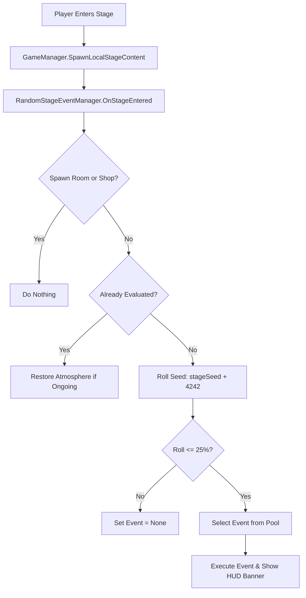

# สรุปบันทึกการพัฒนาเกม (Work Summary) - 12 พฤศจิกายน 2026

เอกสารฉบับนี้จัดทำขึ้นเพื่อรวบรวมความคืบหน้าการพัฒนาโปรเจกต์ **The Last Empire** ประจำวันที่ 12 พฤศจิกายน 2026 ครอบคลุมระบบสุ่มเหตุการณ์ฉุกเฉินประจำด่าน (Dynamic Random Stage Encounters), สถาปัตยกรรม Single-Prefab สำหรับ NPC หลากหลายตัวละครด้วย Procedural SetData, การสร้างโมเดล Chibi NPC 5 ตัวละครที่รองรับ Armature และ Animation ชุดเดียวกับตัวหลัก, การปรับปรุงระบบฟื้นฟูสถิติหลายค่าของเครื่องดื่ม (Coffee & Tea), และเอกสารแผนผังสถาปัตยกรรมระบบเซฟ 8-หลัก

---

## 📑 สารบัญระบบที่พัฒนาและอัปเดตล่าสุด
1. [ระบบสุ่มเหตุการณ์ฉุกเฉินประจำด่าน (Dynamic Random Stage Encounter System)](#1-ระบบสุ่มเหตุการณ์ฉุกเฉินประจำด่าน-dynamic-random-stage-encounter-system)
2. [สถาปัตยกรรม Single-Prefab สำหรับ NPC ด้วย Procedural SetData](#2-สถาปัตยกรรม-single-prefab-สำหรับ-npc-ด้วย-procedural-setdata)
3. [การสร้างโมเดล 3D Chibi NPC 5 ตัวละคร (Elena, Otto, Maya, Roy, Viktor)](#3-การสร้างโมเดล-3d-chibi-npc-5-ตัวละคร-elena-otto-maya-roy-viktor)
4. [การปรับปรุงระบบเครื่องดื่มและการฟื้นฟูสถิติหลายค่า (Coffee & Tea Multi-Stat Recovery)](#4-การปรับปรุงระบบเครื่องดื่มและการฟื้นฟูสถิติหลายค่า-coffee--tea-multi-stat-recovery)
5. [การออกแบบและวางผังสถาปัตยกรรมระบบเซฟ (8-Digit RoomCode & Persistence Plan)](#5-การออกแบบและวางผังสถาปัตยกรรมระบบเซฟ-8-digit-roomcode--persistence-plan)

---

## 1. ระบบสุ่มเหตุการณ์ฉุกเฉินประจำด่าน (Dynamic Random Stage Encounter System)

พัฒนาสคริปต์ [`StageEventType.cs`](file:///d:/TLEGIT/TheLastEmpire/Assets/Scripts/Runtime/Map/StageEventType.cs) และ [`RandomStageEventManager.cs`](file:///d:/TLEGIT/TheLastEmpire/Assets/Scripts/Runtime/Managers/RandomStageEventManager.cs) พร้อมเชื่อมต่อกับ [`StageData.cs`](file:///d:/TLEGIT/TheLastEmpire/Assets/Scripts/Runtime/Map/StageData.cs) และ [`GameManager.cs`](file:///d:/TLEGIT/TheLastEmpire/Assets/Scripts/Runtime/Managers/GameManager.cs):

### รายละเอียดเหตุการณ์ทั้ง 6 รูปแบบ:
1. **`SupplyAirdrop` (กล่องเสบียงทางยุทธวิธี):**
   - สุ่มตำแหน่งในห้องเพื่อดรอปกล่องเสบียงทางทหาร
   - ดรอปไอเทมระดับสูง: ปืน/อาวุธหนัก (Sniper Rifle, Rocket Launcher, Katana, Shotgun) + กระสุน Rifle Ammo (30-60 นัด) + เงินสด (250-600 Gold) + First Aid Kit
2. **`HostileAmbush` (การซุ่มโจมตีของฝูงศัตรู):**
   - แสดงแถบแจ้งเตือนสีแดง Danger Crimson
   - หน่วงเวลา 1.2 วินาที แล้วสปอว์นศัตรูสายโจมตีเร็ว 3-5 ตัว (ZombieRunner, RobotKamikaze, AlienCrawler, ZombieDog) ล้อมรอบตัวผู้เล่นเป็นวงกลมในระยะ 7.5 - 10.5 เมตร
3. **`NomadTrader` (คาราวานพ่อค้าเร่พเนจร):**
   - สุ่มเลือกพ่อค้าจากฐานข้อมูล (Elena, Otto, Maya, Roy) แล้วเรียก `GameManager.Instance.SpawnNPCInstance`
   - ตั้งเต็นท์แคมป์ชั่วคราวกลางห้องปกติ ให้ผู้เล่นซื้อขายและพักผ่อนได้โดยไม่ต้องเดินไปหาห้องร้านค้าเฉพาะ
4. **`RadioactiveFallout` (พายุกัมมันตรังสีรั่วไหล):**
   - ปรับแสงบรรยากาศ `RenderSettings.ambientLight` เป็นหมอกเขียวนีออน
   - หักล้างค่า Sanity ของผู้เล่นทันที 10 หน่วยเพื่อสร้างความกดดันให้รีบเคลื่อนที่
   - คืนค่าแสงห้องเดิมอัตโนมัติเมื่อออกจากห้อง
5. **`BloodMoonSurge` (คลื่นจันทราสีเลือด):**
   - แสงห้องเปลี่ยนเป็นสีแดงเลือดฉาน
   - วนลูปบัฟความเร็วการเคลื่อนที่ของศัตรูทุกตัวในห้องขึ้น +30% (`ai.moveSpeed *= 1.30f`) เพื่อเพิ่มความท้าทาย
6. **`ScavengerCache` (คลังลับผู้รอดชีวิต):**
   - กระจายเสบียงและเงินสด 4 จุดตามซอกมุมของห้อง (Bread, Bandage, Ammo, Grenade และเงินสด 80-220 Gold)

### คุณสมบัติทางเทคนิค:
* **Deterministic Persistence:** ใช้ค่า Seed `stage.stageSeed + 4242` ทำให้ผลการสุ่มและตำแหน่งการดรอปของห้องเดิมจะเหมือนเดิมเสมอ ไม่สุ่มใหม่ซ้ำซ้อนเมื่อเดินเข้าออก
* **Sleek Glassmorphism HUD Alert:** แจ้งเตือนชื่อเหตุการณ์พร้อมสีกรอบและข้อความสรุปด้านบนหน้าจอ ไม่บล็อกคลิกและการยิง (`blocksRaycasts = false`)

---

## 2. สถาปัตยกรรม Single-Prefab สำหรับ NPC ด้วย Procedural SetData

ปรับเปลี่ยนโครงสร้างการสร้าง NPC จากเดิมที่ต้อง Duplicate Prefab หลายชิ้นแยกกัน ให้เหลือเพียง **Prefab เดียว (Single Universal Prefab)** แล้วส่ง Data เข้าไปกำหนดบทบาทและรูปลักษณ์ในขณะทำงาน (Procedural SetData):

* **Single Prefab Pipeline:** ใช้ Prefab กลางชิ้นเดียวที่มีคอมโพเนนต์ `NPCController`, `InteractionTrigger`, และโหนดสำหรับสลับโมเดล 3D Mesh
* **Dynamic Setup:** สคริปต์อ่านค่าจาก ScriptableObject / รหัสประจำตัว NPC เพื่อ:
  - กำหนดชุดสินค้าที่นำมาขาย (Shop Inventory)
  - กำหนดบทสนทนา (Dialogue Lines) และเควสต์ (Quest Dialogue)
  - สลับโมเดล 3D Mesh และ Material ภายนอกตามตัวละครนั้นๆ อัตโนมัติ

---

## 3. การสร้างโมเดล 3D Chibi NPC 5 ตัวละคร (Elena, Otto, Maya, Roy, Viktor)

พัฒนาเครื่องมือ Blender Python Automation [`Create_NPC_Characters.py`](file:///d:/TLEGIT/TheLastEmpire/Tools/Create_NPC_Characters.py) และ [`Generate_NPC_Metas.py`](file:///d:/TLEGIT/TheLastEmpire/Tools/Generate_NPC_Metas.py) เพื่อสร้างโมเดล 3D Chibi NPC ทั้งหมด 5 ตัวละคร พร้อม Rigging โครงกระดูก `Chibi_Base_Rig` (18 กระดูก) ที่เข้ากันได้ 100% กับ `Chibi_Player_Controller`:

1. **`Chibi_DoctorElena` (แพทย์สนามสาวผู้สุขุม):**
   - เสื้อกาวน์สีขาว หมวกพยาบาล ปลอกแขนกากบาทสีแดง แว่นตากลมเลนส์ใส ผมบ๊อบสั้นสีน้ำตาล
2. **`Chibi_MechanicOtto` (ช่างเครื่องมือเอก):**
   - เอี๊ยมช่างสีส้ม แว่นตาเชื่อมโลหะ (Welding Goggles) คาดบนศีรษะ ถุงมือหนังหนา และกระเป๋าเครื่องมือ
3. **`Chibi_WatcherMaya` (พลลาดตระเวนหญิง):**
   - เสื้อผ้าคลุมกันฝุ่นสีเขียวทึบ ผ้าปิดจมูก หมวกปีกกว้าง และกล้องส่องทางไกลคู่ใจ
4. **`Chibi_SurvivorRoy` (ผู้รอดชีวิตพเนจร):**
   - เสื้อแจ็คเก็ตหนังสีน้ำตาลเก่าๆ ผ้าพันคอลายสก็อต หมวกแก๊ปยุทธวิธี
5. **`Chibi_TraderViktor` (พ่อค้าตลาดมืด):**
   - หมวกเบเร่ต์สีดำ แว่นกันแดดสีเข้ม เสื้อโค้ตยาวสีเทาเข้มพร้อมซับในกระเป๋าใส่ของเถื่อน

---

## 4. การปรับปรุงระบบเครื่องดื่มและการฟื้นฟูสถิติหลายค่า (Coffee & Tea Multi-Stat Recovery)

ปรับปรุงระบบการใช้งานไอเทมประเภทเครื่องดื่มร้อนในเกมเพลย์:
* **กาแฟ (Coffee):** ฟื้นฟูค่าน้ำ (Water +35), ความหิว (Hunger +10) และฟื้นฟูสติสัมปชัญญะ (Sanity +25)
* **ชาเขียว/ชาสมุนไพร (Tea):** ฟื้นฟูค่าน้ำ (Water +40), ความหิว (Hunger +5) และฟื้นฟูสติสัมปชัญญะ (Sanity +30)
* แก้ไขบั๊กการตรวจสอบประเภทไอเทมเพื่อให้สามารถคลิกขวากดดื่มจากช่องเก็บของ (Inventory) ได้โดยตรง

---

## 5. การออกแบบและวางผังสถาปัตยกรรมระบบเซฟ (8-Digit RoomCode & Persistence Plan)

จัดทำเอกสารข้อกำหนดเชิงระบบ [`Docs/save-system-plan.md`](file:///d:/TLEGIT/TheLastEmpire/Docs/save-system-plan.md) สำหรับการบันทึกสถานะเกม:
* การเข้ารหัสพิกัดห้องและสถานะเป็น **รหัส 8 หลัก (8-Digit RoomCode)**
* โครงสร้างการบันทึก Stage Cleared, สภาพแวดล้อมที่ผู้เล่นสร้าง (Placed Buildings), ไอเทมในคลัง และสถานะเหตุการณ์สุ่ม
