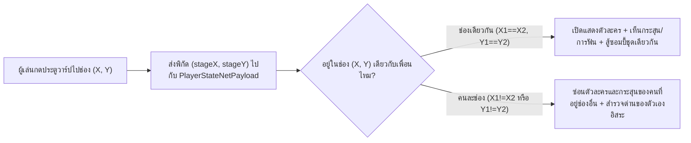

# สรุปบันทึกการพัฒนาเกม (Work Summary) - 22 พฤศจิกายน 2026

เอกสารฉบับนี้รวบรวมความคืบหน้าการพัฒนาโปรเจกต์ **The Last Empire** ประจำวันที่ 22 พฤศจิกายน 2026 บน Branch `multi-player-netcode` ครอบคลุมระบบ **Co-op Multiplayer 1–6 คน (LAN & Local Dual-Client)**, ระบบหน้าจอ **`Lobby_NetCode`** แบบผูก Reference ผ่าน Inspector 100%, ระบบตั้งชื่อผู้เล่น (`AccountName` / `ChangeNamePanel`) ในหน้า `MainMenu`, และระบบเดินสำรวจข้ามช่องพิกัด `(Stage X, Y)` แบบอิสระที่จะพบเจอกันเฉพาะเมื่ออยู่ในช่องพิกัดเดียวกัน

---

## 📑 สารบัญระบบที่พัฒนาและอัปเดตล่าสุด
1. [หน้าเมนูหลักรูปแบบใหม่ & ระบบตั้งชื่อผู้เล่น (MainMenu Offline/Online & Account Name)](#1-หน้าเมนูหลักรูปแบบใหม่--ระบบตั้งชื่อผู้เล่น-mainmenu-offlineonline--account-name)
2. [ระบบค้นหาห้องและห้องเตรียมตัว 6 คน (Lobby_NetCode Pure Inspector Reference UI)](#2-ระบบค้นหาห้องและห้องเตรียมตัว-6-คน-lobby_netcode-pure-inspector-reference-ui)
3. [ระบบเดินข้ามช่องพิกัด (Stage X, Y) แบบอิสระ & การพบเจอกันในช่องเดียวกัน](#3-ระบบเดินข้ามช่องพิกัด-stage-x-y-แบบอิสระ--การพบเจอกันในช่องเดียวกัน)
4. [ระบบซิงค์เกมเพลย์ Co-op 1–6 คน (Combat, Enemies, Anti-Dupe Loot, Buildings & Revive)](#4-ระบบซิงค์เกมเพลย์-co-op-16-คน-combat-enemies-anti-dupe-loot-buildings--revive)

---

## 1. หน้าเมนูหลักรูปแบบใหม่ & ระบบตั้งชื่อผู้เล่น (MainMenu Offline/Online & Account Name)

อัปเดตสคริปต์ [`MainMenuManager.cs`](file:///d:/Unity%20Game%20Project/Eruption/TheLastEmpire/TheLastEmpire/Assets/Scripts/Runtime/UI/MainMenuManager.cs) และ [`EmpireNetworkManager.cs`](file:///d:/Unity%20Game%20Project/Eruption/TheLastEmpire/TheLastEmpire/Assets/Scripts/Runtime/Network/Core/EmpireNetworkManager.cs):

* **ปุ่ม `PLAY OFFLINE` (`newGameBtn`) และ `ONLINE` (`onlineBtn`)**:
  - `PLAY OFFLINE`: ตัดการเชื่อมต่อออนไลน์ที่ค้างอยู่และเปิดหน้าต่างเลือกตัวละครเล่นคนเดียวตามปกติ
  - `ONLINE`: บันทึกชื่อผู้เล่นและ Fade เปลี่ยนซีนไปยัง `Lobby_NetCode`
* **ระบบตั้งชื่อผู้เล่นมุมขวาบน (`AccountName`, `ChangeNamePanel`, `ChangeNameButton`)**:
  - หากผู้เล่นยังไม่เคยตั้งชื่อ ระบบจะสุ่มรหัส 7 ตัวอักษร (เช่น `9CS51XE`) และบันทึกลง `PlayerPrefs` (`TLE_PlayerAccountName`)
  - **ตอนปกติ**: เปิดตา `AccountName` (`SetActive(true)`) และปิดตา `ChangeNamePanel` (`SetActive(false)`)
  - **เมื่อกดปุ่มเหลือง `ChangeNameButton`**: ปิดตา `AccountName` แล้วเปิดตา `ChangeNamePanel` พร้อมนำชื่อเก่ามาแสดงใน `Placeholder` แทนคำว่า `Enter text...`
  - **เมื่อตั้งชื่อเสร็จ (กดปุ่มเหลืองซ้ำ หรือกด Enter)**: บันทึกชื่อใหม่ ปิดตา `ChangeNamePanel` และเปิดตา `AccountName` พร้อมซิงค์ชื่อไปใช้เป็นชื่อผู้เล่นและชื่อห้องเมื่อสร้างห้องใน Lobby

---

## 2. ระบบค้นหาห้องและห้องเตรียมตัว 6 คน (`Lobby_NetCode` Pure Inspector Reference UI)

พัฒนาสคริปต์ UI สำหรับซีน `Lobby_NetCode.unity` โดยใช้ช่อง `[SerializeField]` ล้วน 100% เพื่อให้ลาก Reference ใน Inspector ได้โดยไม่ผูกติดกับชื่อ GameObject:

* **[`RoomThumbnailUI.cs`](file:///d:/Unity%20Game%20Project/Eruption/TheLastEmpire/TheLastEmpire/Assets/Scripts/Runtime/Network/UI/RoomThumbnailUI.cs)**:
  - แปะไว้ที่แถวห้อง `RoomThumbnail` ทั้ง 5 แถวใน `SelectRoomPanel`
  - แสดงชื่อห้อง (ใช้ชื่อหัวห้องโดยตรง), จำนวนผู้เล่น `1/6`, สถานะกุญแจล็อก, และปุ่ม `Join`
  - หากยังไม่มีใครสร้างห้องในวง LAN จะซ่อนแถวห้องทั้งหมด (`HideRow()`) ไม่ให้มีแถวห้องหลอกแสดงค้าง
* **[`RoomMemberSlotUI.cs`](file:///d:/Unity%20Game%20Project/Eruption/TheLastEmpire/TheLastEmpire/Assets/Scripts/Runtime/Network/UI/RoomMemberSlotUI.cs)**:
  - แปะไว้ที่การ์ดสมาชิก `MemberPrefabs` ทั้ง 6 ช่องใน `RoomInfoPanel`
  - **รูป Default ก่อนเลือกตัวละคร**: เมื่อเพิ่งสร้างห้องหรือเพิ่งกด Join เข้ามาจะแสดงรูป Default (เข็มทิศ) จนกว่าผู้เล่นจะกดเลือกตัวละคร
  - **ปุ่มสีเหลืองรูปประแจ (`selectCharacterButton`)**: แสดงและกดได้ **เฉพาะช่องของตัวเราเอง 1 ช่องเท่านั้น** เพื่อเปิดหน้าเลือกตัวละคร
  - **ปุ่มสีแดงกากบาท (`kickButton`)**: แสดงและกดได้ **เฉพาะหัวห้อง (Host)** บนช่องของลูกทีมคนอื่นเพื่อเตะออกจากห้อง
* **[`MultiplayerLobbyUI.cs`](file:///d:/Unity%20Game%20Project/Eruption/TheLastEmpire/TheLastEmpire/Assets/Scripts/Runtime/Network/UI/MultiplayerLobbyUI.cs)**:
  - เชื่อมต่อกับ [`CharacterDatabase.asset`](file:///d:/Unity%20Game%20Project/Eruption/TheLastEmpire/TheLastEmpire/Assets/Resources_Addressable/Database/CharacterDatabase.asset) เพียงช่องเดียวเพื่อดึงรูปโปรไฟล์ของตัวละครทั้ง 7 อาชีพ (`CHAR_01_Vanguard` ถึง `CHAR_07_Demolitionist`)
  - ปุ่ม **`ENTER WASTELAND`** มุมขวาบนแสดงข้อความบรรทัดเดียว (`ENTER WASTELAND`) และจำกัดสิทธิ์ให้ **หัวห้อง (Host)** กดเริ่มเกมได้เท่านั้น ส่วนจำนวนผู้เล่น `PLAYERS: 1/6` แสดงในบรรทัด Subtitle ใต้หัวข้อห้อง

---

## 3. ระบบเดินข้ามช่องพิกัด (Stage X, Y) แบบอิสระ & การพบเจอกันในช่องเดียวกัน

ปรับปรุง [`TransitionPortal.NetHook.cs`](file:///d:/Unity%20Game%20Project/Eruption/TheLastEmpire/TheLastEmpire/Assets/Scripts/Runtime/Network/Hooks/TransitionPortal.NetHook.cs), [`PlayerController.NetHook.cs`](file:///d:/Unity%20Game%20Project/Eruption/TheLastEmpire/TheLastEmpire/Assets/Scripts/Runtime/Network/Hooks/PlayerController.NetHook.cs), [`NetworkPlayerBridge.cs`](file:///d:/Unity%20Game%20Project/Eruption/TheLastEmpire/TheLastEmpire/Assets/Scripts/Runtime/Network/Bridges/NetworkPlayerBridge.cs), และ [`NetworkEnemyBridge.cs`](file:///d:/Unity%20Game%20Project/Eruption/TheLastEmpire/TheLastEmpire/Assets/Scripts/Runtime/Network/Bridges/NetworkEnemyBridge.cs):

* **แยกเดินข้ามช่องอิสระ**: เมื่อผู้เล่นคนใดเดินเข้า `TransitionPortal` จะย้ายเฉพาะผู้เล่นคนนั้นไปยังช่องพิกัด `(X, Y)` ถัดไปโดยไม่ดึงเพื่อนคนอื่นตามไปด้วย
* **อยู่ช่องเดียวกันถึงเจอกัน**: ซิงค์พิกัด `(stageX, stageY)` ใน `PlayerStateNetPayload`, `ProjectileFireNetPayload`, `MeleeAttackNetPayload`, และ `EnemyBatchSync`
* **แสดงพิกัดเพื่อนบน HUD ฝั่งขวา ([`PartyStatusHUD.cs`](file:///d:/Unity%20Game%20Project/Eruption/TheLastEmpire/TheLastEmpire/Assets/Scripts/Runtime/Network/UI/PartyStatusHUD.cs))**: ย้ายแถบสถานะปาร์ตี้ไปไว้ด้านขวาของหน้าจอ ไม่ให้บังเรดาร์ฝั่งซ้าย พร้อมแสดงพิกัดช่อง `(X,Y)` ของสมาชิกแต่ละคน เช่น `P1 • P4NDORA [REBEL] (64,64)`

---

## 4. ระบบซิงค์เกมเพลย์ Co-op 1–6 คน (Combat, Enemies, Anti-Dupe Loot, Buildings & Revive)

* **Owner-Authoritative Movement & 0ms Client Prediction**: ตัวละครของเราเดินและยิงลื่นไหลทันที 0ms พร้อมส่ง RPC กระสุนและการฟันให้เพื่อนที่อยู่ในช่องพิกัดเดียวกันเห็นตรงกัน
* **Multi-Target Enemy Aggro**: ศัตรูค้นหาผู้เล่นที่ยังมีชีวิตและอยู่ในช่องพิกัดเดียวกันที่ใกล้ที่สุดผ่าน `PlayerRegistry.GetClosestAlivePlayer` ทุก 0.3 วินาที
* **Co-op Downed & Revive**: เมื่อเลือดหมดในโหมดปาร์ตี้จะเข้าสถานะล้มรอชุบ 30 วินาที เพื่อนในทีมสามารถเดินเข้าไปกด `[E]` ค้าง 3 วินาทีในระยะ 2.4 เมตรเพื่อชุบชีวิตกลับมาที่เลือด 30%
* **Atomic Server Loot Claim & Shared Buildings**: ป้องกันการเก็บไอเทมชิ้นเดียวกันซ้ำ 100% (`NetworkLootManager`) และซิงค์การวางสิ่งปลูกสร้าง ระบบไฟฟ้า `PowerGridManager` รวมถึงหีบเก็บของส่วนกลาง (`NetworkBuildingSyncManager`)
