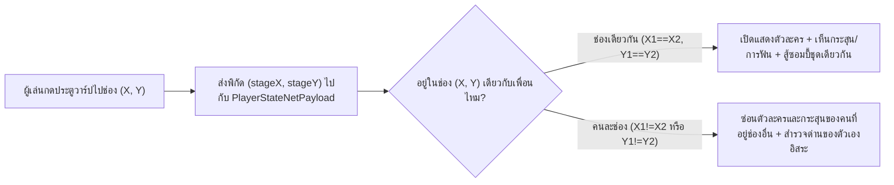

# สรุปบันทึกการพัฒนาเกม (Work Summary) - 22 พฤศจิกายน 2026

เอกสารฉบับนี้รวบรวมความคืบหน้าการพัฒนาโปรเจกต์ **The Last Empire** ประจำวันที่ 22 พฤศจิกายน 2026 บน Branch `multi-player-netcode` ครอบคลุมระบบ **Co-op Multiplayer 1–6 คน (LAN & Local Dual-Client)**, ระบบหน้าจอ **`Lobby_NetCode`** แบบผูก Reference ผ่าน Inspector 100%, ระบบตั้งชื่อผู้เล่น (`AccountName` / `ChangeNamePanel`) ในหน้า `MainMenu`, และระบบเดินสำรวจข้ามช่องพิกัด `(Stage X, Y)` แบบอิสระที่จะพบเจอกันเฉพาะเมื่ออยู่ในช่องพิกัดเดียวกัน

---

## 📑 สารบัญระบบที่พัฒนาและอัปเดตล่าสุด
1. [หน้าเมนูหลักรูปแบบใหม่ & ระบบตั้งชื่อผู้เล่น (MainMenu Offline/Online & Account Name)](#1-หน้าเมนูหลักรูปแบบใหม่--ระบบตั้งชื่อผู้เล่น-mainmenu-offlineonline--account-name)
2. [ระบบค้นหาห้องและห้องเตรียมตัว 6 คน (Lobby_NetCode Pure Inspector Reference UI)](#2-ระบบค้นหาห้องและห้องเตรียมตัว-6-คน-lobby_netcode-pure-inspector-reference-ui)
3. [ระบบเดินข้ามช่องพิกัด (Stage X, Y) แบบอิสระ & การพบเจอกันในช่องเดียวกัน](#3-ระบบเดินข้ามช่องพิกัด-stage-x-y-แบบอิสระ--การพบเจอกันในช่องเดียวกัน)
4. [ระบบซิงค์เกมเพลย์ Co-op 1–6 คน (Combat, Enemies, Anti-Dupe Loot, Buildings & Revive)](#4-ระบบซิงค์เกมเพลย์-co-op-16-คน-combat-enemies-anti-dupe-loot-buildings--revive)
5. [ซิงค์ระบบเก็บของจากรถ/กล่อง, ของดรอป, Building Destruction & Late-Entry Events](#5-ซิงค์ระบบเก็บของจากรถกล่อง-ของดรอป-building-destruction--late-entry-events)
6. [ระบบโยนของออกจากกระเป๋า (Drag-to-Drop Stacked Items & Manual [E] Pickup)](#6-ระบบโยนของออกจากกระเป๋า-drag-to-drop-stacked-items--manual-e-pickup)
7. [แก้บั๊ก Co-op (Portal Warp Trigger, Dual-Client Character/Seed Sync, Demolitionist SatchelVault & Overhead Name)](#7-แก้บั๊ก-co-op-portal-warp-trigger-dual-client-characterseed-sync-demolitionist-satchelvault--overhead-name)
8. [โมเดล 3D Chibi Anime NPC ใหม่ 3 ตัว & ระบบสร้างโมเดลตัวละครจาก Character SO เข้า PlayerPrefabs/Model](#8-โมเดล-3d-chibi-anime-npc-ใหม่-3-ตัว--ระบบสร้างโมเดลตัวละครจาก-character-so-เข้า-playerprefabsmodel)

---

## 1. หน้าเมนูหลักรูปแบบใหม่ & ระบบตั้งชื่อผู้เล่น (MainMenu Offline/Online & Account Name)

อัปเดตสคริปต์ [`MainMenuManager.cs`](file:///d:/Unity%20Game%20Project/Eruption/TheLastEmpire/TheLastEmpire/Assets/Scripts/Runtime/UI/MainMenuManager.cs) และ [`EmpireNetworkManager.cs`](file:///d:/Unity%20Game%20Project/Eruption/TheLastEmpire/TheLastEmpire/Assets/Scripts/Runtime/Network/Core/EmpireNetworkManager.cs):

* **ปุ่ม `PLAY OFFLINE` (`newGameBtn`) และ `ONLINE` (`onlineBtn`)**:
  - `PLAY OFFLINE`: ตัดการเชื่อมต่อออนไลน์ที่ค้างอยู่และเปิดหน้าต่างเลือกตัวละครเล่นคนเดียวตามปกติ
  - `ONLINE`: บันทึกชื่อผู้เล่นและ Fade เปลี่ยนซีนไปยัง `Lobby_NetCode`
* **ระบบตั้งชื่อผู้เล่นมุมขวาบน (`AccountName`, `ChangeNamePanel`, `ChangeNameButton`)**:
  - หากผู้เล่นยังไม่เคยตั้งชื่อ ระบบจะสุ่มรหัส 7 ตัวอักษร (เช่น `9CS51XE`) และบันทึกลง `PlayerPrefs` (`TLE_PlayerAccountName`)
  - **ตอนปกติ**: เปิดตา `AccountName` (`SetActive(true)`) และปิดตา `ChangeNamePanel` (`SetActive(false)`)
  - **เมื่อกดปุ่มเหลือง `ChangeNameButton`**: ปิดตา `AccountName` แล้วเปิดตา `ChangeNamePanel` พร้อมนำชื่อเก่ามาแสดงใน `Placeholder` แทนคำว่า `Enter text...`
  - **เมื่อตั้งชื่อเสร็จ (กดปุ่มเหลืองซ้ำ หรือกด Enter)**: บันทึกชื่อใหม่ ปิดตา `ChangeNamePanel` และเปิดตา `AccountName` พร้อมซิงค์ชื่อไปใช้เป็นชื่อผู้เล่นและชื่อห้องเมื่อสร้างห้องใน Lobby

---

## 2. ระบบค้นหาห้องและห้องเตรียมตัว 6 คน (`Lobby_NetCode` Pure Inspector Reference UI)

พัฒนาสคริปต์ UI สำหรับซีน `Lobby_NetCode.unity` โดยใช้ช่อง `[SerializeField]` ล้วน 100% เพื่อให้ลาก Reference ใน Inspector ได้โดยไม่ผูกติดกับชื่อ GameObject:

* **[`RoomThumbnailUI.cs`](file:///d:/Unity%20Game%20Project/Eruption/TheLastEmpire/TheLastEmpire/Assets/Scripts/Runtime/Network/UI/RoomThumbnailUI.cs)**:
  - แปะไว้ที่แถวห้อง `RoomThumbnail` ทั้ง 5 แถวใน `SelectRoomPanel`
  - แสดงชื่อห้อง (ใช้ชื่อหัวห้องโดยตรง), จำนวนผู้เล่น `1/6`, สถานะกุญแจล็อก, และปุ่ม `Join`
  - หากยังไม่มีใครสร้างห้องในวง LAN จะซ่อนแถวห้องทั้งหมด (`HideRow()`) ไม่ให้มีแถวห้องหลอกแสดงค้าง
* **[`RoomMemberSlotUI.cs`](file:///d:/Unity%20Game%20Project/Eruption/TheLastEmpire/TheLastEmpire/Assets/Scripts/Runtime/Network/UI/RoomMemberSlotUI.cs)**:
  - แปะไว้ที่การ์ดสมาชิก `MemberPrefabs` ทั้ง 6 ช่องใน `RoomInfoPanel`
  - **รูป Default ก่อนเลือกตัวละคร**: เมื่อเพิ่งสร้างห้องหรือเพิ่งกด Join เข้ามาจะแสดงรูป Default (เข็มทิศ) จนกว่าผู้เล่นจะกดเลือกตัวละคร
  - **ปุ่มสีเหลืองรูปประแจ (`selectCharacterButton`)**: แสดงและกดได้ **เฉพาะช่องของตัวเราเอง 1 ช่องเท่านั้น** เพื่อเปิดหน้าเลือกตัวละคร
  - **ปุ่มสีแดงกากบาท (`kickButton`)**: แสดงและกดได้ **เฉพาะหัวห้อง (Host)** บนช่องของลูกทีมคนอื่นเพื่อเตะออกจากห้อง
* **[`MultiplayerLobbyUI.cs`](file:///d:/Unity%20Game%20Project/Eruption/TheLastEmpire/TheLastEmpire/Assets/Scripts/Runtime/Network/UI/MultiplayerLobbyUI.cs)**:
  - เชื่อมต่อกับ [`CharacterDatabase.asset`](file:///d:/Unity%20Game%20Project/Eruption/TheLastEmpire/TheLastEmpire/Assets/Resources_Addressable/Database/CharacterDatabase.asset) เพียงช่องเดียวเพื่อดึงรูปโปรไฟล์ของตัวละครทั้ง 7 อาชีพ (`CHAR_01_Vanguard` ถึง `CHAR_07_Demolitionist`)
  - ปุ่ม **`ENTER WASTELAND`** มุมขวาบนแสดงข้อความบรรทัดเดียว (`ENTER WASTELAND`) และจำกัดสิทธิ์ให้ **หัวห้อง (Host)** กดเริ่มเกมได้เท่านั้น ส่วนจำนวนผู้เล่น `PLAYERS: 1/6` แสดงในบรรทัด Subtitle ใต้หัวข้อห้อง

---

## 3. ระบบเดินข้ามช่องพิกัด (Stage X, Y) แบบอิสระ & การพบเจอกันในช่องเดียวกัน

ปรับปรุง [`TransitionPortal.NetHook.cs`](file:///d:/Unity%20Game%20Project/Eruption/TheLastEmpire/TheLastEmpire/Assets/Scripts/Runtime/Network/Hooks/TransitionPortal.NetHook.cs), [`PlayerController.NetHook.cs`](file:///d:/Unity%20Game%20Project/Eruption/TheLastEmpire/TheLastEmpire/Assets/Scripts/Runtime/Network/Hooks/PlayerController.NetHook.cs), [`NetworkPlayerBridge.cs`](file:///d:/Unity%20Game%20Project/Eruption/TheLastEmpire/TheLastEmpire/Assets/Scripts/Runtime/Network/Bridges/NetworkPlayerBridge.cs), และ [`NetworkEnemyBridge.cs`](file:///d:/Unity%20Game%20Project/Eruption/TheLastEmpire/TheLastEmpire/Assets/Scripts/Runtime/Network/Bridges/NetworkEnemyBridge.cs):

* **แยกเดินข้ามช่องอิสระ**: เมื่อผู้เล่นคนใดเดินเข้า `TransitionPortal` จะย้ายเฉพาะผู้เล่นคนนั้นไปยังช่องพิกัด `(X, Y)` ถัดไปโดยไม่ดึงเพื่อนคนอื่นตามไปด้วย
* **อยู่ช่องเดียวกันถึงเจอกัน**: ซิงค์พิกัด `(stageX, stageY)` ใน `PlayerStateNetPayload`, `ProjectileFireNetPayload`, `MeleeAttackNetPayload`, และ `EnemyBatchSync`
* **แสดงพิกัดเพื่อนบน HUD ฝั่งขวา ([`PartyStatusHUD.cs`](file:///d:/Unity%20Game%20Project/Eruption/TheLastEmpire/TheLastEmpire/Assets/Scripts/Runtime/Network/UI/PartyStatusHUD.cs))**: ย้ายแถบสถานะปาร์ตี้ไปไว้ด้านขวาของหน้าจอ ไม่ให้บังเรดาร์ฝั่งซ้าย พร้อมแสดงพิกัดช่อง `(X,Y)` ของสมาชิกแต่ละคน เช่น `P1 • P4NDORA [REBEL] (64,64)`

---

## 4. ระบบซิงค์เกมเพลย์ Co-op 1–6 คน (Combat, Enemies, Anti-Dupe Loot, Buildings & Revive)

* **Owner-Authoritative Movement & 0ms Client Prediction**: ตัวละครของเราเดินและยิงลื่นไหลทันที 0ms พร้อมส่ง RPC กระสุนและการฟันให้เพื่อนที่อยู่ในช่องพิกัดเดียวกันเห็นตรงกัน
* **Multi-Target Enemy Aggro**: ศัตรูค้นหาผู้เล่นที่ยังมีชีวิตและอยู่ในช่องพิกัดเดียวกันที่ใกล้ที่สุดผ่าน `PlayerRegistry.GetClosestAlivePlayer` ทุก 0.3 วินาที
* **Co-op Downed & Revive**: เมื่อเลือดหมดในโหมดปาร์ตี้จะเข้าสถานะล้มรอชุบ 30 วินาที เพื่อนในทีมสามารถเดินเข้าไปกด `[E]` ค้าง 3 วินาทีในระยะ 2.4 เมตรเพื่อชุบชีวิตกลับมาที่เลือด 30%
* **Atomic Server Loot Claim & Shared Buildings**: ป้องกันการเก็บไอเทมชิ้นเดียวกันซ้ำ 100% (`NetworkLootManager`) และซิงค์การวางสิ่งปลูกสร้าง ระบบไฟฟ้า `PowerGridManager` รวมถึงหีบเก็บของส่วนกลาง (`NetworkBuildingSyncManager`)

---

## 5. ซิงค์ระบบเก็บของจากรถ/กล่อง, ของดรอป, Building Destruction & Late-Entry Events

* **การเก็บของจากรถ/กล่อง (`LootContainer` & `LootUI`)**:
  - ซิงค์การหยิบของจากรถ/กล่องด้วย `NetPacketType.ContainerLootSync` หาก A เปิด `LootUI` ค้างไว้แล้ว B หยิบของชิ้นนั้นไป ช่องไอเทมบนหน้าจอ A จะอัปเดตหายทันที
  - เก็บแคชสถานะรถ/กล่องที่ถูกรื้อไปแล้วข้ามด่าน (`_syncedContainerStates`) ทำให้ผู้เล่นที่เดินเข้าแมพทีหลังเห็นรถที่ถูกรื้อแล้วตรงกัน
* **ของดรอปจากศัตรู & การเก็บของในด่านเดี่ยว**:
  - เพิ่ม `NetPacketType.LootSpawnBroadcast` ให้ของดรอปจากซอมบี้แสดงตรงกันทั้ง Host และ Client
  - แก้ไข `NetworkDropId` ให้ผูกกับ `InitialSpawnPosition` เพื่อไม่ให้ ID เพี้ยนเมื่อไอเทมถูกแม่เหล็กดูดเข้าหาตัว และอนุญาตให้ Client เก็บของในด่านที่เดินอยู่คนเดียวได้
* **การรื้อสิ่งปลูกสร้าง & อีเวนต์สุ่มในด่าน (`BuildingDestroyBroadcast` & `StageEventBroadcast`)**:
  - ซิงค์การทำลาย/รื้อถอนสิ่งปลูกสร้างข้ามเครื่อง
  - ซิงค์ Random Stage Event ทั้งกรณีอยู่ด่านเดียวกัน, Client เข้าด่านคนเดียว, และกู้คืน Event ที่กำลังดำเนินอยู่ (บรรยากาศแสง/หมอก, `NomadTrader`, และไอเทมดรอปที่ยังเหลือบนพื้น) ให้เพื่อนที่ย้ายแมพเข้ามาทีหลัง

---

## 6. ระบบโยนของออกจากกระเป๋า (Drag-to-Drop Stacked Items & Manual `[E]` Pickup)

อัปเดต [`InventoryUI.cs`](file:///d:/Unity%20Game%20Project/Eruption/TheLastEmpire/TheLastEmpire/Assets/Scripts/Runtime/UI/InventoryUI.cs), [`CollectibleItem.cs`](file:///d:/Unity%20Game%20Project/Eruption/TheLastEmpire/TheLastEmpire/Assets/Scripts/Runtime/Combat/CollectibleItem.cs), และ [`NetworkLootManager.cs`](file:///d:/Unity%20Game%20Project/Eruption/TheLastEmpire/TheLastEmpire/Assets/Scripts/Runtime/Network/Bridges/NetworkLootManager.cs):

* **ลากออกนอก `InventoryPanel` เพื่อโยนลงพื้น**:
  - **ลากปกติ**: โยนออกจากกระเป๋าครั้งละ **1 ชิ้น**
  - **กด `Alt + ลาก`**: โยน **ทั้งหมดในช่อง** โดยสร้างไอเทมบนพื้นเพียง **1 ชิ้น** แต่เก็บจำนวนเต็ม (เช่น ยา `x100` เมื่อเก็บจะได้ครบ 100 ชิ้นทันที)
* **ไม่ดูดอัตโนมัติ — ต้องกด `[E]` เพื่อเก็บ**:
  - ไอเทมที่ผู้เล่นโยนทิ้งถูกตั้งค่า `ConfigureAsPlayerDroppedItem()` (`RequireManualPickup = true`) ปิดแม่เหล็กดูดเข้าตัวและแสดงป้าย `[E] Pick up <Item> x<Qty>` ให้ผู้เล่นเดินมากด `E` เก็บเอง
* **รองรับ Co-op Multiplayer**: ส่งคำขอโยนจาก Client -> Host ผ่าน `NetPacketType.ClientDropItemRequest` และกระจายให้เพื่อนในด่านเดียวกันเห็น/เก็บได้ตรงกัน

---

## 7. แก้บั๊ก Co-op (Portal Warp Trigger, Dual-Client Character/Seed Sync, Demolitionist SatchelVault & Overhead Name)

* **แก้บั๊ก A ยืนจุดวาร์ปแล้ว B กด `E` เก็บของแต่ B วาร์ปข้ามแมพ**:
  - แก้ [`TransitionPortal.cs`](file:///d:/Unity%20Game%20Project/Eruption/TheLastEmpire/TheLastEmpire/Assets/Scripts/Runtime/Map/TransitionPortal.cs) ให้ `OnTriggerEnter`/`OnTriggerExit` รับเฉพาะ Local Player (`!IsRemotePlayer`) พร้อมเช็คระยะห่างจาก Collider จริงซ้ำใน `IsPlayerInRange(this)`
  - แก้ Trigger แบบเดียวกันใน [`CampfireBuilding.cs`](file:///d:/Unity%20Game%20Project/Eruption/TheLastEmpire/TheLastEmpire/Assets/Scripts/Runtime/Building/CampfireBuilding.cs), [`FloorBuilding.cs`](file:///d:/Unity%20Game%20Project/Eruption/TheLastEmpire/TheLastEmpire/Assets/Scripts/Runtime/Building/FloorBuilding.cs), และ [`SanityAuraZone.cs`](file:///d:/Unity%20Game%20Project/Eruption/TheLastEmpire/TheLastEmpire/Assets/Scripts/Runtime/Environment/SanityAuraZone.cs)
* **แก้ Dual-Client & WorldSeed & ป้ายชื่อเหนือหัว**:
  - แยก `_sessionSelectedCharacterId` ต่อโปรเซสใน `CharacterDatabase.cs` ไม่ให้ 2 หน้าต่างทับตัวละครกัน, ซิงค์ `PendingMatchWorldSeed` ให้โลกตรงกัน 100%, ส่งดาเมจจาก Client ผ่าน `EnemyDamageRequest`, และแสดงชื่อผู้เล่นบนหัวผ่าน `PlayerPrefabs/Canvas/Text (TMP)` (`overheadNameText`)
* **แก้สกิล `SatchelVaultAbility` ของ Demolitionist (`CHAR_07_Demolitionist`)**:
  - กลิ้งไปข้างหน้า 4.5 เมตรพร้อมวาง C4 (ไม่โดน `FixedUpdate` ทับความเร็ว) และป้องกันแรงระเบิดไม่ให้โดนตัวเองหรือเพื่อนร่วมทีม

---

## 8. โมเดล 3D Chibi Anime NPC ใหม่ 3 ตัว & ระบบสร้างโมเดลตัวละครจาก Character SO เข้า `PlayerPrefabs/Model`

* **โมเดล 3D Chibi Anime NPC 3 ตัวใหม่ ([`Create_Custom_3_NPCs.py`](file:///d:/Unity%20Game%20Project/Eruption/TheLastEmpire/TheLastEmpire/Tools/Create_Custom_3_NPCs.py) & [`NpcCustomModelsAutoSync.cs`](file:///d:/Unity%20Game%20Project/Eruption/TheLastEmpire/TheLastEmpire/Assets/Scripts/Editor/NpcCustomModelsAutoSync.cs))**:
  - ปั้นด้วย Blender สไตล์ Toy-Chibi Anime (Rig 18 กระดูก `Chibi_Base_Rig` + 11 แอนิเมชัน + Texture ใบหน้า 1024×1024 / ผม 512×512 + URP Lit Material Remap อัตโนมัติ) แทนที่ 3 Prefab เดิมโดยรักษา GUID:
    1. **`NPC_Elena_Medic_Rigged`**: สาวสตรีทเทคผมบ๊อบดำ หูฟังเหลือง ตา X-Sparkle สีม่วง แจ็คเก็ตเหลือง `69` อาร์มหมี และเข็มขัดแดงพร้อมขวดน้ำยา 3 สี
    2. **`NPC_Maya_Scout_Rigged`**: สาวโกธิค `P4NDORA` ผมบ๊อบดำเรียบ ปากแดงเข้ม โช้คเกอร์ห่วงเงิน เดรสสั้นดำขอบระบาย สร้อยข้อมือจี้แดง และบูทดำหัวเข็มขัดเงิน
    3. **`NPC_Roy_Veteran_Rigged`**: สาวไซเบอร์เทคหางม้าสีฟ้า ตาสีม่วง ปลอกคอ `69` เสื้อครอปขาว ปลอกแขนดำ-เหลือง กางเกงขาสั้นแถบเหลือง และบูทสูงขอบเหลือง
* **ระบบสร้างโมเดลตัวละครผู้เล่นจาก SO โดยตรง ([`PlayerController.cs`](file:///d:/Unity%20Game%20Project/Eruption/TheLastEmpire/TheLastEmpire/Assets/Scripts/Runtime/Player/PlayerController.cs))**:
  - เมื่อเข้าเกม (หรือเพื่อนจอยเข้ามา) ระบบจะ `Instantiate` โมเดลจาก `CharacterData.characterModelPrefab` (`CHAR_01`–`CHAR_07`) เข้าใต้ `PlayerPrefabs/Model` โดยตั้งค่า `Position = (0, -0.6, 0)`, `Rotation = (0, 0, 0)`, `Scale = (0.7, 0.7, 0.7)`
  - ปิดตาโมเดลต้นแบบ (`Chibi_Base_Rigged`) อัตโนมัติ และย้ายชุดอาวุธ `Model/Malee` กับ `Model/Range` เข้ากระดูก `RightHand` พร้อมรีเซ็ต Local Transform (`0,0,0` / Scale `1,1,1`) ให้ถืออาวุธได้ครบทั้ง 18 ชิ้นทุกตัวละคร

---

## 9. รีโมเดล `ZombieSpitter`, `ZombieTank` และนำเข้า Pool + Spawn จริงใน `Gameplay_3D`

* รีโมเดล `ZombieSpitter` (ซอมบี้ผิวเข้มพังก์โมฮอว์ก + ผ้าคลุม + ท่าวิ่งเอนตัวไปข้างหน้า) และ `ZombieTank` (ซอมบี้ผิวเข้มกอลิล่าหลังค่อมแขนใหญ่สักลายทอง) พร้อมเพิ่มเข้า `ObjectPoolManager.pools`, `GameManager.spawnConfigs`, และ `RandomStageEventManager` Ambush Event
* จัดทำแผน `Docs/steam-ugs-cloud-architecture-plan.md`, `Docs/Project_Mayhem.md`, แตก Branch `feat/project-mayhem`, และซิงก์ `main`

---

## 10. รีโมเดล Alien 5 สายพันธุ์ (Smart, Hook, Normal, Invisible, Crawler) & ระบบล่องหน 3D

* **`AlienSmart`**: โดมหลอดไฟแก้วใส URP Transparent + สมองโตเต้นตุบๆ + 4 ขา 2 มือ + ตาเดียวสีเหลือง (โทนม่วง-น้ำเงิน-เขียวมะนาว)
* **`AlienHook`**: กะโหลกยาว + ฐานหนวด 8 เส้น + ตาเดียว + มือซ้ายก้ามยักษ์ยืดพุ่งคว้าได้ 2.75x (ผูก `Hook` กับ `AlienAI.ExecuteHookPull()`) และปรับสีโทน **`Panoptes`**
* **`AlienNormal`**: หัวโตไร้ตา ปากเขี้ยวใหญ่มีน้ำลายยืด ไม่มีขา ลำตัวยาวไปข้างหลังแบบ **จระเข้ไร้ขา** + ท่าคลานลากตัวด้วย 2 มือแบบ **ผีเทเกะเทเกะ (`Teke Teke`)**
* **`AlienInvisible`**: ตัวสูงผอมยาวสีดำสไตล์ **Enderman** (~2.92 ม.) ตาเดียวสีม่วง + หนวดหลังหัวแบบ **จอมมารบูยาวถึงก้น** + อัปเกรด `AlienAI.HandleInvisibilityFade()` ให้ล่องหนโมเดล 3D URP ได้จริง
* **`AlienCrawler`**: สัตว์คลาน 4 ขาขนสีน้ำตาล ตาเดียวโปน หางม้วน พร้อม **เล็บยาวมากทั้ง 4 เท้า** และ **ลิ้นแดงยาวพิเศษ** ริก 3 ข้อ

---

## 11. รีโมเดลบอสซอมบี้ (Slash Top-Hat + ปรสิตหนวดปลาหมึกชมพู), แก้ผิวดินน้ำมันศัตรูทุกตัว & เร่งท่าวิ่งศัตรูสายไว +30%

* **`ZombieLeader` (Boss)**: รีโมเดลเป็น **ร็อคสตาร์ซอมบี้หมวกทรงสูง (Slash Top-Hat + ผมหยิกดำฟู + แว่นกันแดด + แขนกอลิล่าใหญ่ 2 ข้าง ไม่มีกีตาร์ + เดินหลังค่อม + ปรสิตหนวดปลาหมึกสีชมพูเนื้อ/เลือดหมู 8 เส้นบนหลัง)** พร้อมสกิล **เสกลูกน้อง + กระโดดวิถีโค้ง (`Leap`) + พ่นกรด (`Spit`) + Ground Stomp**
* **`ZombieTank`**: รับสกิลบอสเดิมทั้งหมด (**Charge Rush + Ground Stomp AOE + Rage Mode** ยกเว้นเสกลูกน้อง) และใช้โมเดลบอสเดิม (`Chibi_ZombieBoss_Legacy_Rigged.fbx`) โดยเก็บโมเดล `Chibi_ZombieTank_Rigged.fbx` เดิมไว้ครบถ้วน
* **แก้ Texture ผิวดินน้ำมันศัตรูทุกตัว**: สร้าง Triplanar PBR Shader (`TheLastEmpire_EnemyDetailLit.shader`) + สคริปต์สร้าง Texture & Normal Map 512×512 6 ชุด (`EnemyPbrMaterialUpgrader.cs`) อัปเกรด Material ศัตรูทุกตัวทั้ง Zombies, Aliens, และ Robots
* **เร่งท่า Walk/Run ศัตรูสายไว +30%**: ปรับ `BaseEnemyAI.cs` เร่ง `enemyAnimator.speed = 1.30f` อัตโนมัติเวลาเคลื่อนที่สำหรับศัตรูสายไว (`moveSpeed >= 3.5f`)

---

## 12. ปรับสมดุล Combat (HP, Projectile Speed, Gunner Burst) & มาตรฐาน `Name_text` / `Health_text`

* **ความเร็วกระสุนศัตรู**: ปรับ `Projectile.speed` เริ่มต้นและกระสุนศัตรูทุกประเภทเป็น **`50f`** เท่ากระสุนผู้เล่น (`BulletPrefabs.prefab`)
* **`RobotGunner`**: ยิงชุด **Burst ทีละ 5 นัด** แล้วสุ่มเว้นช่วง **`1 - 3 วินาที`** ก่อนยิงชุดถัดไป
* **ปรับสมดุลเลือดศัตรู**: บอสทุกตัว (**×2**), ศัตรูทั่วไป (**+30%**), **ยกเว้น `ZombieBoomer`** (คงเดิม 500)
* **มาตรฐาน `Name_text` / `Health_text`**: ปรับครบทั้ง 24 Prefab (`Width 300, Height 50`, `Teko SDF`, `Bold`, `Auto Size 18–36`, สีขาว, ล้างข้อความค้าง)
