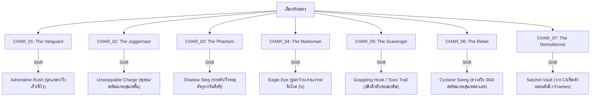

# เอกสารออกแบบตัวละคร (Character Design Document - GDD)

**ชื่อโปรเจกต์:** The Last Empire  
**ประเภทเอกสาร:** Character Systems, Lore & Playable Roster Design  
**วันที่จัดทำ / อัปเดตล่าสุด:** 11 พฤศจิกายน 2026  
**สถานะ:** Official Release Version 2.1 (ครบทั้ง 7 Playable Operatives พร้อมโมเดล 3D Chibi Rigged ครบชุดและ Amnesia Lore)

---

## 📖 1. ภาพรวมระบบตัวละครและเนื้อเรื่อง (Character System & Lore Overview)

ระบบตัวละครใน **The Last Empire** ออกแบบตามแนวทาง **Roguelite Action-Survival** โดยให้ผู้เล่นสามารถเลือกเล่นตัวละครที่มีจุดเด่น, จุดด้อย, ค่าสถานะพื้นฐาน (Base Stats), และความสามารถเฉพาะตัวที่แตกต่างกันอย่างชัดเจน เพื่อส่งเสริมความหลากหลายในการเล่น (Replayability)

### 🧠 กลไกฟื้นความทรงจำเมื่อตื่นขึ้น (Amnesia Awakening System)
ทุกตัวละครเป็นนักรบดัดแปลงของจักรวรรดิที่ถูกสร้างขึ้นเพื่อสู้กับเอเลี่ยน ก่อนจะเกิดเหตุเตาปฏิกรณ์ระเบิดและโลกล่มสลาย ทำให้ทุกคนตื่นขึ้นมากลางซากปรักหักพังพร้อมภาวะสูญเสียความทรงจำชั่วคราว (Amnesia) — อ่านปูมหลังโลกและเนื้อเรื่องหลักฉบับเต็มได้ที่ [GDD/story-lore.md](story-lore.md)
* เมื่อเลือกตัวละครในหน้าเมนูหลัก **Character Select Modal** ระบบจะแสดง:
  * **Lore Synopsis:** ปูมหลังและประวัติก่อนเกิดหายนะ
  * **Awakening Clue:** เบาะแสความคิดแรกในหัวขณะลืมตาตื่น
* เมื่อเข้าสู่ฉากเกมเพลย์ แถบ **Amnesia Awakening Banner** จะลอยขึ้นบนหน้าจอเป็นเวลา 6 วินาที พร้อมข้อความความคิดในหัวของตัวละคร เพื่อปูเรื่องราวและเป้าหมายของแต่ละคน

### ⚡ แกนหลักการควบคุม: Signature Shift Active Ability
ในเกมเพลย์ปกติ ปุ่ม **`Shift`** จะถูกยกระดับจากการเป็นเพียงการ "วิ่งเร็ว (Sprint)" ธรรมดา มาเป็น **ปุ่มกดใช้งานความสามารถเฉพาะตัว (Signature Ability)** ของตัวละครแต่ละตัว โดยแต่ละคลาสจะมีปฏิกิริยาและเอฟเฟกต์เฉพาะตัวเมื่อกดปุ่ม Shift

### 🔄 ความสัมพันธ์กับระบบความหิว (Hunger-Cost Synergy)
ความสามารถ Shift จะผสานเข้ากับ Loop การเอาชีวิตรอดโดยตรง:
* **การเผาผลาญความหิว (Hunger Drain):** ขณะใช้งานหรือเปิดโหมด Shift จะเร่งการลดลงของเกจความหิว ($\text{Hunger Rate} \times 2$ หรือ $\times 3$)
* **ทรัพยากรสองบทบาท:** อาหาร (Bread/Rations) จึงไม่ได้มีไว้เพียงประทังชีวิต แต่ทำหน้าที่เสมือน **"หลอดมานา/พลังงาน"** ในการร่ายสกิล Shift อีกด้วย

---

## 👥 2. รายชื่อตัวละครทั้งหมด 7 ตัว (Playable Operatives A - G)

---

### 🛡️ Character A (CHAR_01): "The Vanguard" (Imperial Vanguard)
* **ฉายา:** ผู้พิทักษ์แห่งจักรวรรดิ (Imperial Vanguard)
* **หมวดหมู่ / บทบาท:** All-Rounder / Frontline (สายสมดุล / ลุยประจัญบาน)
* **ธีมสี UI:** สีส้มแสด (`#F28C26`)
* **เนื้อเรื่องย่อ (Lore Synopsis):** ทหารผ่านศึกผู้ช่ำชองการต่อสู้แห่งกองรักษาการณ์จักรวรรดิ ตื่นขึ้นมาท่ามกลางซากปรักหักพังของค่ายทหาร โดยยังมีคำสัตย์ปฏิญาณของกองพันดังก้องอยู่ในหัว
* **บทพูดตอนฟื้นความทรงจำ (Amnesia Clue):**
  > *"My head is pounding... Where is the squad? My rifle's still primed. I have to reach the inner citadel before everything collapses."*  
  > *(หัวฉันปวดตุบๆ... หมวดของฉันอยู่ไหนกันหมด? ปืนไรเฟิลยังขึ้นลำอยู่ ฉันต้องบุกไปให้ถึงป้อมปราการชั้นในให้ได้ก่อนที่ทุกอย่างจะพังทลาย)*

#### ค่าสถานะพื้นฐาน (Base Stats)
| ค่าสถานะ | ตัวเลข | คำอธิบาย |
|---|---|---|
| **Max HP** | 100 | ค่ามาตรฐาน |
| **Max Hunger** | 100 | ค่ามาตรฐาน |
| **Move Speed** | 5.0 m/s | ความเร็วการเดินปกติ |
| **Base Melee Damage** | 10 | ดาเมจมือเปล่ามาตรฐาน |
| **Base Ranged Damage** | 10 | ดาเมจพื้นฐานปืน |
| **Hunger Consumption** | 1.0x | อัตราเผาผลาญอาหารปกติ |
| **Inventory Slots** | 24 ช่อง | ขนาดกระเป๋าเป้มาตรฐาน |
| **Starting Loadout** | Rifle + Knife, Medium Ammo x60, Rations x2, 100 Gold |

#### ⚡ ความสามารถ Shift: `Adrenaline Rush (อะดรีนาลีนสูบฉีด)`
* **ประเภท:** Toggle / Channeling (กดค้างขณะเคลื่อนที่)
* **การทำงาน:** 
  * ความเร็วเคลื่อนที่เพิ่มขึ้นเป็น **1.75 เท่า**
  * ความเร็วในการโจมตีระยะประชิด (Attack Speed) และความเร็วในการยิง (Fire Rate) เพิ่มขึ้น **+30%**
  * ลดความเสียหายทุกชนิดที่ได้รับลง **20%**
* **ข้อจำกัด (Cost):** ลดค่าความหิวไวขึ้น $2.5\times$ ขณะเปิดใช้งาน
* **Passive Trait:** `Battle Hardened` — ดาเมจจากอาวุธทุกชนิดเพิ่มขึ้น +10%

---

### 🔨 Character B (CHAR_02): "The Juggernaut" (Ironbound Behemoth)
* **ฉายา:** ยักษ์ใหญ่เกราะเหล็ก (Ironbound Behemoth)
* **หมวดหมู่ / บทบาท:** Melee Brawler / Tank (สายชนปะทะ / มนุษย์รถถัง)
* **ธีมสี UI:** สีแดงเพลิงเข้ม (`#EB3838`)
* **เนื้อเรื่องย่อ (Lore Synopsis):** ร่างทดลองดัดแปลงพันธุกรรมเหล็กกล้า ฟื้นขึ้นมาจากซากโรงหล่อใต้ดิน ขับเคลื่อนด้วยไฟแค้นที่มีต่อจักรวรรดิที่นำร่างเขาไปทดลองทรมาน
* **บทพูดตอนฟื้นความทรงจำ (Amnesia Clue):**
  > *"The chains are shattered... What did they do to my flesh? I feel no pain anymore. I will smash through anything in my path."*  
  > *(โซ่ตรวนขาดสะบั้นแล้ว... พวกมันทำอะไรกับร่างกายของฉัน? ฉันไม่รู้สึกถึงความเจ็บปวดใดๆ อีกต่อไป ใครหน้าไหนขวางทาง ฉันจะบดขยี้ให้แหลก)*

#### ค่าสถานะพื้นฐาน (Base Stats)
| ค่าสถานะ | ตัวเลข | คำอธิบาย |
|---|---|---|
| **Max HP** | 150 | พลังชีวิตสูงเป็นพิเศษ (+50%) |
| **Max Hunger** | 120 | อิ่มนานขึ้น |
| **Move Speed** | 4.3 m/s | เคลื่อนที่ช้ากว่าปกติ (-14%) |
| **Base Melee Damage** | 15 | หมัดหนักกว่าตัวอื่น (+50%) |
| **Base Ranged Damage** | 8 | ยิงปืนไม่แม่นยำเท่าที่ควร (-20%) |
| **Hunger Consumption** | 1.2x | ร่างใหญ่ต้องการพลังงานสูง |
| **Inventory Slots** | 28 ช่อง | กระเป๋าขนาดใหญ่ |
| **Starting Loadout** | Sledgehammer + Shotgun, Shotgun Ammo x20, Rations x2, 50 Gold |

#### ⚡ ความสามารถ Shift: `Unstoppable Charge (พุ่งชนไร้ต้าน)`
* **ประเภท:** Active Charge (กด Shift เพื่อพุ่งทะลวง 1.5 วินาที, Cooldown 5 วินาที)
* **การทำงาน:** 
  * พุ่งชนไปข้างหน้าด้วยความเร็วสูง สร้างดาเมจชน 25 หน่วย และผลักศัตรูทั้งหมดที่ขวางทางให้กระเด็น พร้อมทำให้ศัตรูติด Stun ชะงัก 1.0 วินาที
  * ระหว่างพุ่งชน ด้านหน้า 180 องศาจะ **บล็อกและสะท้อนกระสุนปืนทั้งหมด 100%**
* **Passive Trait:** `Thick Skin` — ลดดาเมจกายภาพลงถาวร 15% และมีภูมิคุ้มกันต่อการชะงัก (Stagger Immunity) จากศัตรูทั่วไป

---

### 🗡️ Character C (CHAR_03): "The Phantom" (Shadow Assassin)
* **ฉายา:** นักฆ่ามิติเงา (Shadow Assassin)
* **หมวดหมู่ / บทบาท:** Hit-and-Run / Assassin (ลอบเร้น / แทงข้างหลัง)
* **ธีมสี UI:** สีม่วงนีออน (`#A855F7`)
* **เนื้อเรื่องย่อ (Lore Synopsis):** มือสังหารลับแห่งหน่วยจู่โจมเงา ตื่นขึ้นมาในเงามืดของตรอกซากเมือง พร้อมภารกิจลับที่ถูกเข้ารหัสไว้เพื่อกำจัดบุคคลสำคัญของจักรวรรดิ
* **บทพูดตอนฟื้นความทรงจำ (Amnesia Clue):**
  > *"My target... Where is the doctor? Why did the Empire want him silenced? There are dark secrets buried beneath this ruins."*  
  > *(เป้าหมายของฉัน... ด็อกเตอร์อยู่ที่ไหน? ทำไมจักรวรรดิถึงต้องการปิดปากเขา? มีความลับอันดำมืดถูกฝังซ่อนอยู่ใต้ซากเมืองนี้)*

#### ค่าสถานะพื้นฐาน (Base Stats)
| ค่าสถานะ | ตัวเลข | คำอธิบาย |
|---|---|---|
| **Max HP** | 75 | เปราะบาง เลือดน้อย (-25%) |
| **Max Hunger** | 90 | กระเพาะเล็ก หิวง่าย |
| **Move Speed** | 6.0 m/s | เคลื่อนที่ไวที่สุดในกลุ่ม (+20%) |
| **Base Melee Damage** | 12 | ฟันประชิดคล่องแคล่ว |
| **Base Ranged Damage** | 10 | มาตรฐาน |
| **Dash Distance / CD** | พุ่งไกลขึ้น +25%, คูลดาวน์ 0.55s |
| **Inventory Slots** | 18 ช่อง | กระเป๋าขนาดกะทัดรัด เน้นความคล่องตัว |
| **Starting Loadout** | Katana + Pistol, Light Ammo x40, Rations x2, 150 Gold |

#### ⚡ ความสามารถ Shift: `Shadow Step (ก้าวมิติเงา)`
* **ประเภท:** Channeling / Ghost State (กด Shift ค้างเพื่อวิ่งในร่างเงา)
* **การทำงาน:** 
  * เข้าสู่ร่างเงาโปร่งแสง เพิ่มความเร็ววิ่งขึ้นอีก 40%
  * **Phase Through Enemies:** วิ่งทะลุผ่านตัวมอนสเตอร์ได้โดยตรง ไม่ติดบล็อก และไม่โดนชนดาเมจสัมผัส
  * **Shadow Strike:** การโจมตีแรกสุดหลังจากปล่อยปุ่ม Shift จะการันตี **ติดคริติคอล 100% (Critical Damage 2.0x)**
* **ข้อจำกัด (Cost):** กินค่าความหิวฮวบฮาบ ($2.5\times$)
* **Passive Trait:** `Elusive` — มีโอกาส 15% ที่จะหลบหลีกการโจมตี (Dodge) ทุกชนิดได้ฟรีโดยไม่เสียเลือด

---

### 🎯 Character D (CHAR_04): "The Marksman" (Apex Sharpshooter)
* **ฉายา:** พลแม่นปืนเนตรอินทรี (Apex Sharpshooter)
* **หมวดหมู่ / บทบาท:** Long-Range / Tactical (ยิงไกล / คุมระยะ)
* **ธีมสี UI:** สีฟ้าเทอร์ควอยซ์ (`#00BFFF`)
* **เนื้อเรื่องย่อ (Lore Synopsis):** พลแม่นปืนประจำหน่วยรบพิเศษ ตื่นขึ้นมาบนยอดหอสังเกตการณ์ร้าง และยังจำภาพวินาทีที่เตาปฏิกรณ์ระเบิดผ่านลำกล้องสไนเปอร์ได้อย่างแม่นยำ
* **บทพูดตอนฟื้นความทรงจำ (Amnesia Clue):**
  > *"Through my scope that day... The one who flipped the switch wasn't an invader. It was an Imperial officer! I will uncover the betrayal."*  
  > *(ผ่านกล้องเล็งในวันนั้น... คนที่สับสวิตช์ไม่ใช่ผู้รุกราน แต่เป็นนายทหารของจักรวรรดิเอง! ฉันจะต้องเปิดโปงการทรยศนี้ให้ได้)*

#### ค่าสถานะพื้นฐาน (Base Stats)
| ค่าสถานะ | ตัวเลข | คำอธิบาย |
|---|---|---|
| **Max HP** | 85 | ค่อนข้างเปราะบาง |
| **Max Hunger** | 100 | มาตรฐาน |
| **Move Speed** | 4.8 m/s | ปานกลาง |
| **Base Melee Damage** | 7 | สู้ประชิดตัวอ่อนแอ (-30%) |
| **Base Ranged Damage** | 14 | ยิงปืนแรงเป็นพิเศษ (+40%) |
| **Crit Chance Bonus** | +25% (Base Crit รวม 35%) |
| **Inventory Slots** | 20 ช่อง | ขนาดกลาง |
| **Starting Loadout** | Sniper Rifle + Revolver, Medium x20, Light x20, Rations x2, 80 Gold |

#### ⚡ ความสามารถ Shift: `Eagle Eye (เนตรอินทรีเพ่งเล็ง)`
* **ประเภท:** Tactical Stance (กด Shift ค้างเพื่อเข้าสู่ท่ายิงประณีต)
* **การทำงาน:** 
  * มุมมองกล้องจะขยายกว้างขึ้นทันที (Camera Zoom Out 1.35x) มองเห็นศัตรูในจอได้ไกลขึ้น
  * **Attack Radius (ระยะยิงปืน) เพิ่มขึ้นเป็น 2 เท่า**
  * กระสุนที่ยิงออกไปขณะกด Shift จะมีคุณสมบัติ **เจาะทะลุ (Piercing)** ศัตรูทั้งหมดในแนวยิง
* **ข้อจำกัด (Cost):** ความเร็วในการเดินลดลงเหลือ 35% ขณะเล็ง
* **Passive Trait:** `Deadly Distance` — การยิงเป้าหมายที่อยู่ห่างออกไปเกิน 5 เมตร จะสร้างความเสียหายแรงขึ้น +25%

---

### 🧪 Character E (CHAR_05): "The Scavenger" (Wasteland Nomad)
* **ฉายา:** คนจรจัดแดนรกร้าง (Wasteland Nomad)
* **หมวดหมู่ / บทบาท:** Survivalist / Trapper (สายฟาร์ม / เอาชีวิตรอด / ปั่นป่วน)
* **ธีมสี UI:** สีเขียวใบตอง (`#40D973`)
* **เนื้อเรื่องย่อ (Lore Synopsis):** คนจรจัดคลุมฮู้ดแห่งแดนรกร้าง ผู้ลักลอบผ่านกำแพงเมืองเข้ามาคุ้ยหาเศษเสบียง แต่ติดอยู่ท่ามกลางซากเมืองที่ล่มสลาย
* **บทพูดตอนฟื้นความทรงจำ (Amnesia Clue):**
  > *"My stomach is burning with hunger... Need to find bread or scraps first. Forget the Empire, I just need to blast the city gates open and survive."*  
  > *(ท้องฉันแสบไปหมดด้วยความหิว... ต้องหาขนมปังหรือเศษอาหารก่อน ช่างหัวจักรวรรดิปะไร ฉันแค่ต้องระเบิดประตูเมืองออกไปให้รอดเท่านั้น)*

#### ค่าสถานะพื้นฐาน (Base Stats)
| ค่าสถานะ | ตัวเลข | คำอธิบาย |
|---|---|---|
| **Max HP** | 90 | ปานกลาง |
| **Max Hunger** | 110 | ทนหิวได้ดี (อัตรากินหิวช้าลง 0.85x) |
| **Move Speed** | 5.2 m/s | วิ่งคล่องตัว |
| **Drop Rate Bonus** | +25% | มอนสเตอร์ดรอปของบ่อยขึ้น |
| **Money Multiplier** | +30% | เก็บเงินได้จำนวนมากขึ้น |
| **Inventory Slots** | 30 ช่อง | ช่องกระเป๋าเยอะที่สุดในเกม |
| **Starting Loadout** | Crossbow + Survival Spear, Bolts x25, Rations x2, 300 Gold |

#### ⚡ ความสามารถ Shift: `Grappling Hook (สลิงเกี่ยวทะยาน)`
* **ประเภท:** Active Mobility (คูลดาวน์ 3.0s)
* **การทำงาน:** 
  * ยิงสลิงเส้นลวดเกี่ยวสิ่งปลูกสร้าง, กำแพง หรือสิ่งกีดขวางในระยะ 18 เมตร แล้วดึงตัวผู้เล่นพุ่งเข้าหาจุดที่เกี่ยวอย่างรวดเร็ว (ความเร็ว 22 m/s)
  * เหมาะสำหรับการหลบหนีฝูงซอมบี้ที่ล้อมตัว หรือข้ามสิ่งกีดขวางอย่างฉับพลัน
* **Passive Trait:** `Gourmet Scavenger` — การกินอาหาร (เช่น Bread) นอกจากจะเพิ่มค่าความหิวแล้ว จะช่วยฟื้นฟูเลือดแถมให้อีก 10 HP ทันที

---

### 🏏 Character F (CHAR_06): "The Rebel" (Anarchist Brawler)
* **ฉายา:** สาวพังก์นักจลาจล (Anarchist Brawler)
* **หมวดหมู่ / บทบาท:** Brawler / Close Quarters (สายลุยระยะประชิด / กราดปะทะ)
* **ธีมสี UI:** สีชมพูช็อกกิ้งพิงก์ (`#FA3366`)
* **โมเดลประจำตัว:** `Chibi_PunkGirl_Rigged.fbx`
* **เนื้อเรื่องย่อ (Lore Synopsis):** อดีตสาวพังก์นักจลาจลแห่งแดนรกร้าง ถืออาวุธดัดแปลงติดหนาม ตื่นขึ้นมาท่ามกลางสิ่งกีดขวางบาร์ที่คุกรุ่น พร้อมท้าชนทั้งทหารจักรวรรดิและฝูงซอมบี้
* **บทพูดตอนฟื้นความทรงจำ (Amnesia Clue):**
  > *"Ugh, that blast gave me a ringing headache... Where's my bat? If the Empire thinks they can chain me down, they're in for a bloody surprise!"*  
  > *(อึ้ก แรงระเบิดทำเอาหัวฉันอื้อไปหมด... ไม้เบสบอลฉันอยู่ไหน? ถ้าพวกจักรวรรดิคิดว่าจะล่ามโซ่ฉันได้ล่ะก็ พวกมันเตรียมตัวเจอนองเลือดได้เลย!)*

#### ค่าสถานะพื้นฐาน (Base Stats)
| ค่าสถานะ | ตัวเลข | คำอธิบาย |
|---|---|---|
| **Max HP** | 110 | อึดกว่าตัวทั่วไป (+10%) |
| **Max Hunger** | 100 | มาตรฐาน |
| **Move Speed** | 5.2 m/s | ว่องไวคล่องตัว |
| **Base Melee Damage** | 16 | หมัดและอาวุธประชิดแรงมาก |
| **Base Ranged Damage** | 8 | ยิงปืนไม่ชำนาญ |
| **Crit Bonus** | +15% Chance, +0.4x Multiplier |
| **Inventory Slots** | 22 ช่อง | ขนาดมาตรฐานสายสู้ |
| **Starting Loadout** | Baseball Bat + Shotgun, Shotgun Ammo x24, Rations x2, 120 Gold |

#### ⚡ ความสามารถ Shift: `Cyclone Swing (ควงสวิง 360 ไต้ฝุ่น)`
* **ประเภท:** Active Channeled (กด Shift หมุนตัว 1.2 วินาที, คูลดาวน์ 4.5 วินาที)
* **การทำงาน:** 
  * หมุนตัวควงอาวุธฟาดรอบทิศทาง 360 องศา รัศมี 2.4 เมตร ทำดาเมจต่อเนื่องครั้งละ 22 หน่วย และผลักศัตรูกระเด็นไกล (Knockback 12)
  * **สะท้อนกระสุนปืนทั้งหมด** ที่ยิงเข้ามาใส่ระหว่างหมุน
  * **ได้รับดาเมจเบาลง 40%** ขณะหมุนตัว
* **Passive Trait:** `Frenzy` — เมื่อพลังชีวิตลดลงต่ำกว่า 50% จะเข้าสู่โหมดคลั่ง ตีเร็วขึ้น +35% และเพิ่มคริติคอล +25%, การสังหารศัตรูด้วยการโจมตีระยะประชิดจะช่วยฟื้นฟูค่าความหิว +3.0 ต่อตัว

---

### 💣 Character G (CHAR_07): "The Demolitionist" (Pyrotechnic Saboteur)
* **ฉายา:** ผู้เชี่ยวชาญการก่อวินาศกรรม (Pyrotechnic Saboteur)
* **หมวดหมู่ / บทบาท:** Trapper / Area Denial (ผู้เชี่ยวชาญระเบิดและกับดัก)
* **ธีมสี UI:** สีส้มเพลิงระเบิด (`#F5730D`)
* **โมเดลประจำตัว:** `Chibi_TacticalGirl_Rigged.fbx`
* **เนื้อเรื่องย่อ (Lore Synopsis):** อดีตผู้เชี่ยวชาญสรรพาวุธของจักรวรรดิที่แปรพักตร์ ตื่นขึ้นมาในหลุมระเบิดของคลังแสงที่พังทลาย ล้อมรอบด้วยวัตถุระเบิดที่ยังไม่ทำงาน
* **บทพูดตอนฟื้นความทรงจำ (Amnesia Clue):**
  > *"Careful where you step... that timer's still ticking. The depot was sabotaged from the inside. Whoever blew the blast doors won't escape my payload."*  
  > *(ระวังที่ก้าวหน่อย... ตัวจับเวลายังคงเดินอยู่ คลังแสงนี้ถูกระเบิดทำลายจากข้างใน ใครก็ตามที่สั่งระเบิดประตูนิรภัย มันจะไม่รอดจากระเบิดของฉันแน่)*

#### ค่าสถานะพื้นฐาน (Base Stats)
| ค่าสถานะ | ตัวเลข | คำอธิบาย |
|---|---|---|
| **Max HP** | 105 | ทนทานปานกลาง |
| **Max Hunger** | 105 | ปานกลาง |
| **Move Speed** | 4.9 m/s | ปานกลาง |
| **Base Melee Damage** | 11 | มาตรฐาน |
| **Base Ranged Damage** | 12 | ยิงปืนได้ดี |
| **Inventory Slots** | 26 ช่อง | มีช่องใส่วัตถุดิบระเบิดเพิ่ม |
| **Starting Loadout** | Fire Axe + Revolver, Light Ammo x36, Rations x2, 90 Gold |

#### ⚡ ความสามารถ Shift: `Satchel Vault (วางกับระเบิด C4 ดีดตัว)`
* **ประเภท:** Active Escape & Trap (คูลดาวน์ 5.0 วินาที)
* **การทำงาน:** 
  * ปักวางกระเป๋ากับระเบิด C4 Satchel Charge ลงบนพื้น และดีดตัวพุ่งถอยหลังไป 4.5 เมตรอย่างรวดเร็ว พร้อมสถานะอมตะ (I-Frames) ป้องกันดาเมจระหว่างถอย
  * กับระเบิดจะพร้อมทำงานใน 0.3 วินาที และจะระเบิดทันทีเมื่อศัตรูเดินเข้ามาใกล้ หรือทำงานอัตโนมัติใน 2.5 วินาที
  * สร้างดาเมจระเบิดวงกว้าง **65 AOE Damage** รัศมี 4.5 เมตร พร้อมทำให้ศัตรูติด **Stun ชะงัก 1.2 วินาที**
* **Passive Trait:** `Blast Shield` — ลดดาเมจจากแรงระเบิดทุกชนิดที่ได้รับลง 60%, เพิ่มดาเมจอาวุธระเบิด +20% และเพิ่มรัศมีระเบิดของตัวเอง +30%

---

## 📊 3. ตารางเปรียบเทียบค่าสถานะทั้ง 7 ตัวละคร (Stat Matrix Comparison)

| ตัวละคร | Max HP | Move Speed | Melee Dmg | Ranged Dmg | Slots | จุดเด่นหลัก | Signature Shift Ability |
|---|:---:|:---:|:---:|:---:|:---:|---|---|
| **A: Vanguard** | 100 | 5.0 m/s | 10 | 10 | 24 | สมดุลรอบด้าน | `Adrenaline Rush` (เร่งสปีด+ตีไว+ลดดาเมจ) |
| **B: Juggernaut** | 150 | 4.3 m/s | 15 | 8 | 28 | ถึก, หมัดหนัก, ต้านชะงัก | `Unstoppable Charge` (พุ่งชนสตั๊น+สะท้อนกระสุน) |
| **C: Phantom** | 75 | 6.0 m/s | 12 | 10 | 18 | ว่องไว, ทะลุศัตรู, การันตีคริ | `Shadow Step` (วิ่งทะลุมอน+คริติคอล 100%) |
| **D: Marksman** | 85 | 4.8 m/s | 7 | 14 | 20 | ยิงไกล, เจาะเกราะ, คริแรง | `Eagle Eye` (ซูมกว้าง+ระยะยิง 2x+เจาะทะลุ) |
| **E: Scavenger** | 90 | 5.2 m/s | 10 | 10 | 30 | ฟาร์มของไว, กระเป๋าใหญ่สุด | `Grappling Hook` (ยิงสลิงโหนทะยานหลบหนี) |
| **F: Rebel** | 110 | 5.2 m/s | 16 | 8 | 22 | ฟันประชิดหนัก, โหมดคลั่ง | `Cyclone Swing` (ควงสวิง 360 สะท้อนกระสุน) |
| **G: Demolitionist** | 105 | 4.9 m/s | 11 | 12 | 26 | เชี่ยวชาญระเบิด, ดีดตัวอมตะ | `Satchel Vault` (วางกับระเบิด C4+ดีดตัว I-Frames) |

---

## 💻 4. โครงสร้างการเชื่อมต่อกับระบบโค้ดและ UI (Technical Architecture)

1. **ScriptableObject `CharacterData.cs`** ภายใต้ `Assets/Scripts/Runtime/Data/` เก็บข้อมูล Identity, Lore, Amnesia Clue, สเตตัส, สกิล Shift และ Starting Loadout
2. **Database Asset `CharacterDatabase.asset`** ภายใต้ `Assets/Resources_Addressable/Database/` บรรจุลิสต์ของตัวละครทั้ง 7 ตัวไว้เป็นคลังกลาง
3. **Character Asset Creator `CharacterAssetCreator.cs`** ภายใต้ `Assets/Scripts/Editor/` ทำหน้าที่การันตีความถูกต้องของสเตตัสและข้อความเนื้อเรื่องใน Inspector อัตโนมัติ
4. **UI Menu `CharacterSelectUI.cs`** แสดงข้อความปูมหลัง Lore Synopsis, ข้อความฟื้นความทรงจำ Amnesia Waking Clue, สเตตัส และปุ่มเลือกตัวละคร
5. **HUD In-Game `PlayerHUD.cs`** ทำหน้าที่ดึง `amnesiaWakingClue` ของตัวละครที่เลือก มาเปิดแสดงผลเป็นแบนเนอร์ความทรงจำลอยกลางฉากเป็นเวลา 6 วินาทีเมื่อเริ่มเกม

---

## 🎨 5. รายการโมเดล 3D ตัวละคร Rigged ทั้งหมด (3D Rigged Character Models & Prefabs)

โมเดลตัวละคร 3D ทั้งหมดในโปรเจกต์ใช้โครงกระดูกมาตรฐาน 18 ชิ้น (`Chibi_Base_Rig`: `Root`, `Hips`, `Spine`, `Chest`, `Neck`, `Head`, `Shoulder_L/R`, `UpperArm_L/R`, `Forearm_L/R`, `Hand_L/R`, `Thigh_L/R`, `Shin_L/R`, `Foot_L/R`) จึงสามารถใช้ร่วมกับ `Chibi_Player_Controller.controller` และชุดแอนิเมชันทั้ง 11 ท่าได้อย่างสมบูรณ์:

| ชื่อโมเดล (FBX / Prefab) | ลักษณะดีไซน์ | ตำแหน่งไฟล์ FBX | สคริปต์สร้างโมเดล (Blender Python) |
|---|---|---|---|
| **Chibi_CurlyGirl_Rigged** | สาวแว่นกลม ผมหยิกสีชมพูมัดหางม้า เสื้อแจ็คเก็ตสีฟ้าอมเขียว กางเกงคาร์โก้สีเหลือง | `Assets/GeneratedModels/Chibi_CurlyGirl_Rigged.fbx` | `Tools/Create_Curly_Glasses_Girl.py` |
| **Chibi_BlueOperative_Rigged** | หนุ่มทรงผม Undercut สีน้ำเงินเข้ม แว่นกันแดดทรงกลมเลนส์ฟ้า หูฟังสื่อสาร เสื้อแจ็คเก็ตยุทธวิธีสีเขียวเข้มพร้อมวิทยุ | `Assets/GeneratedModels/Chibi_BlueOperative_Rigged.fbx` | `Tools/Create_Blue_Operative.py` |
| **Chibi_HeavyStriker_Rigged** | นักรบเกราะหนักทรงผมตั้งสีคราม แผลเป็นคาดตาซ้าย ผ้าพันคอ เกราะยุทธวิธีพร้อมกระเป๋าแม็กกาซีนและเกราะไหล่ | `Assets/GeneratedModels/Chibi_HeavyStriker_Rigged.fbx` | `Tools/Create_Heavy_Striker.py` |
| **Chibi_TacticalGirl_Rigged** | สาวนักรบยุทธวิธี (The Demolitionist) เสื้อเกราะสนามและกางเกงยุทธวิธี | `Assets/GeneratedModels/Chibi_TacticalGirl_Rigged.fbx` | `Tools/Create_Tactical_Girl.py` |
| **Chibi_PunkBrawler_Rigged** | นักสู้พังก์หัวหนาม แจ็คเก็ตหนังปักหมุดเหล็ก (The Rebel) | `Assets/GeneratedModels/Chibi_PunkBrawler_Rigged.fbx` | `Tools/Create_Punk_Brawler.py` |
| **Chibi_Base_Rigged** | โมเดลมาตรฐานผู้รอดชีวิต (Base Rigged Template) | `Assets/GeneratedModels/Chibi_Base_Rigged.fbx` | `Tools/Create_Chibi_Base_Rigged.py` |

