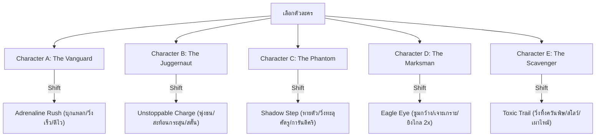
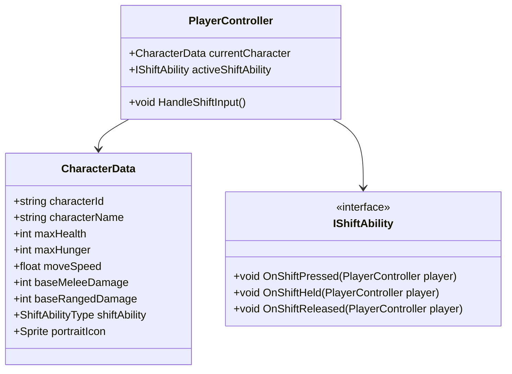

# เอกสารออกแบบตัวละคร (Character Design Document - GDD)

**ชื่อโปรเจกต์:** The Last Empire  
**ประเภทเอกสาร:** Character Systems & Playable Roster Design  
**วันที่จัดทำ:** 13 ตุลาคม 2026  
**สถานะ:** Draft Version 1.0  

---

## 📖 1. ภาพรวมระบบตัวละคร (Character System Overview)

ระบบตัวละครใน **The Last Empire** ออกแบบตามแนวทาง **Roguelite Action-Survival** โดยให้ผู้เล่นสามารถเลือกเล่นตัวละครที่มีจุดเด่น, จุดด้อย, ค่าสถานะพื้นฐาน (Base Stats), และความสามารถเฉพาะตัวที่แตกต่างกันอย่างชัดเจน เพื่อส่งเสริมความหลากหลายในการเล่น (Replayability)

### ⚡ แกนหลักการควบคุม: Signature Shift Active Ability
ในเกมเพลย์ปกติ ปุ่ม **`Shift`** จะถูกยกระดับจากการเป็นเพียงการ "วิ่งเร็ว (Sprint)" ธรรมดา มาเป็น **ปุ่มกดใช้งานความสามารถเฉพาะตัว (Signature Ability)** ของตัวละครแต่ละตัว โดยแต่ละคลาสจะมีปฏิกิริยาและเอฟเฟกต์เฉพาะตัวเมื่อกดปุ่ม Shift

### 🔄 ความสัมพันธ์กับระบบความหิว (Hunger-Cost Synergy)
ความสามารถ Shift จะผสานเข้ากับ Loop การเอาชีวิตรอดโดยตรง:
* **การเผาผลาญความหิว (Hunger Drain):** ขณะใช้งานหรือเปิดโหมด Shift จะเร่งการลดลงของเกจความหิว ($\text{Hunger Rate} \times 2$ หรือ $\times 3$)
* **ทรัพยากรสองบทบาท:** อาหาร (Bread/Rations) จึงไม่ได้มีไว้เพียงประทังชีวิต แต่ทำหน้าที่เสมือน **"หลอดมานา/พลังงาน"** ในการร่ายสกิล Shift อีกด้วย

---

## 👥 2. รายชื่อตัวละครเบื้องต้น 5 ตัว (Playable Characters A - E)

---

### 🛡️ Character A: "The Vanguard" (สายสมดุล / ลุยประจัญบาน)
* **คอนเซปต์:** ทหารผ่านศึกผู้ช่ำชองการต่อสู้ สมดุลทุกระยะ เล่นง่ายและยืดหยุ่น เหมาะสำหรับผู้เล่นเริ่มต้น
* **สไตล์การเล่น:** All-Rounder (ยิงก็ได้ ฟันประชิดก็ดี)

#### ค่าสถานะพื้นฐาน (Base Stats)
| ค่าสถานะ | ตัวเลข | คำอธิบาย |
|---|---|---|
| **Max HP** | 100 | ค่ามาตรฐาน |
| **Max Hunger** | 100 | ค่ามาตรฐาน |
| **Move Speed** | 5.0 m/s | ความเร็วการเดินปกติ |
| **Base Melee Damage** | 10 | ดาเมจมือเปล่ามาตรฐาน |
| **Base Ranged Damage** | 10 | ดาเมจพื้นฐานปืน |
| **Hunger Consumption** | 1.0x | อัตราเผาผลาญอาหารปกติ |

#### ⚡ ความสามารถ Shift: `Adrenaline Rush (อะดรีนาลีนสูบฉีด)`
* **ประเภท:** Toggle / Channeling (กดค้างขณะเคลื่อนที่)
* **การทำงาน:** 
  * ความเร็วเคลื่อนที่เพิ่มขึ้นเป็น **1.75 เท่า**
  * ความเร็วในการโจมตีระยะประชิด (Attack Speed) และความเร็วในการยิง (Fire Rate) เพิ่มขึ้น **+30%**
  * ลดความเสียหายทุกชนิดที่ได้รับลง **20%**
* **ข้อจำกัด (Cost):** ลดค่าความหิวไวขึ้น $2.5\times$ ขณะเปิดใช้งาน
* **Passive Trait:** `Battle Hardened` — ดาเมจจากอาวุธทุกชนิดเพิ่มขึ้น +10%

---

### 🔨 Character B: "The Juggernaut" (สายแทงค์ / หมัดเหล็กทลายฝูง)
* **คอนเซปต์:** อดีตนักกีฬาหรือผู้รอดชีวิตร่างยักษ์ แข็งแกร่ง อดทนสูง ไม่สะทกสะท้านต่อแรงปะทะ
* **สไตล์การเล่น:** Melee Brawler & Crowd Control เน้นชนแหลก กวาดฝูงซอมบี้ให้กระเด็น

#### ค่าสถานะพื้นฐาน (Base Stats)
| ค่าสถานะ | ตัวเลข | คำอธิบาย |
|---|---|---|
| **Max HP** | 150 | พลังชีวิตสูงเป็นพิเศษ (+50%) |
| **Max Hunger** | 120 | อิ่มนานขึ้น |
| **Move Speed** | 4.3 m/s | เคลื่อนที่ช้ากว่าปกติ (-14%) |
| **Base Melee Damage** | 15 | หมัดหนักกว่าตัวอื่น (+50%) |
| **Base Ranged Damage** | 8 | ยิงปืนไม่แม่นยำเท่าที่ควร (-20%) |
| **Hunger Consumption** | 1.2x | ร่างใหญ่ต้องการพลังงานสูง |

#### ⚡ ความสามารถ Shift: `Unstoppable Charge (พุ่งชนไร้ต้าน)`
* **ประเภท:** Active Charge (กด Shift เพื่อพุ่งทะลวง 1.5 วินาที, Cooldown 5 วินาที)
* **การทำงาน:** 
  * พุ่งชนไปข้างหน้าด้วยความเร็วสูง สร้างดาเมจชน 25 หน่วย และผลักศัตรูทั้งหมดที่ขวางทางให้กระเด็น (Knockback แรงพิเศษ) พร้อมทำให้ศัตรูติด Stun ชะงัก 1.0 วินาที
  * ระหว่างพุ่งชน ด้านหน้า 180 องศาจะ **บล็อกและสะท้อนกระสุนปืนทั้งหมด 100%**
  * หากพุ่งชนสิ่งกีดขวางหรือกำแพง จะเกิดคลื่นกระแทก (Ground Shockwave) ทำดาเมจกระจายรอบตัว
* **Passive Trait:** `Thick Skin` — ลดดาเมจกายภาพลงถาวร 15% และมีภูมิคุ้มกันต่อการชะงัก (Stagger Immunity) จากศัตรูทั่วไป

---

### 🗡️ Character C: "The Phantom" (สายว่องไว / นักฆ่ามิติเงา)
* **คอนเซปต์:** หน่วยลอบเร้นที่มีความเร็วระดับพระกาฬ เชี่ยวชาญการเข้า-ออกจังหวะต่อสู้อย่างปลอดภัย
* **สไตล์การเล่น:** Hit-and-Run, Flanking, Assassin เน้นแดชหลบหลีกและลอบเชือดจุดตาย

#### ค่าสถานะพื้นฐาน (Base Stats)
| ค่าสถานะ | ตัวเลข | คำอธิบาย |
|---|---|---|
| **Max HP** | 75 | เปราะบาง เลือดน้อย (-25%) |
| **Max Hunger** | 90 | กระเพาะเล็ก หิวง่าย |
| **Move Speed** | 6.0 m/s | เคลื่อนที่ไวที่สุดในกลุ่ม (+20%) |
| **Base Melee Damage** | 12 | ฟันประชิดคล่องแคล่ว |
| **Dash Distance** | +25% | ระยะแดชพุ่งไกลกว่าปกติ |
| **Dash Cooldown** | -30% | รีคูลดาวน์แดชไวมาก |

#### ⚡ ความสามารถ Shift: `Shadow Step (ก้าวมิติเงา)`
* **ประเภท:** Channeling / Ghost State (กด Shift ค้างเพื่อวิ่งในร่างเงา)
* **การทำงาน:** 
  * ตัวละครจะเข้าสู่ร่างเงาโปร่งแสง (Ghost Form) เพิ่มความเร็ววิ่งขึ้นอีก 40%
  * **Phase Through Enemies:** สามารถวิ่งทะลุผ่านตัวมอนสเตอร์ได้โดยตรง ไม่ติดบล็อก และไม่โดนชนดาเมจสัมผัส
  * **Shadow Strike:** การโจมตีแรกสุดหลังจากปล่อยปุ่ม Shift ออกมา จะการันตี **ติดคริติคอล 100% (Critical Damage 2.0x)**
* **ข้อจำกัด (Cost):** กินค่าความหิวฮวบฮาบ ($3.0\times$)
* **Passive Trait:** `Elusive` — มีโอกาส 15% ที่จะหลบหลีกการโจมตี (Dodge) ทุกชนิดได้ฟรีโดยไม่เสียเลือด

---

### 🎯 Character D: "The Marksman" (สายสไนเปอร์ / มือปืนเพ่งสมาธิ)
* **คอนเซปต์:** อดีตพลแม่นปืนประจำหน่วยรบพิเศษ ถนัดการสังหารระยะไกล ควบคุมระยะยิงอย่างสุขุม
* **สไตล์การเล่น:** Long-Range Shooter, Kiting, Tactical Positioning

#### ค่าสถานะพื้นฐาน (Base Stats)
| ค่าสถานะ | ตัวเลข | คำอธิบาย |
|---|---|---|
| **Max HP** | 85 | ค่อนข้างเปราะบาง |
| **Max Hunger** | 100 | มาตรฐาน |
| **Move Speed** | 4.8 m/s | ปานกลาง |
| **Base Melee Damage** | 7 | สู้ประชิดตัวอ่อนแอ (-30%) |
| **Base Ranged Damage** | 14 | ยิงปืนแรงเป็นพิเศษ (+40%) |
| **Reload Speed** | +35% | เปลี่ยนแมกกาซีนไวกว่าปกติ |

#### ⚡ ความสามารถ Shift: `Eagle Eye (เนตรอินทรีเพ่งเล็ง)`
* **ประเภท:** Tactical Stance (กด Shift ค้างเพื่อเข้าสู่ท่ายิงประณีต)
* **การทำงาน:** 
  * มุมมองกล้องจะขยายกว้างขึ้นทันที (Camera Zoom Out 1.4x) ทำให้มองเห็นศัตรูในจอได้ไกลขึ้น
  * **Attack Radius (ระยะยิงปืน) เพิ่มขึ้นเป็น 2 เท่า**
  * กระสุนที่ยิงออกไปขณะกด Shift จะมีคุณสมบัติ **เจาะทะลุ (Piercing)** ศัตรูได้ 1 ตัว
* **ข้อจำกัด (Cost):** ความเร็วในการเดินลดลงเหลือ 30% (แทบจะยืนนิ่งเพื่อเล็ง) และใช้ความหิวเรื่อยๆ
* **Passive Trait:** `Deadly Distance` — การยิงเป้าหมายที่อยู่ห่างออกไปเกิน 5 เมตร จะสร้างความเสียหายแรงขึ้น +25%

---

### 🧪 Character E: "The Scavenger" (สายคุ้ยขยะ / สารพัดพิษ & ปั่นป่วน)
* **คอนเซปต์:** นักประดิษฐ์เร่ร่อนที่ปรับตัวเก่งในแดนร้าง ถนัดการเก็บเกี่ยวทรัพยากรและปล่อยสารเคมีสกัดกั้น
* **สไตล์การเล่น:** Crowd Control, Area Denial, Resource Hoarder

#### ค่าสถานะพื้นฐาน (Base Stats)
| ค่าสถานะ | ตัวเลข | คำอธิบาย |
|---|---|---|
| **Max HP** | 90 | ปานกลาง |
| **Max Hunger** | 110 | ทนหิวได้ดี |
| **Move Speed** | 5.2 m/s | วิ่งคล่องตัว |
| **Drop Rate Bonus** | +25% | มอนสเตอร์ดรอปของบ่อยขึ้น |
| **Money Multiplier** | +30% | เก็บเงินได้จำนวนมากขึ้น |

#### ⚡ ความสามารถ Shift: `Toxic Trail (ละอองพิษสะกดรอย)`
* **ประเภท:** Toggle Trail (กด Shift เพื่อวิ่งปล่อยแนวพิษ)
* **การทำงาน:** 
  * ขณะกด Shift วิ่ง ตัวละครจะปล่อยควันสารเคมีสีเขียว/น้ำเงินตกค้างไว้บนพื้นตามทางที่วิ่งผ่าน เป็นเวลา 3.5 วินาที
  * ศัตรูที่เหยียบแนวควันพิษจะ **ลดความเร็วเคลื่อนที่ลง 50% (Slow)** และได้รับดาเมจพิษต่อเนื่อง (DoT: 8 Damage/วินาที)
  * เหมาะอย่างยิ่งสำหรับเทคนิค "ลากมอนสเตอร์เป็นขบวนแล้วปล่อยควันรม"
* **Passive Trait:** `Gourmet Scavenger` — การกินอาหาร (เช่น Bread) นอกจากจะเพิ่มค่าความหิวแล้ว จะช่วยฟื้นฟูเลือดแถมให้อีก 10 HP ทันที

---

## 📊 3. ตารางเปรียบเทียบค่าสถานะ (Stat Matrix Comparison)

| ตัวละคร | Max HP | Move Speed | Melee Dmg | Ranged Dmg | จุดเด่นหลัก | Signature Shift Ability |
|---|:---:|:---:|:---:|:---:|---|---|
| **A: Vanguard** | 100 | 5.0 m/s | 10 | 10 | สมดุลรอบด้าน | `Adrenaline Rush` (เร่งสปีด+ตีไว+ลดดาเมจ) |
| **B: Juggernaut** | 150 | 4.3 m/s | 15 | 8 | ถึก, หมัดหนัก, ต้านชะงัก | `Unstoppable Charge` (พุ่งชนสตั๊น+สะท้อนกระสุน) |
| **C: Phantom** | 75 | 6.0 m/s | 12 | 10 | ว่องไว, แดชไกล, คริติคอล | `Shadow Step` (วิ่งทะลุตัวศัตรู+คริติคอล 100%) |
| **D: Marksman** | 85 | 4.8 m/s | 7 | 14 | ยิงไกล, รีโหลดไว, ทะลวง | `Eagle Eye` (ซูมกว้าง+ระยะยิง 2x+เจาะเกราะ) |
| **E: Scavenger** | 90 | 5.2 m/s | 10 | 10 | ฟาร์มของไว, คุมพื้นที่ | `Toxic Trail` (วิ่งทิ้งควันพิษสโลว์+DoT) |

---

## 💻 4. โครงสร้างการเชื่อมต่อกับระบบโค้ด (Technical Architecture Plan)

1. **สร้าง ScriptableObject `CharacterData.cs`** ภายใต้ `Assets/Scripts/Runtime/Data/` เพื่อเก็บสถิติเริ่มต้นของตัวละครแต่ละตัว A - E ในรูปแบบ Asset แยกไฟล์
2. **สร้าง Interface `IShiftAbility.cs`** แยกโค้ดการทำงานของสกิล Shift แต่ละตัวละครออกจากกัน เพื่อความสะอาดตามหลัก Open-Closed Principle
3. **ปรับปรุง `PlayerController.cs`:** 
   * เมื่อโหลดตัวละคร ให้รับค่าสเตตัสเริ่มต้นจาก `CharacterData`
   * เปลี่ยนฟังก์ชัน `Update()` ในส่วน `Input.GetKey(KeyCode.LeftShift)` ให้เรียกผ่าน `activeShiftAbility.OnShiftHeld()` แทนการผูกติดกับการวิ่งเปล่า ๆ
4. **UI HUD Integration:** เพิ่มไอคอนสกิลและคูลดาวน์/สเตตัสของ Shift บนหน้าจอ [PlayerHUD.cs](file:///d:/TLEGIT/TheLastEmpire/Assets/Scripts/Runtime/Player/PlayerHUD.cs)
