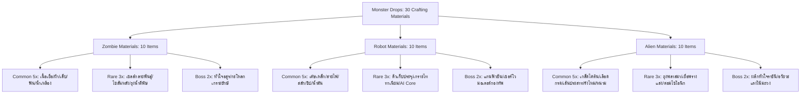

# เอกสารออกแบบระบบวัตถุดิบคราฟต์และไอเทมดรอป (Crafting Materials & Monster Drops - GDD)

**ชื่อโปรเจกต์:** The Last Empire  
**ประเภทเอกสาร:** Crafting System & Loot Drop Design  
**วันที่จัดทำ:** 5 พฤศจิกายน 2026  
**สถานะ:** Implemented Database Version 1.0 (Database IDs: ITEM0036 - ITEM0065)  

---

## 📖 1. ปรัชญาการออกแบบระบบวัตถุดิบ (Design Philosophy)

ใน **The Last Empire** โลกหลังการล่มสลายเต็มไปด้วยภัยคุกคามจาก 3 เผ่าพันธุ์หลัก ได้แก่ **ซอมบี้ (Zombie)**, **หุ่นยนต์ (Robot / Mech)**, และ **เอเลี่ยน (Alien / Xenomorph)** 

วัตถุดิบที่ดรอปจากแต่ละเผ่าพันธุ์สะท้อนอัตลักษณ์และวิทยาการชีวภาพที่แตกต่างกันอย่างสิ้นเชิง:
1. **ซอมบี้ (Infected Bio-Scraps):** ชิ้นส่วนชีวภาพเน่าเปื่อย สารคัดหลั่ง เซลล์กลายพันธุ์ และกระดูกหนา เหมาะสำหรับการปรุงยา กระตุ้นสารเคมี เพิ่มความทนทาน หรือทำกับดัก
2. **หุ่นยนต์ (Cybernetic & High-Tech Scrap):** ชิ้นส่วนวิศวกรรมจักรกล แผงวงจร แผ่นเกราะไททาเนียม และตัวเก็บประจุพลังงาน เหมาะสำหรับชิ้นส่วนอาวุธปืน เกราะป้องกัน และอุปกรณ์ไฟฟ้า
3. **เอเลี่ยน (Extraterrestrial & Psionic Xenomatter):** สสารต่างดาว คริสตัลพลังงาน พลาสมาชีวภาพ และอวัยวะควบคุมสนามแรงโน้มถ่วง เหมาะสำหรับวิทยาการชั้นสูง อาวุธพลังงาน และโมดูลพิเศษ

---

---

## 👾 2.1 รายชื่อมอนสเตอร์และการแบ่งเผ่าพันธุ์ (Monster Roster & Factions - 22 Types)

เพื่อรองรับระบบดรอปวัตถุดิบและสร้างความหลากหลายเชิงกลยุทธ์ในการต่อสู้ เกมได้แบ่งศัตรูออกเป็น **3 เผ่าพันธุ์ รวมทั้งหมด 22 ชนิด** (ซอมบี้ 7 ชนิด, หุ่นยนต์ 8 ชนิด, เอเลี่ยน 7 ชนิด) โดยแต่ละเผ่าใช้ Dedicated AI Component และ Prefab ที่แยกจากกันโดยเฉพาะ:

### 🧟 1. เผ่าซอมบี้ (Infected Undead - 7 ชนิด)
* **AI Component:** `ZombieAI.cs` (Enums: `ZombieType`)
* **Prefabs Directory:** `Assets/Resources/Prefabs/Character/`
* **ตารางดรอป:** วัสดุชีวภาพ (`ITEM0036` - `ITEM0045`)

| Prefab Name | ชนิด (Type) | ชื่อเรียก (Display Name) | HP | Move Speed | ดาเมจ | พฤติกรรมเด่น / ท่าพิเศษ |
| :--- | :--- | :--- | :---: | :---: | :---: | :--- |
| `ZombieNormal` | Normal (0) | Walker | 70 | 1.2 m/s | 15 | เดินตามผู้เล่นเป็นฝูง ทนทานปานกลาง |
| `ZombieDog` | Dog (1) | Zombie Dog | 50 | 4.5 m/s | 20 | วิ่งรวดเร็ว กระโจนพุ่งเข้าใส่จากระยะ 4 เมตร |
| `ZombieBoomer` | Boomer (2) | Boomer | 60 | 2.0 m/s | 15 | ระเบิดพลีชีพสร้างดาเมจ AOE กว้าง 3 เมตร |
| `ZombieRunner` | Runner (4) | Runner | 65 | 4.0 m/s | 18 | ซอมบี้วิ่งเร็ว วิ่งเข้าประชิดตัวอย่างต่อเนื่อง |
| `ZombieSpitter` *(ใหม่)* | Spitter (5) | Acid Spitter | 65 | 2.5 m/s | 15 | ยิงกระสุนกรดพิษชีวภาพระยะไกล (3 - 8.5m) |
| `ZombieTank` *(ใหม่)* | Tank (6) | Zombie Brute | 180 | 1.6 m/s | 25 | ซอมบี้ยักษ์พลังชีวิตสูง ทนการชะงัก (Knockback Force 12) |
| `ZombieLeader` | Leader (3) - **BOSS** | Zombie Leader | 1500 | 2.5 m/s | 35 | บอส: คำรามบัฟลูกน้อง, กวาด Stomp AOE, พุ่งชน Charge, เข้าสู่ Rage Mode เมื่อเลือด < 30% |

---

### 🤖 2. เผ่าหุ่นยนต์ (Cybernetic Mechs - 8 ชนิด)
* **AI Component:** `RobotAI.cs` (Enums: `RobotType`, Shield Block: `IDamageable`)
* **Prefabs Directory:** `Assets/Resources/Prefabs/Character/`
* **ตารางดรอป:** ชิ้นส่วนโลหะและวงจรจักรกล (`ITEM0046` - `ITEM0055`)

| Prefab Name | ชนิด (Type) | ชื่อเรียก (Display Name) | HP | Move Speed | ดาเมจ | พฤติกรรมเด่น / ท่าพิเศษ |
| :--- | :--- | :--- | :---: | :---: | :---: | :--- |
| `RobotNormal` | Normal (0) | Robot Scout | 85 | 3.0 m/s | 16 | หุ่นยนต์ลาดตระเวน ตรวจจับผู้เล่นด้วยเซนเซอร์สายตา (FOV) |
| `RobotTanker` | Tanker (1) | Shield Mech | 200 | 2.0 m/s | 22 | โล่พลังงานด้านหน้า 180° บล็อกดาเมจผู้เล่นได้ 100% (ขึ้นข้อความ "BLOCKED") |
| `RobotBlade` | Blade (2) | Blade Strider | 95 | 4.5 m/s | 20 | พุ่งชาร์จแดชฟันประชิด (Dash Slash) อย่างรวดเร็ว |
| `RobotGunner` | Gunner (3) | Gunner Bot | 80 | 3.0 m/s | 14 | ยิงปืนกลเล็งใส่ผู้เล่นเป็นชุดจากระยะ 5 เมตร |
| `RobotLaser` | Laser (4) | Laser Sentinel | 100 | 3.0 m/s | 18 | เล็งเส้นเลเซอร์เตือนก่อนยิงลำแสงอนุภาค (Laser Beam Tick DoT) |
| `RobotDrone` *(ใหม่)* | Drone (6) | Attack Drone | 55 | 5.2 m/s | 12 | โดรนบินสอดแนมความเร็วสูง เคลื่อนที่โฉบเฉี่ยวว่องไว |
| `RobotKamikaze` *(ใหม่)* | Kamikaze (7) | Bomb Bot | 60 | 4.2 m/s | 20 | หุ่นยนต์ระเบิดพลีชีพ กะพริบไฟฉุกเฉินเตือนแล้วระเบิดทำลายล้าง |
| `RobotLeader` | Leader (5) - **BOSS** | Mech Overlord | 1600 | 2.5 m/s | 40 | บอสจักรกล: เกราะหนา ยิงปืนกลหนักและลำแสงพิฆาต |

---

### 👽 3. เผ่าเอเลี่ยน (Extraterrestrial Xenomorphs - 7 ชนิด)
* **AI Component:** `AlienAI.cs` (Enums: `AlienType`)
* **Prefabs Directory:** `Assets/Resources/Prefabs/Character/`
* **ตารางดรอป:** สสารต่างดาวและอวัยวะไซโอนิก (`ITEM0056` - `ITEM0065`)

| Prefab Name | ชนิด (Type) | ชื่อเรียก (Display Name) | HP | Move Speed | ดาเมจ | พฤติกรรมเด่น / ท่าพิเศษ |
| :--- | :--- | :--- | :---: | :---: | :---: | :--- |
| `AlienNormal` | Normal (0) | Xenomorph Drone | 75 | 3.5 m/s | 16 | สัตว์ต่างดาวพื้นฐาน ก้าวร้าวเป็นพิเศษในเวลากลางคืน (Night Aggro) |
| `AlienHook` | Hook (1) | Hook Stalker | 90 | 3.5 m/s | 18 | ยิงระยางค์ดึงกระชากตัวผู้เล่น (Grapple Hook Pull) ให้เข้ามาหา |
| `AlienInvisible` | Invisible (2) | Shadow Lurker | 70 | 3.5 m/s | 22 | ล่องหนพรางตัวโปร่งแสง (Fade Cloaking) จะปรากฏตัวเมื่อเข้าใกล้ 4 เมตร |
| `AlienSmart` | Smart (3) | Hunter Flanker | 85 | 4.0 m/s | 18 | เคลื่อนที่แบบโอบล้อม (Flanking Strafe) เคลื่อนที่ฉากข้างหลบกระสุน |
| `AlienSpitter` *(ใหม่)* | Spitter (5) | Plasma Spitter | 75 | 3.0 m/s | 15 | พ่นกระสุนพลาสมาชีวภาพสีม่วงเรืองแสงจากระยะไกล |
| `AlienCrawler` *(ใหม่)* | Crawler (6) | Skittering Crawler | 60 | 5.0 m/s | 16 | สิ่งมีชีวิตคลานติดพื้นความเร็วสูง เข้าจู่โจมอย่างรวดเร็วและเงียบเชียบ |
| `AlienLeader` | Leader (4) - **BOSS** | Hive Queen | 1400 | 2.8 m/s | 35 | บอสนางพญาต่างดาว: เสกลูกสมุนเอเลี่ยนออกมาและขว้างพุ่งใส่ผู้เล่น |

## 📊 2. มาตรฐานระดับความหายากและอัตราดรอป (Rarity & Drop Tier Standards)

| ระดับความหายาก (Tier) | อัตราดรอปมอนทั่วไป (Normal Drop) | อัตราดรอปจากบอส (Boss Drop) | จำนวนที่ดรอป (Qty) | สีธีมประจำระดับ (Rarity Color) | วัตถุประสงค์การใช้งาน |
| :--- | :---: | :---: | :---: | :---: | :--- |
| **⚪ ทั่วไป (Common)** | **25%** | **60%** | 1 - 2 ชิ้น (บอส 1 - 3 ชิ้น) | ขาว/เทา (`#E2E8F0`) | วัตถุดิบฐานสำหรับคราฟต์กระสุน ยาพื้นฐาน ชิ้นส่วนซ่อมบำรุง |
| **🟣 หายาก (Rare)** | **5%** | **30%** | 1 ชิ้น (บอส 1 - 2 ชิ้น) | ม่วง/ฟ้า (`#A855F7` / `#38BDF8`) | วัตถุดิบแกนหลักสำหรับอัปเกรดอาวุธ เกราะขั้นสูง และเซรุ่ม |
| **🟡 บอส (Boss Drop)** | *ไม่ดรอป* | **20%** | 1 ชิ้น | ส้มทอง (`#F59E0B`) | ชิ้นส่วนระดับตำนานสำหรับสร้างอาวุธบอส หรือเทคโนโลยีระดับสูงสุด |

---

## 🧟 3. ตารางวัตถุดิบเผ่าพันธุ์ซอมบี้ (Zombie Materials)

| รหัสไอเทม | ชื่อภาษาอังกฤษ (Item Name) | ชื่อภาษาไทย | ระดับ | สีธีม | คำอธิบาย (Lore & Description) |
| :--- | :--- | :--- | :---: | :---: | :--- |
| `ITEM0036` | Contaminated Flesh | เนื้อเน่าติดเชื้อ | Common | `#84CC16` | ชิ้นเนื้อซอมบี้ที่เน่าเปื่อยแต่ยังมีร่องรอยเซลล์แบ่งตัวอย่างผิดปกติ |
| `ITEM0037` | Torn Infected Cloth | เศษผ้าเปื้อนเลือด | Common | `#94A3B8` | เศษผ้าขี้ริ้วเหนียวและเปรอะเปื้อนที่ติดอยู่กับซากร่างซอมบี้ |
| `ITEM0038` | Rotten Bone Claw | เล็บกระดูกหยาบ | Common | `#E2E8F0` | ปลายนิ้วและกรงเล็บกระดูกที่แห้งกรังจนแข็งคมเหมือนหิน |
| `ITEM0039` | Decayed Infected Fang | ฟันกรามติดเชื้อ | Common | `#CBD5E1` | ฟันซอมบี้ที่แหลมคม เต็มไปด้วยคราบแบคทีเรียอันตราย |
| `ITEM0040` | Tainted Ichor Vial | น้ำเหลืองปนเปื้อน | Common | `#22C55E` | ของเหลวข้นสีเขียวคล้ำในถุงเนื้อเยื่อ มีฤทธิ์กัดกร่อนและเป็นพิษ |
| `ITEM0041` | Concentrated Virus Strain | เซลล์กลายพันธุ์เข้มข้น | Rare | `#A855F7` | ตัวอย่างสารพันธุกรรมไวรัสกลายพันธุ์บริสุทธิ์ มีไอควันสารเคมีระเหยออกมา |
| `ITEM0042` | Hardened Spine Segment | ไขสันหลังกระดูกเหล็ก | Rare | `#38BDF8` | ท่อนกระดูกสันหลังที่แข็งตัวเป็นพิเศษจากการกลายพันธุ์ขั้นสูง |
| `ITEM0043` | Toxic Bile Sac | ถุงน้ำดีมีพิษ | Rare | `#10B981` | ถุงอวัยวะภายในที่กักเก็บกรดพิษเข้มข้น พร้อมระเบิดเมื่อถูกกระทบกระเทือน |
| `ITEM0044` | Pulsing Abomination Heart | หัวใจอสูรยังเต้นอยู่ | Boss | `#EF4444` | หัวใจซอมบี้ขนาดมหึมาจากบอส ที่ยังคงเต้นตุบๆ และสูบฉีดเลือดดำอยู่ได้เอง |
| `ITEM0045` | Titan Skull Crest | กะโหลกเกราะยักษ์ | Boss | `#F59E0B` | ส่วนหัวกะโหลกหนาพิเศษของบอสซอมบี้ขนาดใหญ่ แข็งแกร่งทนทานเทียบเท่าเหล็กกล้า |

---

## 🤖 4. ตารางวัตถุดิบเผ่าพันธุ์หุ่นยนต์ (Robot / Mech Materials)

| รหัสไอเทม | ชื่อภาษาอังกฤษ (Item Name) | ชื่อภาษาไทย | ระดับ | สีธีม | คำอธิบาย (Lore & Description) |
| :--- | :--- | :--- | :---: | :---: | :--- |
| `ITEM0046` | Scrap Metal Plate | เศษแผ่นเหล็กกล้า | Common | `#94A3B8` | แผ่นเกราะเหล็กมาตรฐานที่หลุดลอกออกมาจากโครงสร้างหุ่นยนต์ |
| `ITEM0047` | Torn Copper Wiring | สายไฟทองแดงฉีกขาด | Common | `#F97316` | มัดสายไฟนำกระแสไฟทองแดงที่ยังคงส่งสัญญาณกระตุกเป็นจังหวะ |
| `ITEM0048` | Hydraulic Piston Bolt | สลักเกลียวไฮดรอลิก | Common | `#64748B` | น็อตและข้อต่อไฮดรอลิกสำหรับระบบขับเคลื่อนแขนกล |
| `ITEM0049` | Basic Logic Chip | ชิปประมวลผลพื้นฐาน | Common | `#06B6D4` | ไมโครคอนโทรลเลอร์ที่ใช้ควบคุมคำสั่งลาดตระเวนขั้นพื้นฐาน |
| `ITEM0050` | Synthetic Machine Oil | น้ำมันหล่อลื่นสังเคราะห์ | Common | `#EAB308` | สารหล่อลื่นเกรดอุตสาหกรรมสำหรับลดการเสียดสีของเฟืองจักรกล |
| `ITEM0051` | High-Capacity Capacitor | ตัวเก็บประจุความหนาแน่นสูง | Rare | `#3B82F6` | แบตเตอรี่คาปาซิเตอร์ที่ยังกักเก็บประจุไฟฟ้าแรงสูงไว้เต็มเปี่ยม |
| `ITEM0052` | Reinforced Titanium Plate | แผ่นเกราะไททาเนียมเสริมแรง | Rare | `#60A5FA` | แผ่นโลหะผสมไททาเนียมน้ำหนักเบาแต่ทนความร้อนและแรงกระแทกได้สูง |
| `ITEM0053` | Advanced Neural Processor | แกน AI ประมวลผลขั้นสูง | Rare | `#8B5CF6` | แผงเมนบอร์ดปัญญาประดิษฐ์ระดับยุทธวิธีที่บรรจุอัลกอริทึมการต่อสู้ |
| `ITEM0054` | Miniature Fusion Reactor | แกนปฏิกรณ์ไมโครฟิวชัน | Boss | `#00F0FF` | แหล่งกำเนิดพลังงานนิวเคลียร์ฟิวชันขนาดกะทัดรัด เปล่งแสงพลาสมาสีฟ้าสว่างจ้า |
| `ITEM0055` | Military Overdrive Servo | เซอร์โวมอเตอร์เกรดกองทัพ | Boss | `#F59E0B` | มอเตอร์ต้นกำลังขนาดมหึมาจากบอสหุ่นยนต์ที่ให้แรงบิดมหาศาล |

---

## 👽 5. ตารางวัตถุดิบเผ่าพันธุ์เอเลี่ยน (Alien / Xenomorph Materials)

| รหัสไอเทม | ชื่อภาษาอังกฤษ (Item Name) | ชื่อภาษาไทย | ระดับ | สีธีม | คำอธิบาย (Lore & Description) |
| :--- | :--- | :--- | :---: | :---: | :--- |
| `ITEM0056` | Chitin Carapace Shard | สะเก็ดเกล็ดไคติน | Common | `#A855F7` | เกล็ดเปลือกนอกสีดำเหลือบม่วง แข็งแกร่งและไม่นำความร้อน |
| `ITEM0057` | Phosphorescent Acid Blood | เลือดกรดเรืองแสง | Common | `#84CC16` | ของเหลวสีเขียวนีออนที่ส่องแสงในที่มืดและมีฤทธิ์ละลายสารอินทรีย์ |
| `ITEM0058` | Xeno Nerve Tendril | เส้นใยประสาทเอเลี่ยน | Common | `#EC4899` | เส้นเอ็นต่างดาวที่ยืดหยุ่นสูงและตอบสนองต่อกระแสไฟฟ้าชีวภาพ |
| `ITEM0059` | Cracked Alien Spore Husk | เศษรังไหมสปอร์ | Common | `#D946EF` | ซากเปลือกห่อหุ้มเซลล์ตัวอ่อนที่แห้งกรอบ |
| `ITEM0060` | Prismatic Stinger | หนามคริสตัลแหลมคม | Common | `#06B6D4` | หนามชีวภาพปลายหอกที่สะท้อนแสงหลากสีดั่งปริซึม |
| `ITEM0061` | Bio-Plasma Sac | ถุงพลาสมาชีวภาพ | Rare | `#F43F5E` | ต่อมพิเศษใต้ผิวหนังที่ผลิตพลังงานความร้อนสูงคล้ายพลาสมาธรรมชาติ |
| `ITEM0062` | Chameleon Phase Membrane | เยื่อบุพรางแสง | Rare | `#818CF8` | ผิวหนังชั้นในที่มีความสามารถในการหักเหแสงจนเกือบมองไม่เห็น |
| `ITEM0063` | Psionic Resonator Gland | ต่อมพลังจิตไซโอนิก | Rare | `#C084FC` | อวัยวะรับส่งคลื่นโทรจิตที่สั่นสะเทือนเบาๆ ตลอดเวลา |
| `ITEM0064` | Overlord Xenocrystal Core | ผลึกหัวใจราชินี | Boss | `#E11D48` | คริสตัลสีม่วงเข้มบริสุทธิ์ที่เติบโตใจกลางอกของบอสเอเลี่ยน เป็นศูนย์รวมพลังงาน |
| `ITEM0065` | Gravitational Bio-Organ | อวัยวะควบคุมแรงโน้มถ่วง | Boss | `#F59E0B` | อวัยวะชีวภาพแปลกประหลาดที่สามารถบิดเบือนมวลและแรงโน้มถ่วงรอบตัวได้ |

---

## 🛠️ 6. แนวทางต่อยอดระบบคราฟต์ในอนาคต (Future Crafting Integration)

1. **คราฟต์กระสุนและของยังชีพ (Survival & Consumables):**
   - เช่น ใช้ `Torn Copper Wiring` + `Scrap Metal Plate` ผลิตกระสุนปืนพก/ปืนไรเฟิล
   - ใช้ `Contaminated Flesh` ผ่านกระบวนการกรองเป็นสารสกัดยาแก้พิษ
2. **สร้างและอัปเกรดอาวุธ (Weapon Crafting & Upgrades):**
   - อาวุธชีวภาพติดพิษ (Bio-weapons): ใช้ชิ้นส่วนซอมบี้และเอเลี่ยน
   - อาวุธพลังงานไซเบอร์เนติก (High-tech energy weapons): ใช้ชิ้นส่วนหุ่นยนต์
3. **อาวุธระดับบอส (Boss Legendaries):**
   - อาวุธปืนพลาสมาต่างดาว (Xeno Plasma Cannon) จาก `Overlord Xenocrystal Core`
   - ค้อนไฮดรอลิกยักษ์ (Titan Impact Sledge) จาก `Titan Skull Crest`
   - ปืนลำแสงอนุภาค (Fusion Beam Emitter) จาก `Miniature Fusion Reactor`

---

## ⚙️ 7. ระบบหน้าต่างคราฟต์ โต๊ะคราฟต์ และการแจ้งเตือน `Log_HUD` (Implemented Crafting & Notification Systems)

1. **การแบ่งเงื่อนไขหมวดหมู่คราฟต์ (`CraftController.cs`):**
   - **หมวดหมู่ที่คราฟต์ได้ทุกที่ (No Workbench Required):** `Utility`, `Weapons`, `Consumables`, `Tools`, และ `Special` ผู้เล่นสามารถกดเปิดหน้าต่างคราฟต์ (`C`) และสร้างได้ทันทีทุกที่
   - **หมวดหมู่ที่ต้องใช้โต๊ะคราฟต์ (`Survivor Workbench` Required):** เฉพาะหมวด `Building` และ `Defense` เท่านั้น
   - **การซ่อนแท็บหมวดหมู่ซ้ายมืออัตโนมัติ:** เมื่อไม่ได้อยู่ใกล้โต๊ะคราฟต์ ปุ่มแท็บ `Building` และ `Defense` ทางซ้ายมือจะถูกซ่อน (`SetActive(false)`) และจะเปิดแสดงผล (`SetActive(true)`) เฉพาะเมื่อเดินเข้าใกล้โต๊ะคราฟต์แล้วกดใช้งาน (`[E] Crafting Table`)
2. **ระบบแจ้งเตือนไอเทมที่ได้รับและคราฟต์ (`ItemLogHUD.cs` & `LogThumbnail.cs`):**
   - ใช้ระบบ **Object Pool ขนาด 10 ชิ้น (`poolSize = 10`)** จาก `Assets/Resources_Addressable/Prefabs/UI/LogThumbnail.prefab` ภายใต้ `Log_HUD` (`GridLayoutGroup`)
   - เมื่อเก็บของหรือได้รับไอเทม แสดง `Got <ItemName> x<Amount>` และเมื่อคราฟต์ไอเทมหรือวางสิ่งปลูกสร้าง แสดง `Crafted <Name> x<Amount>`
   - แจ้งเตือนแต่ละชิ้นแสดงผลนาน **2.0 วินาที** แล้วค่อยๆ จางหายกลับเข้า Pool โดยหากได้รับหลายชิ้นจะเรียงต่อกันลงมาอัตโนมัติ

