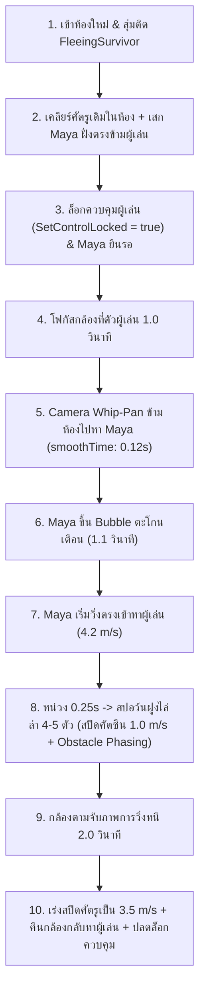

# เอกสารออกแบบระบบเหตุการณ์สุ่มและคัตซีน (Event & Cutscene Design Document - GDD)

**ชื่อโปรเจกต์:** The Last Empire  
**ประเภทเอกสาร:** Dynamic Stage Encounters, Cinematic Cutscenes & Camera Choreography  
**วันที่จัดทำ / อัปเดตล่าสุด:** 17 พฤศจิกายน 2026  
**สถานะ:** Active Implementation (`RandomStageEventManager` & `FleeingSurvivor` Cutscene)

---

## 🎯 1. ภาพรวมระบบเหตุการณ์สุ่มประจำด่าน (Dynamic Random Stage Encounters)

ระบบถูกออกแบบมาเพื่อสร้างความไม่จำเจในการสำรวจแผนที่ Grid ปกติ โดยผู้เล่นมีโอกาสพบเหตุการณ์เฉพาะหน้าเมื่อเดินผ่าน `TransitionPortal` เข้าสู่ห้องใหม่ (ไม่จำกัดอยู่แค่ห้อง `BiomeType.SpecialEvent`)

* **ไฟล์หลัก:**
  * [`RandomStageEventManager.cs`](file:///d:/TLEGIT/TheLastEmpire/Assets/Scripts/Runtime/Managers/RandomStageEventManager.cs) — ตัวจัดการกลาง (Singleton) ประเมินโอกาส, สปอว์นเหตุการณ์, ควบคุม Cutscene และแสดง HUD Banner
  * [`StageEventType.cs`](file:///d:/TLEGIT/TheLastEmpire/Assets/Scripts/Runtime/Map/StageEventType.cs) — Enum ระบุประเภทเหตุการณ์ทั้ง 7 รูปแบบ
  * [`StageData.cs`](file:///d:/TLEGIT/TheLastEmpire/Assets/Scripts/Runtime/Map/StageData.cs) — เก็บสถานะ `randomEventType` และ `hasEventTriggered`

### กฎการสุ่มและความคงตัว (Spawning Rules & Persistence)
1. **โอกาสเกิด (Event Chance):** ค่าเริ่มต้น **25%** (`eventChance = 0.25f`) ต่อการเข้าห้องปกติครั้งแรก (รองรับโหมดทดสอบ `forcedEventType` และคำสั่ง Queue ข้ามด่าน)
2. **ข้อยกเว้น (Safe Zones):** ไม่สุ่มเกิดในห้องเกิดเริ่มต้น (Spawn Room), ห้องร้านค้าเฉพาะ (`isShopStage`), และห้องที่เคลียร์แล้ว (`isCleared` เว้นแต่เปิด `allowEventsInClearedRooms`)
3. **Deterministic Seed:** ใช้ `stage.stageSeed + 4242` ทำให้ห้องเดิมไม่สุ่มเปลี่ยนประเภทเหตุการณ์ไปมาเมื่อเดินย้อนกลับ
4. **Strict Nighttime Alien Rule:** ศัตรูเผ่า Alien (`AlienCrawler`, `AlienSpitter`) จะถูกกรองออกจากพูลสุ่มของ Event (`HostileAmbush` และ `FleeingSurvivor`) ในเวลากลางวัน และจะเกิดได้เฉพาะเวลากลางคืน (`DayNightManager.Instance.IsNight`) เท่านั้น

---

## 📋 2. ประเภทเหตุการณ์ทั้งหมด 7 รูปแบบ (`StageEventType`)

| ลำดับ | Event Type | สีธีม HUD | กลไกและผลกระทบต่อเกมเพลย์ |
|:---:|---|---|---|
| **1** | **`SupplyAirdrop`** | Amber Gold | สปอว์นกล่องเสบียงทหารกลางห้อง ดรอปอาวุธระดับสูง (Sniper Rifle, Rocket Launcher, Katana, Shotgun หรือ Adrenaline Shot) + Rifle Ammo 30–60 นัด + เงิน 250–600 Gold + First Aid Kit |
| **2** | **`HostileAmbush`** | Danger Crimson | หน่วงเวลา 1.2 วินาที แล้วสปอว์นฝูงศัตรูสายบุกเร็ว 3–5 ตัวล้อมรอบตัวผู้เล่นในระยะ 7.5–10.5 เมตร |
| **3** | **`NomadTrader`** | Cyan Teal | สุ่ม NPC พ่อค้าเร่ (`doctor_elena`, `mechanic_otto`, `watcher_maya`, `survivor_roy`) มาตั้งแคมป์ชั่วคราวในห้องปกติ |
| **4** | **`RadioactiveFallout`** | Toxic Neon Green | เปลี่ยนแสงบรรยากาศ (`RenderSettings.ambientLight`) เป็นหมอกเขียวกัมมันตรังสี ลดค่า Sanity ของผู้เล่นทันที 10 หน่วย และคืนค่าแสงเมื่อออกจากห้อง |
| **5** | **`BloodMoonSurge`** | Blood Red | ย้อมบรรยากาศห้องเป็นสีแดงเลือดและบัฟความเร็วเคลื่อนที่ศัตรูทุกตัวในห้องขึ้น +30% (`moveSpeed *= 1.30f`) แลกกับรางวัลเงินดรอป 2x |
| **6** | **`ScavengerCache`** | Scavenger Bronze | สปอว์นกองเสบียงลับ 4 จุดตามมุมห้อง สลับระหว่างเงินสด (80–220 Gold) กับไอเทมยังชีพ (Bread, Bandage, Pistol Ammo, Shotgun Ammo, Grenade) |
| **7** | **`FleeingSurvivor`** | High Alert Orange-Red | **เหตุการณ์แบบ Cinematic Cutscene:** NPC Maya วิ่งหนีตายข้ามห้องเข้าหาผู้เล่น พร้อมลากฝูงศัตรู 4–5 ตัวไล่กวดตามหลังมา |

---

## 🎬 3. ระบบคัตซีน: `FleeingSurvivor` & Camera Whip-Pan

เหตุการณ์ **`FleeingSurvivor`** เป็นต้นแบบของ **In-Game Cinematic Cutscene** ที่ใช้การควบคุมกล้อง (`CameraFollow`), การล็อกอินพุตผู้เล่นชั่วคราว (`PlayerController.SetControlLocked`), กล่องบทพูดลอยเหนือหัว (`DIalogPanel`), และระบบ AI วิ่งไล่กวด (`FleeingSurvivorRunner` + `BaseEnemyAI`) ทำงานร่วมกันแบบ Real-time

### องค์ประกอบสำคัญของ Cutscene Sequence
1. **การกำหนดทิศทางแบบ Dynamic Opposite Course:**
   * คำนวณฝั่งตรงข้ามจากตำแหน่งยืนจริงของผู้เล่นเมื่อวาร์ปเข้าประตู (เหนือ $\leftrightarrow$ ใต้, ตะวันออก $\leftrightarrow$ ตะวันตก) เพื่อให้ Maya วิ่งพุ่งตรงเข้าหาผู้เล่นและทะลุออกประตูหลังผู้เล่นอย่างเป็นธรรมชาติ
2. **Camera Whip-Pan ([`CameraFollow.cs`](file:///d:/TLEGIT/TheLastEmpire/Assets/Scripts/Runtime/Player/CameraFollow.cs#L48-L78)):**
   * `SetTemporaryTarget(npcObj.transform, customSmoothTime: 0.12f)` เลื่อนกล้องข้ามห้องอย่างรวดเร็วไปจับจุดเกิดเหตุ
   * `ResetTarget(restoreSmoothTime: 0.2f)` ดึงกล้องกลับมายังผู้เล่นหลังจบจังหวะเปิดตัว
3. **การควบคุมตัวละครวิ่งหนี ([`FleeingSurvivorRunner.cs`](file:///d:/TLEGIT/TheLastEmpire/Assets/Scripts/Runtime/Combat/FleeingSurvivorRunner.cs)):**
   * ใช้ข้อมูล `watcher_maya` จาก `NPCDatabase` พร้อมไอคอนและกล่องบทพูดลอยเหนือหัว (`DIalogPanel`)
   * ปิด `CanInteract = false` และทำลาย `NPCController` ทิ้งทันทีเพื่อไม่ให้ปุ่ม `[E] Talk` ขึ้นมาขวางระหว่างวิ่งหนีตาย
   * ใช้ `CrossFadeInFixedTime("Run", 0.05f)` บังคับท่าวิ่งต่อเนื่องและจัดความสูงเท้าแตะพื้น (`naturalGroundY`) ตาม `CapsuleCollider`
4. **ฝูงศัตรูไล่กวดแบบทะลุสิ่งกีดขวาง (`Obstacle Phasing`):**
   * สปอว์นเรียงแถวด้านหลัง Maya (4–5 ตัว) พร้อมเรียก `ai.EnableChaserPhasing(player.transform, restoreDistance: 4.5f)` ทำให้ฝูงศัตรูวิ่งทะลุกำแพง/ตึกตาม Maya มาได้โดยไม่ติดฉาก และคืนค่า Collider เป็น Solid Physics ทันทีเมื่อเข้าใกล้ผู้เล่นในระยะ $\le 4.5\text{m}$ หรือถูกโจมตี

---

## 🔔 4. ระบบแจ้งเตือน HUD (`DynamicEventBanner_HUD`)

* สร้าง UI แบบ Glassmorphism (`CanvasGroup` ที่ตั้งค่า `blocksRaycasts = false` และ `raycastTarget = false` ทุกชิ้น เพื่อไม่ให้ขวางการคลิกยิงของผู้เล่น)
* แสดงแถบสีเน้นด้านบน (Accent Stripe), หัวข้อเหตุการณ์ (`TitleText`), และคำอธิบายสั้น (`SubText`) ก่อนค่อยๆ จางหายอัตโนมัติหลังแสดงผลครบเวลา
