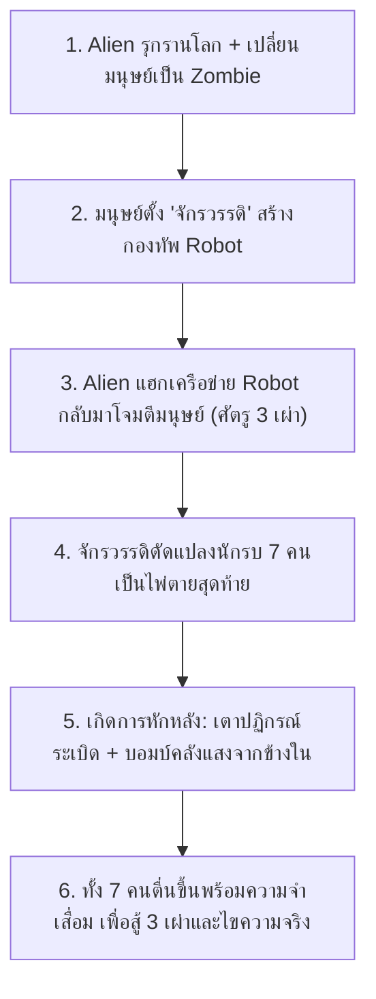

# เอกสารออกแบบเนื้อเรื่องและปูมหลังโลก (World Lore & Story Design - GDD)

**ชื่อโปรเจกต์:** The Last Empire  
**ประเภทเอกสาร:** Main Storyline, World Lore & 7 Operatives Narrative  
**วันที่จัดทำ:** 10 พฤศจิกายน 2026  
**สถานะ:** Official Draft Version 1.0  

---

## 🌍 1. เนื้อเรื่องหลักของโลก (Main World Lore)

### 1.1 การรุกรานของเอเลี่ยนและจุดกำเนิดฝูงซอมบี้ (The Alien Invasion & Infection)
โลกใน **The Last Empire** ล่มสลายลงจากการรุกรานของสิ่งมีชีวิตต่างดาว (**เผ่าพันธุ์ Alien**) ที่มีสติปัญญาและเทคโนโลยีชีวภาพสูงล้ำ พวกมันแพร่กระจายเชื้อปรสิตและรังสีชีวภาพไปทั่วโลก จนประชากรมนุษย์ส่วนใหญ่ติดเชื้อและกลายสภาพเป็น **ฝูงซอมบี้ (Zombie Horde)** เพื่อทำลายอารยธรรมมนุษย์จากภายใน

### 1.2 การลุกขึ้นสู้ของ "จักรวรรดิ" และกองทัพหุ่นยนต์ (The Empire & Robot Army)
มนุษยชาติที่เหลือรอดรวมตัวกันสร้างรัฐป้อมปราการแห่งสุดท้ายขึ้นในนาม **จักรวรรดิ (The Empire)** มีศูนย์กลางอยู่ที่ **ป้อมปราการชั้นใน (Inner Citadel)** พร้อมระดมทรัพยากรสร้าง **กองทัพหุ่นยนต์สงคราม (Robot Faction)** ติดอาวุธหนักและระบบ AI อัตโนมัติออกไปต่อกรกับฝูงซอมบี้และเอเลี่ยนแทนกำลังพลมนุษย์

### 1.3 จุดพลิกผัน: การแฮกหุ่นยนต์และสงคราม 3 เผ่าพันธุ์ (The Hijacked Network)
เอเลี่ยนฉลาดล้ำเกินกว่าที่จักรวรรดิคาดคิด พวกมันเจาะเข้าสู่เครือข่ายควบคุมกลาง (AI Core) และ **แฮกหุ่นยนต์สงครามทั้งหมดของจักรวรรดิ** ให้แปรพักตร์หันปากกระบอกปืนกลับมาไล่ล่ามนุษย์เสียเอง ส่งผลให้ผู้รอดชีวิตต้องติดอยู่ในวงล้อมของศัตรู **3 เผ่าพันธุ์พร้อมกัน**:
1. **Zombie (ผู้ติดเชื้อ):** อดีตมนุษย์ที่ถูกเอเลี่ยนเปลี่ยนเป็นอาวุธชีวภาพ
2. **Robot (เครื่องจักรทรยศ):** กองทัพหุ่นยนต์ของจักรวรรดิที่ถูกเอเลี่ยนยึดระบบควบคุม
3. **Alien (ผู้รุกราน):** ผู้บงการตัวจริงจากนอกโลกที่แข็งแกร่งและดุร้ายขึ้นเป็นพิเศษในยามค่ำคืน

### 1.4 โครงการสุดท้าย: มนุษย์ดัดแปลงทั้ง 7 (Project Last Hope)
เมื่อแนวรบหุ่นยนต์พังทลาย จักรวรรดิจึงทุ่มทรัพยากรทั้งหมดเข้าสู่ **โครงการดัดแปลงมนุษย์ขั้นสุดยอด** (ผสานเกราะชีวะ ยีนสังเคราะห์ ชิปประสาท และยุทโธปกรณ์เฉพาะทาง) สร้างนักรบแนวหน้าพิเศษขึ้น **7 คน** เพื่อเป็นไพ่ตายสุดท้ายในการบุกฝ่าวงล้อม 3 เผ่าพันธุ์ เข้าทำลายรังหลักของเอเลี่ยนและตัดสัญญาณแฮกหุ่นยนต์

### 1.5 เหตุการณ์วันล่มสลาย (The Collapse & Amnesia)
ก่อนที่ปฏิบัติการกวาดล้างใหญ่จะเริ่มต้นขึ้น ได้เกิด **"เหตุการณ์ก่อวินาศกรรมจากภายใน"** — เตาปฏิกรณ์หลักของเมืองเกิดระเบิดขึ้นอย่างรุนแรง ประตูนิรภัยของคลังแสงถูกบอมบ์ตัดขาดจากด้านใน และศูนย์บัญชาการ **Inner Citadel** เงียบหายไป แรงระเบิดรวมถึงผลข้างเคียงจากระบบดัดแปลงประสาททำให้ทั้ง 7 คน **กระจัดกระจายไปคนละทิศทางพร้อมภาวะสูญเสียความทรงจำชั่วคราว (Amnesia)** ตื่นขึ้นมาเพื่อต่อจิ๊กซอว์ความจริงและสานต่อภารกิจที่ค้างคา

---

## 👥 2. เนื้อเรื่องของตัวละครทั้ง 7 (Character Stories & Augmentation Origins)

### 🛡️ 1. The Vanguard (`CHAR_01`) — *"นายทหารผู้ภักดีที่เหลือรอด"*
* **การดัดแปลงจากจักรวรรดิ:** ทหารผ่านศึกแนวหน้าที่เข้ารับการฝังตัวกระตุ้นอะดรีนาลีนและระบบประสาทการรบ (`Adrenaline Rush`) เพื่อเป็นหัวหอกนำหน่วยบุกฝ่ารังเอเลี่ยน
* **เหตุการณ์ที่เกิดขึ้น:** ระหว่างเตรียมนำกองพันเคลื่อนพล แรงระเบิดจากเตาปฏิกรณ์ฉีกขบวนทัพของเขาออกเป็นเสี่ยงๆ เขาตื่นขึ้นมากลางซากค่ายทหารโดยจำไม่ได้ว่าเกิดอะไรขึ้น จำได้เพียงคำสัตย์ปฏิญาณและภารกิจเดียวในหัว: **ต้องรวบรวมกำลังที่เหลือและบุกฝ่าไปถึง `Inner Citadel` ให้ได้** ก่อนที่ทุกอย่างจะพังทลาย

### 🔨 2. The Juggernaut (`CHAR_02`) — *"อาวุธมีชีวิตที่ถูกจองจำ"*
* **การดัดแปลงจากจักรวรรดิ:** ร่างทดลองที่ถูกส่งลง **โรงหล่อใต้ดิน (Underground Foundry)** เพื่อผ่าตัดเสริมโครงกระดูกเหล็กกล้าและกล้ามเนื้อดัดแปลงพันธุกรรม (`Thick Skin` / `Unstoppable Charge`) ให้แกร่งพอจะปะทะหุ่นยนต์และเอเลี่ยนระดับบอสได้โดยตรง
* **เหตุการณ์ที่เกิดขึ้น:** ความเจ็บปวดจากการดัดแปลงอันโหดร้ายทำให้เขาคลุ้มคลั่ง จักรวรรดิจึงล่ามโซ่ตรวนขังเขาไว้ใต้ดินรอวันปล่อยลงสนามรบ เมื่อเตาปฏิกรณ์ระเบิด โซ่ตรวนขาดสะบั้น เขาตื่นขึ้นมาพร้อมความโกรธแค้นที่มีต่อจักรวรรดิ และพร้อมบดขยี้ทุกสิ่งที่ขวางหน้าทั้ง 3 เผ่าพันธุ์

### 🗡️ 3. The Phantom (`CHAR_03`) — *"มือสังหารที่ถือความลับของ The Doctor"*
* **การดัดแปลงจากจักรวรรดิ:** มือสังหารหน่วยลับที่ถูกดัดแปลงด้วยเทคโนโลยีพรางตัวและเร่งความเร็วระดับมิติเงา (`Shadow Step`) เพื่อลอบเข้าไปตัดหัวเป้าหมายสำคัญของฝ่ายศัตรูโดยไม่ถูกเซ็นเซอร์ตรวจจับ
* **เหตุการณ์ที่เกิดขึ้น:** เพียงไม่กี่นาทีก่อนการระเบิด เขาได้รับคำสั่งลับสุดยอดให้ **ตามไปปิดปาก "The Doctor"** (หัวหน้านักวิทยาศาสตร์ผู้ดูแลโครงการดัดแปลงและ AI หุ่นยนต์) เพราะ The Doctor ค้นพบความลับอันดำมืดว่า **เหตุใดเอเลี่ยนจึงสามารถเจาะแฮกหุ่นยนต์ของจักรวรรดิได้** — เมื่อตื่นขึ้นพร้อมความจำที่ขาดหาย เขาจึงต้องตามหา The Doctor เพื่อรู้ความจริงว่าใครอยู่เบื้องหลังคำสั่งนี้

### 🎯 4. The Marksman (`CHAR_04`) — *"พยานผู้เห็นคนทรยศผ่านกล้องสไนเปอร์"*
* **การดัดแปลงจากจักรวรรดิ:** พลแม่นปืนรบพิเศษที่ได้รับการผ่าตัดติดตั้งดวงตาไซเบอร์เนติกส์ระยะไกล (`Eagle Eye`) เพื่อสอดแนมและล็อกจุดอ่อนของรังเอเลี่ยนและหุ่นยนต์จากระยะไกล
* **เหตุการณ์ที่เกิดขึ้น:** ขณะซุ่มคุ้มกันแนวหลังจากยอดหอสังเกตการณ์ ภาพสุดท้ายที่ติดตาเขาผ่านลำกล้องสไนเปอร์ไม่ใช่ฝีมือผู้รุกรานภายนอก แต่คือ **นายทหารระดับสูงของจักรวรรดิ (`Imperial Officer`) เป็นคนเดินไปสับสวิตช์ระเบิดเตาปฏิกรณ์ด้วยตัวเอง** — เขาตื่นขึ้นมาบนหอคอยร้างพร้อมเป้าหมายในการตามล่าและเปิดโปงการทรยศครั้งนี้

### 🧪 5. The Scavenger (`CHAR_05`) — *"คนนอกกำแพงที่ติดอยู่ในกรงหายนะ"*
* **การดัดแปลงจากจักรวรรดิ:** คนเร่ร่อนนอกกำแพงเมืองที่แอบลักลอบเข้ามาคุ้ยหาเสบียง แต่ถูกจับได้และถูกบังคับให้เข้าร่วมการทดลองภาคสนาม ติดตั้งอุปกรณ์สลิงเคลื่อนที่ความเร็วสูง (`Grappling Hook`) และปรับแต่งระบบเผาผลาญให้ทนทานต่อความหิวและสภาพแวดล้อมเป็นพิษ
* **เหตุการณ์ที่เกิดขึ้น:** เมื่อเตาปฏิกรณ์ระเบิด ประตูเมือง (`City Gates`) ปิดตายทุกทิศทาง ทำให้เขาติดอยู่ในเขตสังหารร่วมกับซอมบี้ หุ่นยนต์ และเอเลี่ยน เขาไม่ได้สนใจเกียรติยศหรือการเมืองของจักรวรรดิ เป้าหมายมีเพียงอย่างเดียวคือ **เอาชีวิตรอดและระเบิดประตูเมืองหนีออกไป**

### 🏏 6. The Rebel (`CHAR_06`) — *"สาวพังก์ผู้ไม่ยอมก้มหัวให้ทั้งจักรวรรดิและเอเลี่ยน"*
* **การดัดแปลงจากจักรวรรดิ:** หัวโจกกลุ่มต่อต้านนอกรีตที่ปะทะกับทั้งเอเลี่ยนและเจ้าหน้าที่จักรวรรดิ จนถูกจับตัวไปฉีดเซรุ่มบ้าคลั่ง (`Frenzy`) เพื่อดัดแปลงเป็นกำลังพลแนวหน้าแบบใช้แล้วทิ้ง
* **เหตุการณ์ที่เกิดขึ้น:** ท่ามกลางความโกลาหลของการระเบิด เธอหลุดออกมาได้กลางแนวบาร์ที่ไฟไหม้คุกรุ่นพร้อมไม้เบสบอลติดหนามคู่ใจ สำหรับเธอ ทั้ง **จักรวรรดิที่พยายามล่ามโซ่ประชาชน** และ **เอเลี่ยนที่เปลี่ยนผู้คนเป็นซอมบี้** ต่างก็เป็นศัตรูที่ต้องซัดให้ร่วงเหมือนกันทั้งหมด

### 💣 7. The Demolitionist (`CHAR_07`) — *"ผู้เชี่ยวชาญสรรพาวุธที่จับได้ถึงการก่อวินาศกรรม"*
* **การดัดแปลงจากจักรวรรดิ:** อดีตผู้เชี่ยวชาญสรรพาวุธของจักรวรรดิที่แปรพักตร์ออกมาหลังเห็นความโหดร้ายของโครงการทดลองมนุษย์ เธอเสริมผิวหนังและชุดเกราะกันแรงระเบิด (`Blast Shield`) พร้อมติดตั้งยุทโธปกรณ์ C4 (`Satchel Vault`) เพื่อใช้ถล่มรังเอเลี่ยนให้สิ้นซาก
* **เหตุการณ์ที่เกิดขึ้น:** เธอตื่นขึ้นมาในหลุมระเบิดของคลังแสง (Munitions Depot) และด้วยสัญชาตญาณวิศวกรวัตถุระเบิด เธอดูออกทันทีว่า **ประตูนิรภัยของคลังแสงถูกวางระเบิดตัดขาดจากข้างใน (`sabotaged from the inside`)** เพื่อปิดตายไม่ให้นักรบดัดแปลงเข้าถึงคลังอาวุธได้ — เธอจึงออกตามล่าตัวการที่สั่งระเบิดคลังแสงให้สาสม

---

## 🎯 3. โครงสร้างการดำเนินเรื่องในเกมเพลย์ (Story Progression Arc)

| ช่วงเกม (Act) | พื้นที่และภัยคุกคามหลัก | พัฒนาการด้านเนื้อเรื่อง |
|---|---|---|
| **Act I: Outskirts & Survival** | ชานเมืองที่เต็มไปด้วย **Zombie** (ผู้ติดเชื้อจากเอเลี่ยน) | ตัวละครตื่นพร้อม **Amnesia Awakening Banner** เก็บเสบียง อาวุธ และพบผู้รอดชีวิต/พ่อค้าอย่าง **Pepper** และ **Zack** |
| **Act II: The Hijacked Grid** | เขตเมืองชั้นในและฐานอุตสาหกรรมที่มี **Robot ที่ถูกแฮก** | ต่อสู้กับเครื่องจักรของจักรวรรดิที่แปรพักตร์ ตั้งฐาน/ป้อมป้องกัน (Building System) และเก็บเบาะแสเรื่อง **The Doctor** กับ **นายทหารทรยศ** |
| **Act III: Inner Citadel & Alien Hive** | ศูนย์บัญชาการ **Inner Citadel** และ **รังหลักของ Alien** | เปิดโปงความจริงเบื้องหลังการแฮกและการระเบิดเตาปฏิกรณ์ ทำลายศูนย์ควบคุมของเอเลี่ยน ปลดการแฮกหุ่นยนต์ และทวงโลกคืนสู่มนุษยชาติ |

