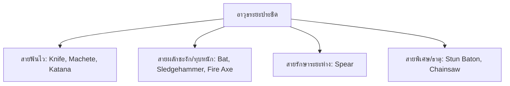

# เอกสารออกแบบระบบอาวุธ (Weapon Design Document - GDD)

**ชื่อโปรเจกต์:** The Last Empire  
**ประเภทเอกสาร:** Weapon System Design (Ranged & Melee Arsenal)  
**วันที่จัดทำ:** 13 ตุลาคม 2026  
**สถานะ:** Implemented Version 1.0 (Phase 1 Complete) - 14 ตุลาคม 2026  

---

## 📖 1. ปรัชญาการออกแบบระบบอาวุธ (Design Philosophy)

ใน **The Last Empire** อาวุธถูกแบ่งออกเป็น 2 เสาหลักที่เกื้อหนุนกัน:
1. **อาวุธระยะไกล (Ranged Weapons):** ปลอดภัย ทำดาเมจไว แต่ต้องบริหาร **กระสุน (Ammo Economy)** และจังหวะรีโหลดแมกกาซีน
2. **อาวุธระยะประชิด (Melee Weapons):** **ไม่ใช้กระสุน** แต่เสี่ยงต่อการถูกศัตรูรุมกัด เน้นค่า **แรงผลักชะงัก (Knockback/Stagger)** และ **ระยะกวาด (Cleave Radius)** เพื่อสร้างพื้นที่ปลอดภัย

---

## 🗡️ 2. คลังอาวุธระยะประชิด (Melee Weapons Arsenal)

ปัจจุบันในเกมมีอาวุธประชิดอยู่ 3 ชิ้นหลัก (มีด, ไม้เบสบอล, มาเชเต้) และหมัดเปล่า  
เพื่อเพิ่มมิติให้ครบเครื่อง จึงออกแบบอาวุธประชิดเพิ่มอีก **6 สไตล์** รวมเป็น 9 ชนิด:

### รายละเอียดอาวุธระยะประชิดแต่ละประเภท

#### 1. Unarmed (หมัดเปล่า - ติดตัว)
* **คอนเซปต์:** ชก/ต่อยเมื่อไม่ได้ถืออาวุธใดๆ
* **สเตตัส:** Damage: 10 | Attack Rate: 0.3s | Radius: 1.0m | Knockback: 5 | Stagger: 0.2s

#### 2. Combat Knife (มีดพกทหาร - มีในเกมแล้ว)
* **คอนเซปต์:** ฟันเร็วมาก รัวจังหวะถี่ กินระยะแคบ เหมาะกับการเชือดศัตรูเดี่ยวๆ
* **สเตตัส:** Damage: 25 | Attack Rate: 0.25s (เร็วที่สุด) | Radius: 1.0m | Knockback: 5 | Stagger: 0.2s

#### 3. Baseball Bat (ไม้เบสบอล - มีในเกมแล้ว)
* **คอนเซปต์:** เน้นแรงกระแทก กวาดมอนสเตอร์ให้กระเด็นเปิดทาง
* **สเตตัส:** Damage: 40 | Attack Rate: 0.5s | Radius: 1.4m | Knockback: **15 (ผลักกระเด็นไกลมาก)** | Stagger: 0.5s

#### 4. Machete (มีดสปาต้า / มาเชเต้ - มีในเกมแล้ว)
* **คอนเซปต์:** คมดาบหนัก คมเฉือนรุนแรง จัดการซอมบี้ได้ไว
* **สเตตัส:** Damage: 55 | Attack Rate: 0.6s | Radius: 1.3m | Knockback: 10 | Stagger: 0.3s

---

#### 5. Fire Axe (ขวานดับเพลิง) — *[เสนอเพิ่มใหม่ ⭐]*
* **คอนเซปต์:** อาวุธยอดฮิตแนววันสิ้นโลก จามหัวอย่างรุนแรง ฟันเฉือนสร้างแผลลึก
* **สเตตัส:** Damage: **65** | Attack Rate: 0.7s | Radius: 1.35m | Knockback: 12 | Stagger: 0.4s
* **คุณสมบัติพิเศษ:** มีโอกาส 25% ที่จะติดสถานะ **Bleed (เลือดไหล)** ทำดาเมจเพิ่ม 15 หน่วยใน 2 วินาที

#### 6. Katana (ดาบซามูไร / คาตานะ) — *[เสนอเพิ่มใหม่ ⭐]*
* **คอนเซปต์:** คมดาบยาว ฟันกวาดเป็นวงพระจันทร์เสี้ยวกว้างเป็นพิเศษ คล่องตัวสูง
* **สเตตัส:** Damage: 50 | Attack Rate: 0.4s | Radius: **1.6m (กวาดกว้างมาก)** | Knockback: 8 | Stagger: 0.3s
* **คุณสมบัติพิเศษ:** **Critical Chance +20%** และสามารถกวาดโดนศัตรูพร้อมกันได้สูงสุด 4 ตัว

#### 7. Sledgehammer (ค้อนปอนด์ยักษ์) — *[เสนอเพิ่มใหม่ ⭐ เข้ากับ Character B]*
* **คอนเซปต์:** ช้ามากแต่พลังทำลายมหาศาล ทุบพื้นสร้างแรงสะเทือน
* **สเตตัส:** Damage: **90** | Attack Rate: 0.95s (ช้าสุด) | Radius: 1.4m | Knockback: **20** | Stagger: **0.8s (สตั๊น)**
* **คุณสมบัติพิเศษ:** **Ground Slam** ทุกครั้งที่ทุบ จะสร้างคลื่นกระแทกขนาดเล็กสตั๊นศัตรูรอบข้าง 100%

#### 8. Survival Spear (หอกดัดแปลงปลายแหลม) — *[เสนอเพิ่มใหม่]*
* **คอนเซปต์:** แทงทะลวงแนวตรง รักษาระยะห่างจากซอมบี้ ไม่ต้องเข้าไปเสี่ยงโดนกัด
* **สเตตัส:** Damage: 45 | Attack Rate: 0.45s | Radius: **2.2m (ระยะแทงไกลที่สุด)** | Knockback: 10 | Stagger: 0.3s
* **คุณสมบัติพิเศษ:** **Thrust Pierce** แทงทะลวงศัตรูเป็นเส้นตรงได้ 2 ตัวพร้อมกัน

#### 9. Stun Baton (กระบองช็อตไฟฟ้า) — *[เสนอเพิ่มใหม่]*
* **คอนเซปต์:** อาวุธปราบจลาจล ปล่อยกระแสไฟฟ้าขัดจังหวะศัตรู
* **สเตตัส:** Damage: 35 | Attack Rate: 0.45s | Radius: 1.2m | Knockback: 6 | Stagger: **0.6s**
* **คุณสมบัติพิเศษ:** มีโอกาส 30% ที่จะ **ช็อตเป็นประกายไฟ (Chain Shock)** ชะงักศัตรูตัวข้างๆ ด้วย

#### 10. Chainsaw (เลื่อยไฟฟ้า) — *[อาวุธระดับบอส / Secret Weapon]*
* **คอนเซปต์:** เลื่อยทำลายล้างระยะประชิด กดฟันค้างเพื่อบดขยี้ศัตรู
* **สเตตัส:** Damage: 20 (ต่อ Tick ทุกๆ 0.1 วินาที = 200 DPS) | Radius: 1.2m | Knockback: 3 | Stagger: 0.1s
* **ข้อจำกัด:** ต้องใช้ **เชื้อเพลิง (Fuel Canister)** ในการทำงาน

---

### 📊 ตารางเปรียบเทียบอาวุธระยะประชิด (Melee Weapons Matrix)

| อาวุธ | Damage | Attack Rate | Attack Radius | Knockback | Stagger | คุณสมบัติเด่น |
|---|:---:|:---:|:---:|:---:|:---:|---|
| **Unarmed** | 10 | 0.30s | 1.0m | 5 | 0.2s | หมัดเปล่าติดตัว |
| **Combat Knife** | 25 | **0.25s** | 1.0m | 5 | 0.2s | ฟันเร็วที่สุดในเกม |
| **Baseball Bat** | 40 | 0.50s | 1.4m | **15** | 0.5s | ผลักกระเด็นเปิดทางดีเยี่ยม |
| **Machete** | 55 | 0.60s | 1.3m | 10 | 0.3s | ดาเมจเฉือนสูง มาตรฐาน |
| **Fire Axe** | 65 | 0.70s | 1.35m | 12 | 0.4s | ติดสถานะ Bleed เลือดไหล |
| **Katana** | 50 | 0.40s | **1.6m** | 8 | 0.3s | กวาดกว้างมาก + คริติคอลสูง |
| **Sledgehammer** | **90** | 0.95s | 1.4m | **20** | **0.8s** | ดาเมจสูงสุด + สตั๊นพื้น |
| **Survival Spear**| 45 | 0.45s | **2.2m** | 10 | 0.3s | ระยะแทงไกลที่สุด ปลอดภัย |
| **Stun Baton** | 35 | 0.45s | 1.2m | 6 | 0.6s | ช็อตชะงักแบบลูกโซ่ |

---

## 🔫 3. คลังอาวุธระยะไกล (Ranged Weapons Arsenal)

ปัจจุบันมีอยู่ 3 กระบอก (Pistol, Shotgun, Rifle)  
เพื่อเติมเต็มความหลากหลาย จึงออกแบบปืนเพิ่มอีก **6 กระบอก** ดังนี้:

### รายละเอียดอาวุธปืนแต่ละประเภท

#### 1. 9mm Pistol (ปืนพกมาตรฐาน - มีในเกมแล้ว)
* **สเตตัส:** Damage: 15 | Fire Rate: 0.4s | Mag: 12 | Reload: 1.0s | Range: 1.5m (แปลงสเกล) | กระสุน: Light Ammo
* **จุดเด่น:** อาวุธเริ่มต้น พกพาสะดวก ไม่เปลืองกระสุน

#### 2. Assault Rifle (ไรเฟิลจู่โจม - มีในเกมแล้ว)
* **สเตตัส:** Damage: 25 | Fire Rate: 0.12s (รัว) | Mag: 30 | Reload: 1.5s | Range: 3.0m | กระสุน: Medium Ammo
* **จุดเด่น:** ดาเมจต่อเนื่อง ยิงรัว คุมระยะกลางดีที่สุด

#### 3. Pump Shotgun (ลูกซองปั๊ม - มีในเกมแล้ว)
* **สเตตัส:** Damage: 12 × 5 ลูกปราย | Fire Rate: 0.7s | Mag: 6 | Reload: 2.0s | Range: 0.8m | กระสุน: Shotgun Ammo
* **จุดเด่น:** ดาเมจระยะเผาขนรุนแรง ผลักศัตรูกระเด็น

---

#### 4. SMG - Submachine Gun (ปืนกลมือ เช่น Vector / MP5) — *[เสนอเพิ่มใหม่ ⭐]*
* **คอนเซปต์:** ยิงรัวที่สุดในเกม น้ำหนักเบา เดินยิงคล่องตัวสูง
* **สเตตัส:** Damage: 16 | Fire Rate: **0.08s (รัวจัด)** | Mag: **35** | Reload: 1.2s | Range: 2.0m | กระสุน: **Light Ammo**
* **จุดเด่น:** ทำให้กระสุน Light Ammo มีคุณค่าตลอดทั้งเกม

#### 5. Hunting Sniper Rifle (สไนเปอร์ไรเฟิลลูกเลื่อน) — *[เสนอเพิ่มใหม่ ⭐ เข้ากับ Character D]*
* **คอนเซปต์:** สังหารศัตรูระยะไกล เจาะทะลุเป็นเส้นตรง
* **สเตตัส:** Damage: **110** | Fire Rate: 1.2s | Mag: 5 | Reload: 2.2s | Range: **6.0m (ไกลสุดจอ)** | กระสุน: **Medium Ammo**
* **คุณสมบัติพิเศษ:** กระสุน **Piercing เจาะทะลุศัตรูได้ 2 ตัว**

#### 6. Heavy Revolver / Magnum (ปืนลูกโม่แม็กนั่ม) — *[เสนอเพิ่มใหม่ ⭐]*
* **คอนเซปต์:** ปืนพกพลังทำลายสูง 6 นัด ยิงทีละนัดแต่เข้าเป้าจังๆ ซอมบี้ชะงักหงายหลัง
* **สเตตัส:** Damage: **55** | Fire Rate: 0.65s | Mag: 6 | Reload: 1.8s | Range: 2.5m | กระสุน: **Light Ammo**
* **คุณสมบัติพิเศษ:** High Stagger & Knockback ผลักศัตรูชะงัก 100%

#### 7. Flamethrower (ปืนพ่นไฟ) — *[เสนอเพิ่มใหม่ ตาม Roadmap]*
* **คอนเซปต์:** พ่นเปลวเพลิงเป็นกรวยต่อเนื่อง ล้างบางฝูงซอมบี้
* **สเตตัส:** Damage: 10/Tick (รัวต่อเนื่อง) | Mag: 50 | Reload: 2.5s | Range: 1.8m (โคนกว้าง) | กระสุน: **Heavy/Fuel Ammo**
* **คุณสมบัติพิเศษ:** ทำดาเมจทะลุโล่ศัตรู (Ignore Frontal Shield) และติดไฟ DoT

#### 8. Rocket / Grenade Launcher (ปืนยิงระเบิด) — *[เสนอเพิ่มใหม่ ตาม Roadmap]*
* **คอนเซปต์:** อาวุธหนักทำลายล้างสูง ยิงระเบิดตกใส่พื้นที่
* **สเตตัส:** Damage: **150 (AOE)** | Fire Rate: 1.5s | Mag: 1 | Reload: 2.5s | Range: 4.0m | กระสุน: **Heavy/Fuel Ammo**
* **คุณสมบัติพิเศษ:** รัศมีระเบิดวงกว้าง 3.5 เมตร เหมาะสำหรับถล่มรังและจัดการบอส

#### 9. Hunting Crossbow (หน้าไม้ล่าสัตว์) — *[เสนอเพิ่มใหม่]*
* **คอนเซปต์:** อาวุธเงียบสายลอบเร้น ประหยัดกระสุน
* **สเตตัส:** Damage: 70 | Fire Rate: 1.0s | Mag: 1 | Reload: 1.2s | Range: 3.5m | กระสุน: **Bolts**
* **คุณสมบัติพิเศษ:** ยิงเงียบไม่ล่อศัตรูทั้งห้อง และมีโอกาส 40% ที่ลูกดอกจะตกพื้นให้วิ่งเก็บกลับมาใช้ใหม่

---

### 📊 ตารางเปรียบเทียบอาวุธระยะไกล (Ranged Weapons Matrix)

| อาวุธ | Damage | Fire Rate | Mag | Reload | ชนิดกระสุน | จุดเด่น |
|---|:---:|:---:|:---:|:---:|---|---|
| **Pistol** | 15 | 0.40s | 12 | 1.0s | Light Ammo | เริ่มต้น สมดุล |
| **Assault Rifle** | 25 | 0.12s | 30 | 1.5s | Medium Ammo | รัวต่อเนื่อง ระยะกลาง |
| **Shotgun** | 12 × 5 | 0.70s | 6 | 2.0s | Shotgun Shell | ระยะเผาขน กระจายตัว |
| **SMG** | 16 | **0.08s** | 35 | 1.2s | Light Ammo | รัวที่สุด คล่องตัวสูง |
| **Sniper Rifle** | **110** | 1.20s | 5 | 2.2s | Medium Ammo | ไกลสุดจอ + เจาะทะลุ 2 ตัว |
| **Revolver** | 55 | 0.65s | 6 | 1.8s | Light Ammo | หมัดหนัก ผลักชะงัก 100% |
| **Flamethrower** | 10/tick | ต่อเนื่อง | 50 | 2.5s | Heavy/Fuel | ทะลุโล่ เคลียร์ฝูงซอมบี้ |
| **Rocket Launcher**| **150** | 1.50s | 1 | 2.5s | Heavy/Fuel | ระเบิด AOE วงกว้าง |
| **Crossbow** | 70 | 1.00s | 1 | 1.2s | Bolts | เงียบ + เก็บลูกศรคืนได้ |

---

## 📦 4. ระบบประเภทกระสุน (Consolidated Ammo Types)

เพื่อไม่ให้รกกระเป๋าเป้ (Inventory) กำหนดให้ใช้กระสุนเพียง **4 ชนิด**:
1. **Light Ammo (กล่องส้ม/เหลือง):** ใช้กับ Pistol, Revolver, SMG
2. **Medium Ammo (กล่องเขียวทหาร):** ใช้กับ Assault Rifle, Sniper Rifle
3. **Shotgun Ammo (กล่องแดง):** ใช้กับ Shotgun
4. **Heavy / Fuel Ammo (ถังเชื้อเพลิง/จรวด):** ใช้กับ Flamethrower, Rocket Launcher
